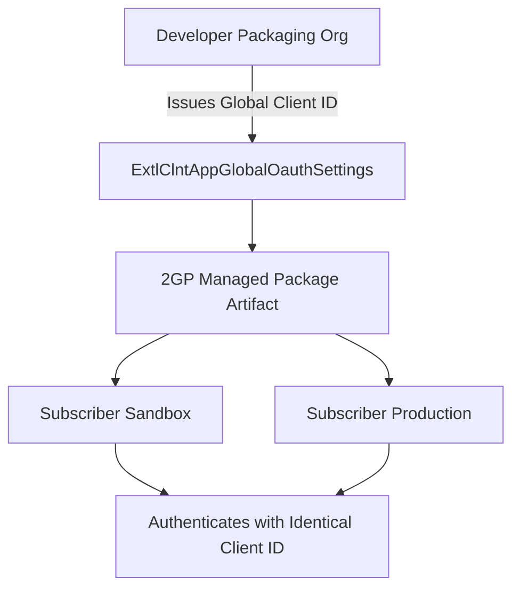

## Architectural Overview

`ExtlClntAppGlobalOauthSettings` is the architectural anchor for distributed OAuth integrations within the Salesforce External Client App ecosystem. When Independent Software Vendors (ISVs) or enterprise platform teams build 2GP packages for distribution across multiple scratch orgs, sandboxes, and production instances, maintaining a unified OAuth consumer key (client ID) is essential.

In legacy Connected Apps, deploying an app across separate orgs generated disparate consumer keys and required manual configuration updates in external client systems. `ExtlClntAppGlobalOauthSettings` resolves this fragmentation by establishing an immutable global client identifier generated in the developer packaging org and shared consistently across all subscriber orgs upon package installation.



This architecture guarantees that remote web services, mobile clients, and daemon daemons only need to register a single OAuth client ID to authenticate against any authorized Salesforce tenant.

## Directory and File Conventions

`ExtlClntAppGlobalOauthSettings` files are structured within the `extlClntAppGlobalOauthSettings` folder:

| Property | Value |
| :--- | :--- |
| **Metadata Type Name** | `ExtlClntAppGlobalOauthSettings` |
| **SFDX Folder** | `force-app/main/default/extlClntAppGlobalOauthSettings/` |
| **File Suffix** | `.globalOauth-meta.xml` or `.extlClntAppGlobalOauthSettings-meta.xml` |
| **Packaging Behavior** | Packaged in 2GP Managed or Unlocked Packages |

## Key Metadata Fields

The `ExtlClntAppGlobalOauthSettings` schema exposes core OAuth client parameters:

| Field Name | Field Type | Required | Architectural Description |
| :--- | :--- | :--- | :--- |
| `consumerKey` | `string` | Yes | Globally unique OAuth client identifier issued to the developer packaging tenant. |
| `callbackUrl` | `string` | Yes | Authorized redirect URI endpoint for OAuth 2.0 authorization code handshakes. |
| `isConsumerSecretOptional` | `boolean` | No | Allows public clients (mobile/SPA) utilizing PKCE to omit client secrets. |
| `developerName` | `string` | Yes | Programmatic API name linking the global OAuth definition to the app. |
| `singleLogoutUrl` | `string` | No | Global OpenID Connect (OIDC) single logout endpoint. |

## Declarative XML and Package Manifest Examples

Below is a declarative XML definition of `ExtlClntAppGlobalOauthSettings` for an enterprise microservice client:

```xml title="force-app/main/default/extlClntAppGlobalOauthSettings/Enterprise_Billing_ECA.globalOauth-meta.xml"
<?xml version="1.0" encoding="UTF-8"?>
<ExtlClntAppGlobalOauthSettings xmlns="http://soap.sforce.com/2006/04/metadata">
    <callbackUrl>https://billing-service.enterprise.com/oauth/callback</callbackUrl>
    <consumerKey>3MVG9qKMclm.2GP_Enterprise_Billing_Client_Key_68_0</consumerKey>
    <developerName>Enterprise_Billing_ECA</developerName>
    <isConsumerSecretOptional>false</isConsumerSecretOptional>
</ExtlClntAppGlobalOauthSettings>
```

### Package Manifest (`package.xml`)

```xml title="manifest/package.xml"
<?xml version="1.0" encoding="UTF-8"?>
<Package xmlns="http://soap.sforce.com/2006/04/metadata">
    <types>
        <members>Enterprise_Billing_ECA</members>
        <name>ExtlClntAppGlobalOauthSettings</name>
    </types>
    <version>68.0</version>
</Package>
```

## CLI Retrieval and Deployment Commands

Retrieve and deploy global OAuth settings using the Salesforce CLI:

```bash
# Retrieve global OAuth settings for the specified app
sf project retrieve start --metadata ExtlClntAppGlobalOauthSettings:Enterprise_Billing_ECA

# Deploy global OAuth settings to packaging org
sf project deploy start --metadata ExtlClntAppGlobalOauthSettings:Enterprise_Billing_ECA

# Deploy full External Client App definition bundle
sf project deploy start --metadata "ExternalClientApp,ExtlClntAppGlobalOauthSettings,ExtlClntAppOauthSettings"
```

## Architect Best Practices and Gotchas

- **Packaging Key Immutability:** Once a 2GP package version is generated with an `ExtlClntAppGlobalOauthSettings` definition, the `consumerKey` is permanently bound to that package family. Modifying the key creates a new integration entity and requires client-side reconfigurations.
- **Consumer Secret Governance:** The consumer secret associated with the `consumerKey` is generated securely in the developer org and must never be committed to source repositories. Secure external storage (e.g., HashiCorp Vault or AWS Secrets Manager) should govern secret distribution to backend servers.
- **Public vs. Confidential Clients:** For mobile applications or Single-Page Applications (SPAs) unable to protect secrets, set `isConsumerSecretOptional` to `true` and mandate Proof Key for Code Exchange (PKCE) in the companion OAuth settings.

> [!NOTE]
> Global OAuth settings represent developer metadata, whereas subscriber orgs receive policy metadata (`ExtlClntAppOauthConfigurablePolicies`) upon installation.

> [!WARNING]
> Never regenerate or delete `ExtlClntAppGlobalOauthSettings` in the developer packaging org without coordinating cutovers, as doing so revokes OAuth connectivity across all subscriber installations.
