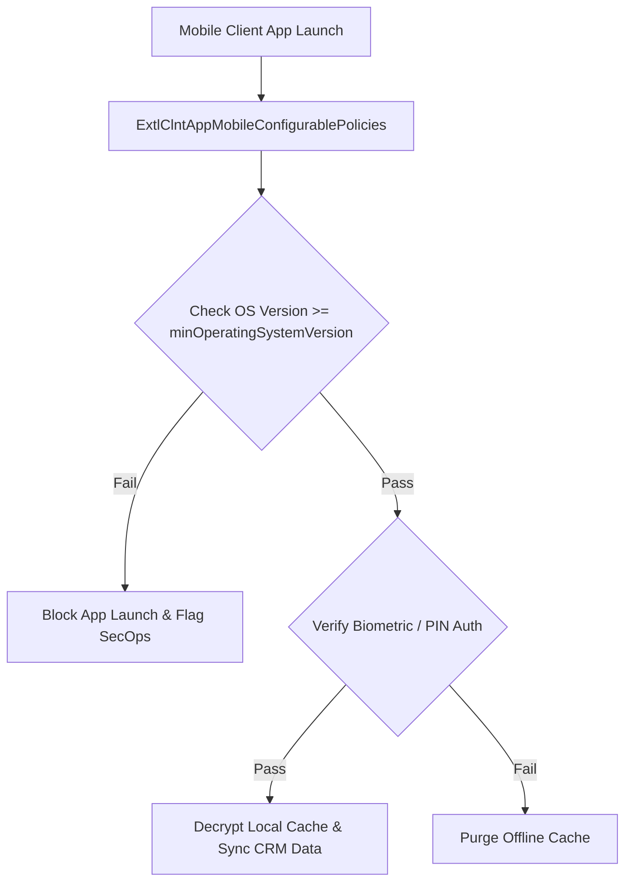

## Architectural Overview

`ExtlClntAppMobileConfigurablePolicies` provides enterprise administrators with mobile device security controls within the External Client App framework. When field technicians, sales representatives, and mobile workers access sensitive CRM data via native iOS and Android applications, the underlying devices represent potential threat vectors if lost, stolen, or compromised by malware.

This metadata type empowers enterprise security architects to enforce Zero-Trust device compliance policies directly at the application layer. Rather than relying solely on third-party Mobile Device Management (MDM) platforms, `ExtlClntAppMobileConfigurablePolicies` enforces biometric authentication, minimum mobile operating system baselines, and maximum offline cache lifespans natively within the Salesforce identity stack.



Because this metadata is subscriber-configurable, enterprise IT administrators can adjust mobile compliance rules across production environments independently of the developer-managed mobile application codebase.

## Directory and File Conventions

`ExtlClntAppMobileConfigurablePolicies` metadata files are organized in the `extlClntAppMobileConfigurablePolicies` directory:

| Property | Value |
| :--- | :--- |
| **Metadata Type Name** | `ExtlClntAppMobileConfigurablePolicies` |
| **SFDX Folder** | `force-app/main/default/extlClntAppMobileConfigurablePolicies/` |
| **File Suffix** | `.mobilePolicies-meta.xml` or `.extlClntAppMobileConfigurablePolicies-meta.xml` |
| **Packaging Scope** | Subscriber Managed |

## Key Metadata Fields

The `ExtlClntAppMobileConfigurablePolicies` schema defines device compliance parameters:

| Field Name | Field Type | Required | Architectural Description |
| :--- | :--- | :--- | :--- |
| `enforceBiometrics` | `boolean` | No | Mandates TouchID, FaceID, or Android Biometric Prompt before accessing cached data. |
| `pinLength` | `integer` | No | Required numeric passcode length when offline authentication fallback is required. |
| `minOperatingSystemVersion` | `string` | No | Lowest supported mobile OS version (e.g., iOS 17.0 or Android 14) allowed to authenticate. |
| `offlineSessionTimeout` | `integer` | No | Maximum hours encrypted data can reside offline before mandating cloud re-authentication. |
| `isScreenCaptureBlocked` | `boolean` | No | Prevents device screenshots and background app switcher previews to mitigate data leakage. |

## Declarative XML and Package Manifest Examples

Below is a declarative XML definition of `ExtlClntAppMobileConfigurablePolicies` configured for strict enterprise security:

```xml title="force-app/main/default/extlClntAppMobileConfigurablePolicies/Field_Sales_Mobile.mobilePolicies-meta.xml"
<?xml version="1.0" encoding="UTF-8"?>
<ExtlClntAppMobileConfigurablePolicies xmlns="http://soap.sforce.com/2006/04/metadata">
    <enforceBiometrics>true</enforceBiometrics>
    <isScreenCaptureBlocked>true</isScreenCaptureBlocked>
    <minOperatingSystemVersion>17.0</minOperatingSystemVersion>
    <offlineSessionTimeout>24</offlineSessionTimeout>
    <pinLength>6</pinLength>
</ExtlClntAppMobileConfigurablePolicies>
```

### Package Manifest (`package.xml`)

```xml title="manifest/package.xml"
<?xml version="1.0" encoding="UTF-8"?>
<Package xmlns="http://soap.sforce.com/2006/04/metadata">
    <types>
        <members>Field_Sales_Mobile</members>
        <name>ExtlClntAppMobileConfigurablePolicies</name>
    </types>
    <version>68.0</version>
</Package>
```

## CLI Retrieval and Deployment Commands

Manage mobile configurable policies with the Salesforce CLI:

```bash
# Retrieve mobile policies for a designated external client app
sf project retrieve start --metadata ExtlClntAppMobileConfigurablePolicies:Field_Sales_Mobile

# Deploy mobile policies to target environment
sf project deploy start --metadata ExtlClntAppMobileConfigurablePolicies:Field_Sales_Mobile

# Retrieve all mobile security policies across the org
sf project retrieve start --metadata ExtlClntAppMobileConfigurablePolicies
```

## Architect Best Practices and Gotchas

- **OS Minimum Version Coordination:** Coordinate `minOperatingSystemVersion` bumps with corporate mobile device upgrade cycles. Enforcing a newly released OS version before company devices are updated will lock out field users unexpectedly.
- **Offline Cache Hygiene:** Balance `offlineSessionTimeout` against field user requirements. While 12 to 24 hours is typical for standard sales scenarios, field service operations in remote areas with zero cell connectivity may require 72 hours with mandatory encrypted PIN validation.
- **Screen Capture Protection:** Enabling `isScreenCaptureBlocked` disables mobile OS screenshots on Android and masks snapshot thumbnails in the iOS multitasking switcher, preventing sensitive customer PII from leaking to local device photo storage.

> [!TIP]
> Combine `enforceBiometrics` with `pinLength` set to 6 digits to maintain frictionless user experience while providing fallback security when biometrics are temporarily unavailable.

> [!WARNING]
> Setting `offlineSessionTimeout` to zero forces users to authenticate against Salesforce on every app launch, rendering the application unusable in offline or low-connectivity environments.
