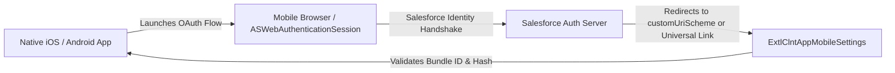

## Architectural Overview

`ExtlClntAppMobileSettings` constitutes the developer-side configuration layer for native and hybrid mobile applications integrated via the Salesforce External Client App framework. When developing custom Swift, Kotlin, React Native, or Flutter enterprise apps, the mobile binary must securely interface with the Salesforce identity and authorization plane.

This metadata type registers the cryptographic and operational fingerprints of the mobile client. It defines iOS Bundle Identifiers, Android Package Names, custom deep-linking URI schemes, and modern App-to-Web link associations (Apple Universal Links and Android App Links).



By decoupling these technical registration properties from subscriber security policies, mobile developers can version and release mobile app descriptor updates across sandboxes and production packaging orgs cleanly.

## Directory and File Conventions

`ExtlClntAppMobileSettings` files reside within the `extlClntAppMobileSettings` folder:

| Property | Value |
| :--- | :--- |
| **Metadata Type Name** | `ExtlClntAppMobileSettings` |
| **SFDX Folder** | `force-app/main/default/extlClntAppMobileSettings/` |
| **File Suffix** | `.mobile-meta.xml` or `.extlClntAppMobileSettings-meta.xml` |
| **Packaging Support** | Managed 2GP, Unlocked Packages |

## Key Metadata Fields

The `ExtlClntAppMobileSettings` XML schema includes the following structural definitions:

| Field Name | Field Type | Required | Architectural Description |
| :--- | :--- | :--- | :--- |
| `applicationBundleIdentifier` | `string` | Yes | iOS bundle ID (e.g., `com.company.salesapp`) or Android package name. |
| `customUriScheme` | `string` | Yes | Custom deep-link scheme used for OAuth redirect interception (e.g., `salesapp://oauth`). |
| `mobilePlatform` | `string` | Yes | Target operating system: `iOS`, `Android`, or `CrossPlatform`. |
| `isUniversalLinkEnabled` | `boolean` | No | Authorizes HTTPS domain-based universal link redirects instead of custom schemes. |
| `androidCertificateHash` | `string` | No | SHA-256 fingerprint of the Android signing keystore for asset link verification. |

## Declarative XML and Package Manifest Examples

Below is a declarative XML definition of `ExtlClntAppMobileSettings` for a cross-platform enterprise mobile application:

```xml title="force-app/main/default/extlClntAppMobileSettings/Service_Tech_Mobile.mobile-meta.xml"
<?xml version="1.0" encoding="UTF-8"?>
<ExtlClntAppMobileSettings xmlns="http://soap.sforce.com/2006/04/metadata">
    <androidCertificateHash>45:B2:19:D4:88:E7:F1:60:A2:3C:99:11:80:55:72:EE:9F:44:A1:BC</androidCertificateHash>
    <applicationBundleIdentifier>com.enterprise.servicetech</applicationBundleIdentifier>
    <customUriScheme>servicetech://oauth2/callback</customUriScheme>
    <isUniversalLinkEnabled>true</isUniversalLinkEnabled>
    <mobilePlatform>CrossPlatform</mobilePlatform>
</ExtlClntAppMobileSettings>
```

### Package Manifest (`package.xml`)

```xml title="manifest/package.xml"
<?xml version="1.0" encoding="UTF-8"?>
<Package xmlns="http://soap.sforce.com/2006/04/metadata">
    <types>
        <members>Service_Tech_Mobile</members>
        <name>ExtlClntAppMobileSettings</name>
    </types>
    <version>68.0</version>
</Package>
```

## CLI Retrieval and Deployment Commands

Retrieve and deploy mobile settings metadata using the Salesforce CLI:

```bash
# Retrieve mobile settings for a specific external client app
sf project retrieve start --metadata ExtlClntAppMobileSettings:Service_Tech_Mobile

# Deploy mobile settings to target staging sandbox
sf project deploy start --metadata ExtlClntAppMobileSettings:Service_Tech_Mobile

# Deploy all mobile integration components concurrently
sf project deploy start --metadata "ExtlClntAppMobileSettings,ExtlClntAppMobileConfigurablePolicies"
```

## Architect Best Practices and Gotchas

- **Universal Links vs. Custom Schemes:** Modern mobile security standards recommend Universal Links (iOS) and App Links (Android) over custom URI schemes (`myapp://`). Custom schemes can be hijacked by malicious third-party apps installed on the same device, whereas Universal Links enforce DNS domain verification.
- **Keystore Hash Verification:** Ensure the `androidCertificateHash` matches the release signing key generated by your CI/CD build system or Google Play App Signing. Mismatches will cause Google Play asset link handshakes to fail.
- **Companion OAuth Scope Binding:** The mobile settings file must be deployed alongside `ExtlClntAppOauthSettings` configured with the `RefreshToken` and `Mobile` scopes to support continuous offline token refreshes.

> [!NOTE]
> Setting `isUniversalLinkEnabled` to true requires hosting an `apple-app-site-association` and `assetlinks.json` file on the domain referenced in the callback URL.

> [!WARNING]
> Changing `applicationBundleIdentifier` after app distribution breaks OAuth callbacks for deployed mobile devices until users download an updated binary.
