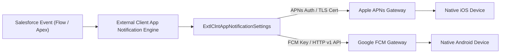

## Architectural Overview

`ExtlClntAppNotificationSettings` configures outbound mobile push notification channels within the Salesforce External Client App architecture. In modern omni-channel enterprise solutions, notifying field workers, sales agents, or service dispatchers in real-time when critical events occur (such as SLA breaches, order approvals, or high-priority case escalations) is a core capability.

Behind the scenes, dispatching a push notification requires Salesforce to authenticate securely with Apple Push Notification service (APNs) and Google Firebase Cloud Messaging (FCM). `ExtlClntAppNotificationSettings` establishes these technical credentials, manages APNs production versus sandbox environments, and specifies device registration endpoints.



By decoupling developer push gateway settings from subscriber push execution policies, mobile architects ensure seamless infrastructure maintenance without impacting business user notification preferences.

## Directory and File Conventions

`ExtlClntAppNotificationSettings` files reside within the `extlClntAppNotificationSettings` directory:

| Property | Value |
| :--- | :--- |
| **Metadata Type Name** | `ExtlClntAppNotificationSettings` |
| **SFDX Folder** | `force-app/main/default/extlClntAppNotificationSettings/` |
| **File Suffix** | `.notif-meta.xml` or `.extlClntAppNotificationSettings-meta.xml` |
| **API Version** | 68.0 |

## Key Metadata Fields

The `ExtlClntAppNotificationSettings` schema includes the following configuration fields:

| Field Name | Field Type | Required | Architectural Description |
| :--- | :--- | :--- | :--- |
| `applePushNotificationEnvironment` | `string` | No | Target APNs environment: `Sandbox` or `Production`. |
| `applePushNotificationServiceCert` | `string` | No | Base64-encoded or certificate alias reference for APNs mutual TLS authentication. |
| `fcmServerKey` | `string` | No | Google Firebase Cloud Messaging API key or service account token for Android delivery. |
| `enableCustomPushNotifications` | `boolean` | No | Enables custom Notification Type routing through this External Client App channel. |
| `deviceTokenEndpoint` | `string` | No | Custom gateway endpoint for caching and rotating mobile device push registration tokens. |

## Declarative XML and Package Manifest Examples

Below is a declarative XML definition of `ExtlClntAppNotificationSettings` configured for production enterprise mobile notifications:

```xml title="force-app/main/default/extlClntAppNotificationSettings/Field_Operations_ECA.notif-meta.xml"
<?xml version="1.0" encoding="UTF-8"?>
<ExtlClntAppNotificationSettings xmlns="http://soap.sforce.com/2006/04/metadata">
    <applePushNotificationEnvironment>Production</applePushNotificationEnvironment>
    <enableCustomPushNotifications>true</enableCustomPushNotifications>
    <deviceTokenEndpoint>https://push-gateway.enterprise.com/tokens/register</deviceTokenEndpoint>
</ExtlClntAppNotificationSettings>
```

### Package Manifest (`package.xml`)

```xml title="manifest/package.xml"
<?xml version="1.0" encoding="UTF-8"?>
<Package xmlns="http://soap.sforce.com/2006/04/metadata">
    <types>
        <members>Field_Operations_ECA</members>
        <name>ExtlClntAppNotificationSettings</name>
    </types>
    <version>68.0</version>
</Package>
```

## CLI Retrieval and Deployment Commands

Manage notification settings with the Salesforce CLI:

```bash
# Retrieve notification settings for the field operations app
sf project retrieve start --metadata ExtlClntAppNotificationSettings:Field_Operations_ECA

# Deploy notification settings to production
sf project deploy start --metadata ExtlClntAppNotificationSettings:Field_Operations_ECA

# Validate push notification deployment without committing
sf project deploy start --metadata ExtlClntAppNotificationSettings --dry-run
```

## Architect Best Practices and Gotchas

- **APNs Environment Isolation:** Never configure `applePushNotificationEnvironment` as `Production` in development sandboxes or scratch orgs. iOS development builds signed with development provisioning profiles will reject push payloads originating from the APNs production gateway.
- **Annual Certificate Renewal Lifecycles:** Apple APNs certificates expire annually. Establish automated calendar alerts and DevOps runbooks at least 30 days prior to certificate expiration to generate, validate, and deploy updated certificate metadata without service interruption.
- **Token Invalidation Handling:** Mobile device tokens are invalidated whenever users reinstall the mobile app or upgrade devices. Implement proper token invalidation handlers on your push gateway to prevent delivery failure spikes that can trigger vendor throttling.

> [!TIP]
> Transition to Apple Token-based authentication (.p8 Auth Keys) where supported to eliminate the annual operational overhead of renewing APNs SSL certificates (.p12).

> [!WARNING]
> Uploading an invalid or expired push certificate will immediately halt all outbound push notification dispatches across connected mobile devices.
