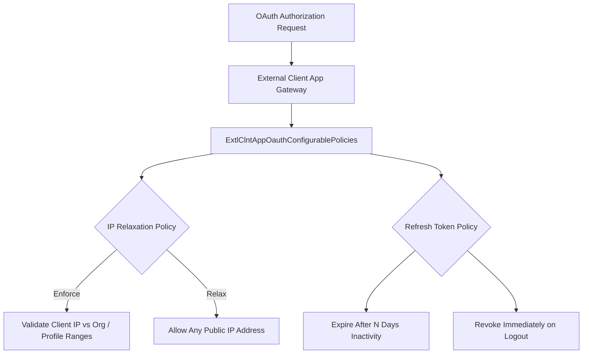

## Architectural Overview

`ExtlClntAppOauthConfigurablePolicies` represents the subscriber-administered OAuth governance layer within the Salesforce External Client App architecture. In legacy Connected Apps, operational security policies—such as IP range enforcement, refresh token expiration intervals, and single logout handlers—were intermingled with technical OAuth client parameters.

This metadata type establishes a clear security boundary for OAuth execution. While integration developers specify required OAuth scopes and callback endpoints, the subscriber security team retains exclusive authority over operational risk parameters via `ExtlClntAppOauthConfigurablePolicies`. This guarantees that enterprise tenant policies—such as zero-trust IP restrictions and token revocation rules—are strictly enforced regardless of updates shipped by software vendors.



Enterprise security teams can version-control this metadata within tenant-specific repositories, enabling continuous compliance auditing and automated promotion across sandbox environments.

## Directory and File Conventions

`ExtlClntAppOauthConfigurablePolicies` metadata files reside within the `extlClntAppOauthConfigurablePolicies` folder:

| Property | Value |
| :--- | :--- |
| **Metadata Type Name** | `ExtlClntAppOauthConfigurablePolicies` |
| **SFDX Folder** | `force-app/main/default/extlClntAppOauthConfigurablePolicies/` |
| **File Suffix** | `.oauthPolicies-meta.xml` or `.extlClntAppOauthConfigurablePolicies-meta.xml` |
| **Packaging Scope** | Subscriber Managed |

## Key Metadata Fields

The `ExtlClntAppOauthConfigurablePolicies` XML schema defines runtime OAuth security parameters:

| Field Name | Field Type | Required | Architectural Description |
| :--- | :--- | :--- | :--- |
| `ipRelaxation` | `string` | Yes | IP restriction enforcement: `Enforce` (adheres to profile ranges) or `RelaxForApp`. |
| `refreshTokenPolicy` | `string` | Yes | Token lifecycle: `Infinite`, `SpecifiedDays`, or `Zero` (revoke immediately). |
| `refreshTokenValidity` | `integer` | No | Lifespan in days when `refreshTokenPolicy` is configured as `SpecifiedDays`. |
| `singleLogoutUrl` | `string` | No | OIDC single logout redirection endpoint called when sessions terminate. |
| `isTokenExchangeEnabled` | `boolean` | No | Authorizes RFC 8693 OAuth 2.0 Token Exchange for cross-domain delegation. |

## Declarative XML and Package Manifest Examples

Below is a declarative XML definition of `ExtlClntAppOauthConfigurablePolicies` configured for high-security enterprise environments:

```xml title="force-app/main/default/extlClntAppOauthConfigurablePolicies/Enterprise_ERP_Integration.oauthPolicies-meta.xml"
<?xml version="1.0" encoding="UTF-8"?>
<ExtlClntAppOauthConfigurablePolicies xmlns="http://soap.sforce.com/2006/04/metadata">
    <ipRelaxation>Enforce</ipRelaxation>
    <isTokenExchangeEnabled>false</isTokenExchangeEnabled>
    <refreshTokenPolicy>SpecifiedDays</refreshTokenPolicy>
    <refreshTokenValidity>30</refreshTokenValidity>
    <singleLogoutUrl>https://erp.enterprise.com/auth/single-logout</singleLogoutUrl>
</ExtlClntAppOauthConfigurablePolicies>
```

### Package Manifest (`package.xml`)

```xml title="manifest/package.xml"
<?xml version="1.0" encoding="UTF-8"?>
<Package xmlns="http://soap.sforce.com/2006/04/metadata">
    <types>
        <members>Enterprise_ERP_Integration</members>
        <name>ExtlClntAppOauthConfigurablePolicies</name>
    </types>
    <version>68.0</version>
</Package>
```

## CLI Retrieval and Deployment Commands

Retrieve and deploy OAuth configurable policy metadata using the Salesforce CLI:

```bash
# Retrieve OAuth configurable policies for the designated app
sf project retrieve start --metadata ExtlClntAppOauthConfigurablePolicies:Enterprise_ERP_Integration

# Deploy OAuth policies to target environment
sf project deploy start --metadata ExtlClntAppOauthConfigurablePolicies:Enterprise_ERP_Integration

# Deploy all policy files across the repository
sf project deploy start --metadata "ExtlClntAppOauthConfigurablePolicies,ExtlClntAppConfigurablePolicies"
```

## Architect Best Practices and Gotchas

- **IP Relaxation Security Risks:** Setting `ipRelaxation` to `RelaxForApp` bypasses profile-level login IP ranges. While necessary for integrations originating from dynamic cloud IP pools (e.g., AWS Lambda or Azure Functions), never relax IP restrictions without pairing with mutual TLS (mTLS) or strong OAuth client authentication.
- **Refresh Token Invalidation:** When `refreshTokenPolicy` is configured as `SpecifiedDays`, ensure automated integration services execute daily synthetic health checks. If a service remains dormant beyond the specified lifespan, the refresh token expires and requires human intervention to re-authenticate.
- **Single Logout URL Validation:** Ensure the `singleLogoutUrl` points to an HTTPS endpoint that can parse standard OpenID Connect logout tokens asynchronously without timing out.

> [!NOTE]
> Setting `ipRelaxation` to `Enforce` requires all incoming API calls from this client to originate from IP ranges explicitly whitelisted in the user profile or network settings.

> [!WARNING]
> Changing `refreshTokenPolicy` to `Zero` prevents long-lived offline access and will break headless daemon batch jobs relying on continuous refresh token rotation.
