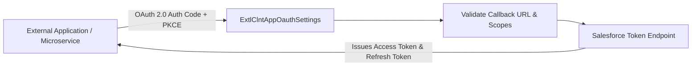

## Architectural Overview

`ExtlClntAppOauthSettings` represents the developer OAuth 2.0 contract within the Salesforce External Client App framework. In enterprise integration architecture, establishing secure API communication channels requires precise specification of authorization protocols, callback endpoints, and permissions boundaries (OAuth Scopes).

In legacy Connected Apps, developer OAuth settings were conflated with tenant administration settings. `ExtlClntAppOauthSettings` isolates developer concerns. Software engineers and integration architects define the allowed OAuth grant types (e.g., Authorization Code, Client Credentials, JWT Bearer), redirect callback URLs, and required scopes (such as `Api`, `Web`, and `RefreshToken`) within this dedicated metadata component.



Because developer OAuth settings are versioned independently, changes to callback URLs or required API scopes can be deployed cleanly through CI/CD pipelines across developer scratch orgs, staging environments, and packaging pipelines.

## Directory and File Conventions

`ExtlClntAppOauthSettings` metadata files reside within the `extlClntAppOauthSettings` directory:

| Property | Value |
| :--- | :--- |
| **Metadata Type Name** | `ExtlClntAppOauthSettings` |
| **SFDX Folder** | `force-app/main/default/extlClntAppOauthSettings/` |
| **File Suffix** | `.oauth-meta.xml` or `.extlClntAppOauthSettings-meta.xml` |
| **Packaging Behavior** | Packaged in 2GP Managed or Unlocked Packages |

## Key Metadata Fields

The `ExtlClntAppOauthSettings` schema exposes core OAuth client parameters:

| Field Name | Field Type | Required | Architectural Description |
| :--- | :--- | :--- | :--- |
| `callbackUrl` | `string` | Yes | Whitespace-delimited or comma-separated list of authorized redirect URIs. |
| `scopes` | `list` | Yes | OAuth scopes granting access (e.g., `Api`, `Web`, `RefreshToken`, `CustomApplications`). |
| `isPkceRequired` | `boolean` | No | Mandates Proof Key for Code Exchange (RFC 7636) for authorization code flows. |
| `isSecretRequiredForRefreshToken` | `boolean` | No | Enforces client secret validation during refresh token exchange requests. |
| `isClientCredentialsEnabled` | `boolean` | No | Activates OAuth 2.0 Client Credentials flow for server-to-server daemon processes. |

## Declarative XML and Package Manifest Examples

Below is a declarative XML definition of `ExtlClntAppOauthSettings` configured with enterprise security standards:

```xml title="force-app/main/default/extlClntAppOauthSettings/Financial_Data_Service.oauth-meta.xml"
<?xml version="1.0" encoding="UTF-8"?>
<ExtlClntAppOauthSettings xmlns="http://soap.sforce.com/2006/04/metadata">
    <callbackUrl>https://services.financial.internal/oauth/callback</callbackUrl>
    <isClientCredentialsEnabled>true</isClientCredentialsEnabled>
    <isPkceRequired>true</isPkceRequired>
    <isSecretRequiredForRefreshToken>true</isSecretRequiredForRefreshToken>
    <scopes>Api</scopes>
    <scopes>RefreshToken</scopes>
    <scopes>OpenID</scopes>
</ExtlClntAppOauthSettings>
```

### Package Manifest (`package.xml`)

```xml title="manifest/package.xml"
<?xml version="1.0" encoding="UTF-8"?>
<Package xmlns="http://soap.sforce.com/2006/04/metadata">
    <types>
        <members>Financial_Data_Service</members>
        <name>ExtlClntAppOauthSettings</name>
    </types>
    <version>68.0</version>
</Package>
```

## CLI Retrieval and Deployment Commands

Manage OAuth settings metadata using the Salesforce CLI:

```bash
# Retrieve OAuth settings for a specific external client app
sf project retrieve start --metadata ExtlClntAppOauthSettings:Financial_Data_Service

# Deploy OAuth settings to target environment
sf project deploy start --metadata ExtlClntAppOauthSettings:Financial_Data_Service

# Deploy full External Client App bundle concurrently
sf project deploy start --metadata "ExternalClientApp,ExtlClntAppOauthSettings,ExtlClntAppGlobalOauthSettings"
```

## Architect Best Practices and Gotchas

- **Mandatory PKCE for Public Clients:** Always configure `isPkceRequired` to `true` for all native mobile apps, desktop clients, and single-page web applications. PKCE prevents malicious actors from intercepting authorization codes in transit.
- **Principle of Least Privilege for Scopes:** Avoid requesting the `Full` scope. Restrict your configuration to explicit scopes like `Api` for programmatic REST/SOAP access, `RefreshToken` for offline sync, and `OpenID` for identity claims.
- **Client Credentials Execution User:** When enabling `isClientCredentialsEnabled` for headless daemon services, configure a dedicated integration user with tailored permission sets rather than binding to a system administrator account.

> [!TIP]
> Use multiple redirect URLs separated by newlines to support local developer testing (`http://localhost:8080/callback`) alongside staging and production endpoints.

> [!WARNING]
> Removing an active scope from `scopes` will immediately cause insufficient privilege errors for connected clients upon their next token refresh.
