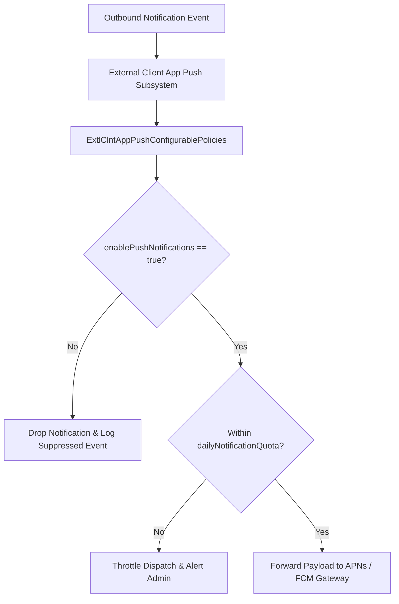

## Architectural Overview

`ExtlClntAppPushConfigurablePolicies` provides the administrative governance plane for mobile push notifications dispatched by External Client Apps. In large-scale enterprise environments with thousands of field workers and mobile users, unthrottled or unmonitored push notifications present significant operational risks—including message flooding, user fatigue, battery drain, and cloud gateway rate-limiting.

This metadata type enables subscriber system administrators to establish governance policies over outbound push dispatches. Administrators can independently enable or disable push messaging across specific tenant environments (such as disabling push in sandbox testing to avoid confusing end users), enforce daily rate limits, and restrict delivery to approved enterprise push gateways.



By decoupling subscriber push policy governance from developer push infrastructure, enterprise organizations maintain total control over mobile notification traffic without modifying underlying codebase integrations.

## Directory and File Conventions

`ExtlClntAppPushConfigurablePolicies` metadata files reside within the `extlClntAppPushConfigurablePolicies` directory:

| Property | Value |
| :--- | :--- |
| **Metadata Type Name** | `ExtlClntAppPushConfigurablePolicies` |
| **SFDX Folder** | `force-app/main/default/extlClntAppPushConfigurablePolicies/` |
| **File Suffix** | `.pushPolicies-meta.xml` or `.extlClntAppPushConfigurablePolicies-meta.xml` |
| **Packaging Scope** | Subscriber Managed |

## Key Metadata Fields

The `ExtlClntAppPushConfigurablePolicies` XML schema defines administrative dispatch controls:

| Field Name | Field Type | Required | Architectural Description |
| :--- | :--- | :--- | :--- |
| `enablePushNotifications` | `boolean` | Yes | Administrative toggle to activate or suspend push notifications in the tenant. |
| `dailyNotificationQuota` | `integer` | No | Maximum outbound push dispatches permitted across a rolling 24-hour period. |
| `permittedPushGateways` | `list` | No | Whitelisted push notification gateway endpoints authorized to receive event payloads. |
| `isPayloadEncryptionMandated` | `boolean` | No | Requires end-to-end payload encryption for sensitive notification body text. |

## Declarative XML and Package Manifest Examples

Below is a declarative XML definition of `ExtlClntAppPushConfigurablePolicies` configured for an enterprise subscriber org:

```xml title="force-app/main/default/extlClntAppPushConfigurablePolicies/Field_Operations_Push.pushPolicies-meta.xml"
<?xml version="1.0" encoding="UTF-8"?>
<ExtlClntAppPushConfigurablePolicies xmlns="http://soap.sforce.com/2006/04/metadata">
    <dailyNotificationQuota>50000</dailyNotificationQuota>
    <enablePushNotifications>true</enablePushNotifications>
    <isPayloadEncryptionMandated>true</isPayloadEncryptionMandated>
</ExtlClntAppPushConfigurablePolicies>
```

### Package Manifest (`package.xml`)

```xml title="manifest/package.xml"
<?xml version="1.0" encoding="UTF-8"?>
<Package xmlns="http://soap.sforce.com/2006/04/metadata">
    <types>
        <members>Field_Operations_Push</members>
        <name>ExtlClntAppPushConfigurablePolicies</name>
    </types>
    <version>68.0</version>
</Package>
```

## CLI Retrieval and Deployment Commands

Manage push configurable policies using the Salesforce CLI:

```bash
# Retrieve push configurable policies for a designated external client app
sf project retrieve start --metadata ExtlClntAppPushConfigurablePolicies:Field_Operations_Push

# Deploy push policies to production
sf project deploy start --metadata ExtlClntAppPushConfigurablePolicies:Field_Operations_Push

# Validate push policy metadata before deploying
sf project deploy start --metadata ExtlClntAppPushConfigurablePolicies --dry-run
```

## Architect Best Practices and Gotchas

- **Sandbox Notification Suppression:** Keep `enablePushNotifications` set to `false` in developer sandboxes and staging environments to prevent automated test suites from spamming real mobile devices with test notifications.
- **Payload Encryption Governance:** When `isPayloadEncryptionMandated` is set to `true`, notification payloads containing customer PII or financial data must be decrypted by the mobile application using a shared key rather than displayed in cleartext on the lock screen.
- **Quota Monitoring:** Establish automated monitoring on daily push dispatch volumes to ensure unexpected automated Flows do not exhaust `dailyNotificationQuota` early in the business day.

> [!NOTE]
> Modifying push configurable policies does not require redeploying developer push certificates or regenerating client application binaries.

> [!WARNING]
> Exceeding `dailyNotificationQuota` causes Salesforce to silently drop outbound push notifications until the 24-hour rolling window resets.
