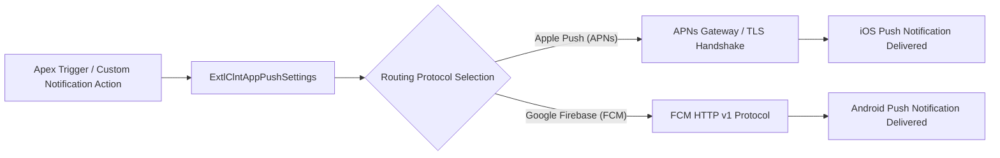

## Architectural Overview

`ExtlClntAppPushSettings` defines the developer-side push messaging technical infrastructure within the Salesforce External Client App ecosystem. When mobile software developers build enterprise applications that rely on mobile alerts, the Salesforce platform must be equipped with the appropriate network routes, cryptographic signatures, and gateway parameters to interface with Apple (APNs) and Google (FCM).

In legacy Connected Apps, push certificates and gateway settings were inextricably bound with OAuth secrets and admin permissions. `ExtlClntAppPushSettings` extracts developer push infrastructure into a self-contained metadata entity. Developers specify whether Apple APNs or Google FCM is supported, define push gateway endpoints, and register token lifespans.



This clean architecture allows developers to update push infrastructure parameters across development sandboxes and 2GP packaging pipelines without impacting the operational policies managed by subscriber administrators.

## Directory and File Conventions

`ExtlClntAppPushSettings` metadata files reside within the `extlClntAppPushSettings` directory:

| Property | Value |
| :--- | :--- |
| **Metadata Type Name** | `ExtlClntAppPushSettings` |
| **SFDX Folder** | `force-app/main/default/extlClntAppPushSettings/` |
| **File Suffix** | `.push-meta.xml` or `.extlClntAppPushSettings-meta.xml` |
| **Packaging Behavior** | Packaged in 2GP Managed or Unlocked Packages |

## Key Metadata Fields

The `ExtlClntAppPushSettings` schema exposes the following technical configuration attributes:

| Field Name | Field Type | Required | Architectural Description |
| :--- | :--- | :--- | :--- |
| `isApplePushSupported` | `boolean` | Yes | Activates Apple Push Notification service (APNs) messaging for iOS devices. |
| `isFcmPushSupported` | `boolean` | Yes | Activates Google Firebase Cloud Messaging (FCM) protocol for Android devices. |
| `pushEndpointUrl` | `string` | No | Custom intermediate routing endpoint or enterprise push gateway proxy. |
| `tokenExpirationMinutes` | `integer` | No | Client device registration token cache duration before re-registration is required. |
| `developerName` | `string` | Yes | API name linking push settings to the parent External Client App. |

## Declarative XML and Package Manifest Examples

Below is a declarative XML definition of `ExtlClntAppPushSettings` configured for a multi-platform enterprise mobile deployment:

```xml title="force-app/main/default/extlClntAppPushSettings/Logistics_Mobile_Push.push-meta.xml"
<?xml version="1.0" encoding="UTF-8"?>
<ExtlClntAppPushSettings xmlns="http://soap.sforce.com/2006/04/metadata">
    <developerName>Logistics_Mobile_Push</developerName>
    <isApplePushSupported>true</isApplePushSupported>
    <isFcmPushSupported>true</isFcmPushSupported>
    <pushEndpointUrl>https://push-relay.enterprise-logistics.com/v1/dispatch</pushEndpointUrl>
    <tokenExpirationMinutes>10080</tokenExpirationMinutes>
</ExtlClntAppPushSettings>
```

### Package Manifest (`package.xml`)

```xml title="manifest/package.xml"
<?xml version="1.0" encoding="UTF-8"?>
<Package xmlns="http://soap.sforce.com/2006/04/metadata">
    <types>
        <members>Logistics_Mobile_Push</members>
        <name>ExtlClntAppPushSettings</name>
    </types>
    <version>68.0</version>
</Package>
```

## CLI Retrieval and Deployment Commands

Retrieve and deploy push settings metadata using the Salesforce CLI:

```bash
# Retrieve push settings for a specific client application
sf project retrieve start --metadata ExtlClntAppPushSettings:Logistics_Mobile_Push

# Deploy push settings to target sandbox
sf project deploy start --metadata ExtlClntAppPushSettings:Logistics_Mobile_Push

# Retrieve all push components across the project
sf project retrieve start --metadata "ExtlClntAppPushSettings,ExtlClntAppPushConfigurablePolicies"
```

## Architect Best Practices and Gotchas

- **FCM HTTP v1 Migration:** Ensure external push integration gateways utilize Google Firebase Cloud Messaging HTTP v1 API. Legacy FCM API keys are deprecated; token exchanges must be negotiated via OAuth 2.0 service account credentials.
- **Token Cache Alignment:** Align `tokenExpirationMinutes` with the token refresh interval implemented in your native mobile application binary. A mismatch can result in push delivery attempts against stale, invalidated device tokens.
- **Proxy Gateway Resiliency:** If deploying a custom `pushEndpointUrl`, design the proxy gateway to handle bursty spikes resulting from automated bulk record updates or mass notification dispatches.

> [!TIP]
> Configure `tokenExpirationMinutes` to 10080 (7 days) for high-frequency field apps to minimize battery-draining token refresh cycles on mobile devices.

> [!WARNING]
> Disabling `isApplePushSupported` in production metadata will immediately terminate push delivery to all registered iOS client devices.
