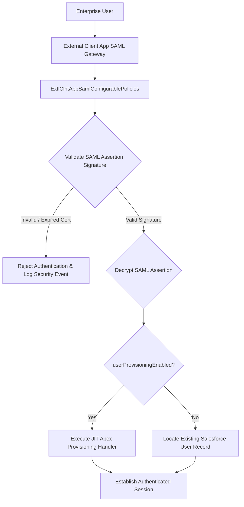

## Architectural Overview

`ExtlClntAppSamlConfigurablePolicies` represents the SAML 2.0 identity federation governance layer within the Salesforce External Client App framework. In enterprise federated architectures, authenticating corporate users into external partner portals, embedded web applications, or third-party SaaS systems frequently relies on SAML Single Sign-On (SSO).

When an External Client App acts as an Identity Provider (IdP) or Service Provider (SP), subscriber security teams must enforce strict cryptographic standards. `ExtlClntAppSamlConfigurablePolicies` provides subscriber administrators with fine-grained control over identity federation settings—including the SAML Entity ID, assertion signing algorithms, decryption certificates, and Just-In-Time (JIT) provisioning rules.



This decoupled configuration ensures that when third-party software updates are deployed, local SAML identity trust relationships and corporate cryptographic keys remain protected and uncorrupted.

## Directory and File Conventions

`ExtlClntAppSamlConfigurablePolicies` files reside within the `extlClntAppSamlConfigurablePolicies` directory:

| Property | Value |
| :--- | :--- |
| **Metadata Type Name** | `ExtlClntAppSamlConfigurablePolicies` |
| **SFDX Folder** | `force-app/main/default/extlClntAppSamlConfigurablePolicies/` |
| **File Suffix** | `.samlPolicies-meta.xml` or `.extlClntAppSamlConfigurablePolicies-meta.xml` |
| **Packaging Scope** | Subscriber Managed |

## Key Metadata Fields

The `ExtlClntAppSamlConfigurablePolicies` XML schema defines federation security attributes:

| Field Name | Field Type | Required | Architectural Description |
| :--- | :--- | :--- | :--- |
| `entityId` | `string` | Yes | Unique SAML 2.0 entity identifier for the service provider or identity provider. |
| `assertionDecryptionCertificate` | `string` | No | Certificate alias used to decrypt incoming encrypted SAML XML assertions. |
| `samlInitiationMethod` | `string` | Yes | Handshake initiation mode: `IdpInitiated` or `SpInitiated`. |
| `userProvisioningEnabled` | `boolean` | No | Enables Just-In-Time (JIT) user account creation upon valid SAML assertion. |
| `jitHandlerApexClass` | `string` | No | Apex class implementing `Auth.SamlJitHandler` for custom user provisioning. |

## Declarative XML and Package Manifest Examples

Below is a declarative XML definition of `ExtlClntAppSamlConfigurablePolicies` configured for SAML 2.0 SSO with assertion encryption:

```xml title="force-app/main/default/extlClntAppSamlConfigurablePolicies/Enterprise_Portal_SSO.samlPolicies-meta.xml"
<?xml version="1.0" encoding="UTF-8"?>
<ExtlClntAppSamlConfigurablePolicies xmlns="http://soap.sforce.com/2006/04/metadata">
    <assertionDecryptionCertificate>Enterprise_SAML_Decryption_Cert</assertionDecryptionCertificate>
    <entityId>https://sso.enterprise-portal.internal/saml/metadata</entityId>
    <samlInitiationMethod>SpInitiated</samlInitiationMethod>
    <userProvisioningEnabled>false</userProvisioningEnabled>
</ExtlClntAppSamlConfigurablePolicies>
```

### Package Manifest (`package.xml`)

```xml title="manifest/package.xml"
<?xml version="1.0" encoding="UTF-8"?>
<Package xmlns="http://soap.sforce.com/2006/04/metadata">
    <types>
        <members>Enterprise_Portal_SSO</members>
        <name>ExtlClntAppSamlConfigurablePolicies</name>
    </types>
    <version>68.0</version>
</Package>
```

## CLI Retrieval and Deployment Commands

Manage SAML configurable policies using the Salesforce CLI:

```bash
# Retrieve SAML policies for the portal application
sf project retrieve start --metadata ExtlClntAppSamlConfigurablePolicies:Enterprise_Portal_SSO

# Deploy SAML policies to target staging org
sf project deploy start --metadata ExtlClntAppSamlConfigurablePolicies:Enterprise_Portal_SSO

# Validate deployment without committing changes
sf project deploy start --metadata ExtlClntAppSamlConfigurablePolicies --dry-run
```

## Architect Best Practices and Gotchas

- **Prefer SP-Initiated SSO:** Architect your SAML workflows around `SpInitiated` rather than `IdpInitiated`. SP-Initiated SAML mitigates cross-site request forgery (CSRF) vulnerabilities by ensuring every assertion corresponds to a validated in-flight authentication request.
- **Certificate Lifecycle Automation:** Store certificates in Salesforce Certificate and Key Management prior to referencing them in `assertionDecryptionCertificate`. Deploying policies referencing non-existent certificate aliases will fail validation.
- **JIT Handler Performance:** If `userProvisioningEnabled` is active, ensure the `jitHandlerApexClass` executes bulk-safe, highly optimized DML operations to prevent user login latency from exceeding SAML gateway timeout limits.

> [!NOTE]
> When `assertionDecryptionCertificate` is configured, Salesforce automatically publishes the public decryption key in the federation SAML metadata XML document.

> [!WARNING]
> Changing the `entityId` in production will invalidate existing identity federation agreements until the updated entity ID is registered with the third-party IdP or SP.
