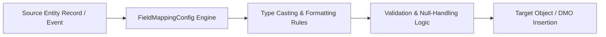

## Architectural Overview

`FieldMappingConfig` represents declarative field transformation and schema alignment rules within the Salesforce Metadata API. In complex multi-cloud architectures—such as synchronizing staging objects with Data Cloud Data Model Objects (DMOs), executing automated Lead Conversion mappings, or integrating Health Cloud and Financial Services Cloud objects—writing custom Apex translation logic introduces maintenance overhead and performance bottlenecks.

`FieldMappingConfig` externalizes field transformation logic into version-controlled metadata. It defines deterministic mappings between source entity fields and target entity fields, specifying type conversions, default values, and data normalization rules that are executed natively within the Salesforce platform core runtime.



By maintaining `FieldMappingConfig` in your CI/CD repository, schema alterations can be tested in scratch orgs, peer-reviewed via pull requests, and deployed systematically without risk of runtime script failures.

## Directory and File Conventions

`FieldMappingConfig` metadata files are located in the `fieldMappingConfigs` directory:

| Property | Value |
| :--- | :--- |
| **Metadata Type Name** | `FieldMappingConfig` |
| **SFDX Folder** | `force-app/main/default/fieldMappingConfigs/` |
| **File Suffix** | `.fieldMappingConfig-meta.xml` |
| **API Version** | 68.0 |

## Key Metadata Fields

The `FieldMappingConfig` XML schema defines schema mapping parameters:

| Field Name | Field Type | Required | Architectural Description |
| :--- | :--- | :--- | :--- |
| `developerName` | `string` | Yes | Unique programmatic identifier for the field mapping set. |
| `masterLabel` | `string` | Yes | Human-readable label for the configuration in Setup and admin tools. |
| `sourceEntity` | `string` | Yes | API name of the source standard or custom object. |
| `targetEntity` | `string` | Yes | API name of the target standard or custom object. |
| `description` | `string` | No | Architectural summary of the mapping scope and business context. |

## Declarative XML and Package Manifest Examples

Below is a declarative XML definition of `FieldMappingConfig` mapping inbound prospect staging records into standard Contact records:

```xml title="force-app/main/default/fieldMappingConfigs/Prospect_To_Contact_Mapping.fieldMappingConfig-meta.xml"
<?xml version="1.0" encoding="UTF-8"?>
<FieldMappingConfig xmlns="http://soap.sforce.com/2006/04/metadata">
    <description>Maps staged inbound marketing prospect records into standard Contact objects</description>
    <developerName>Prospect_To_Contact_Mapping</developerName>
    <masterLabel>Prospect To Contact Mapping</masterLabel>
    <sourceEntity>Inbound_Prospect__c</sourceEntity>
    <targetEntity>Contact</targetEntity>
</FieldMappingConfig>
```

### Package Manifest (`package.xml`)

```xml title="manifest/package.xml"
<?xml version="1.0" encoding="UTF-8"?>
<Package xmlns="http://soap.sforce.com/2006/04/metadata">
    <types>
        <members>Prospect_To_Contact_Mapping</members>
        <name>FieldMappingConfig</name>
    </types>
    <version>68.0</version>
</Package>
```

## CLI Retrieval and Deployment Commands

Retrieve and deploy `FieldMappingConfig` metadata using the Salesforce CLI:

```bash
# Retrieve a specific field mapping configuration
sf project retrieve start --metadata FieldMappingConfig:Prospect_To_Contact_Mapping

# Deploy all field mapping configs to target org
sf project deploy start --metadata FieldMappingConfig

# Validate deployment dependencies prior to execution
sf project deploy start --metadata FieldMappingConfig --dry-run
```

## Architect Best Practices and Gotchas

- **Dependency Sequencing:** `FieldMappingConfig` has hard dependencies on the existence of both `sourceEntity` and `targetEntity`, along with all mapped custom fields. Deploy custom objects and fields in Wave 1 before deploying mapping configs in Wave 2.
- **Type Compatibility Enforcement:** Mapped source and target fields must possess compatible data types. Mapping a source text field of length 255 to a target text field of length 50 will cause truncation exceptions during batch pipeline execution.
- **Companion Relationship Definitions:** Pair `FieldMappingConfig` with `FieldSrcTrgtRelationship` metadata to establish deterministic relational linkage and foreign key resolutions across transformed record sets.

> [!NOTE]
> Declarative field mapping configurations execute inside Salesforce kernel routines, outperforming equivalent Apex trigger or Flow translation loops by orders of magnitude.

> [!WARNING]
> Deleting or renaming a custom field that participates in a `FieldMappingConfig` will cause metadata validation failures until the mapping file is updated.
