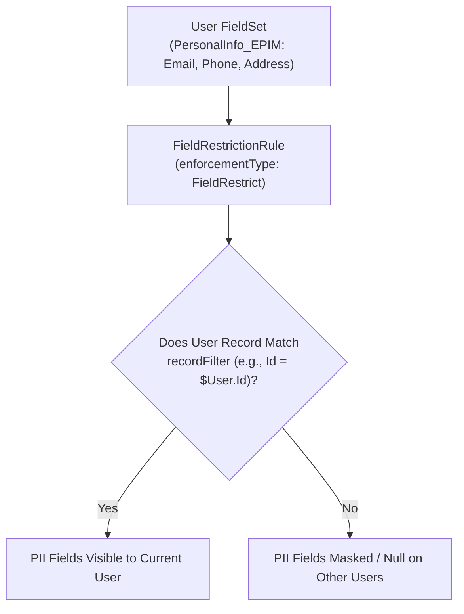

## Why the `FieldRestrictionRule` Metadata Type Matters

In Experience Cloud portals and internal HR / Workplace Command Center apps, users must be able to query the `User` or `Employee` object to see colleagues' names or avatars—which requires granting **Read** access on the object and its fields. However, standard Field-Level Security (FLS) is all-or-nothing: if you grant Read FLS on `User.Email`, `User.MobilePhone`, or `User.Title`, an external portal user can see those PII fields on *every* user record they can view.

**`FieldRestrictionRule`** (`fieldRestrictionRules/<Name>.rule-meta.xml`), powering **Enhanced Personal Information Management (EPIM)**, solves this by applying a **record-level filter to field visibility** on the `User` and `Employee` objects.



---

## Key Metadata Fields on `FieldRestrictionRule`

| Field | Type | Required | Description |
|---|---|---|---|
| `targetEntity` | `string` | Yes | Must be `User` or `Employee`. |
| `enforcementType` | `EnforcementType` | Yes | Must be `FieldRestrict`. |
| `classificationType` | `ClassificationType` | No | `FieldSet` (modern EPIM standard, API v54.0+) or `ComplianceCategory` (legacy pre-Spring '22). |
| `classification` | `string[]` | Yes | Developer name of the [FieldSet](/docs/metadata/field-set-metadata-type/) (e.g., `PersonalInfo_EPIM`) or compliance category (`PII`). |
| `userCriteria` | `string` | Yes | Criteria selecting which logged-in users the rule applies to. |
| `recordFilter` | `string` | Yes | Criteria determining on which `User` or `Employee` records the classified fields remain visible. |
| `active` | `boolean` | Yes | `true` to enforce the field visibility rule. |
| `masterLabel` | `string` | Yes | Display label of the rule. |
| `version` | `int` | Yes | Schema version (`1`). |

---

## Real-World XML Example (`fieldRestrictionRules/Portal_User_PII_Visibility.rule-meta.xml`)

```xml
<?xml version="1.0" encoding="UTF-8"?>
<FieldRestrictionRule xmlns="http://soap.sforce.com/2006/04/metadata">
    <active>true</active>
    <classification>PersonalInfo_EPIM</classification>
    <classificationType>FieldSet</classificationType>
    <description>Allows external portal users to see PII fields in PersonalInfo_EPIM only on their own User record.</description>
    <enforcementType>FieldRestrict</enforcementType>
    <masterLabel>Portal User PII Visibility</masterLabel>
    <recordFilter>Id = $User.Id</recordFilter>
    <targetEntity>User</targetEntity>
    <userCriteria>$User.IsActive = true</userCriteria>
    <version>1</version>
</FieldRestrictionRule>
```

---

## Senior Architect Best Practices

> [!WARNING]
> **Deploy the `PersonalInfo_EPIM` `FieldSet` Alongside `FieldRestrictionRule`:** When you add custom fields to the `User` object that contain sensitive personal data (such as `National_ID__c` or `Personal_Email__c`), always add those fields to `objects/User/fieldSets/PersonalInfo_EPIM.fieldSet-meta.xml` and deploy the `FieldSet` in the same commit as your `FieldRestrictionRule`.

