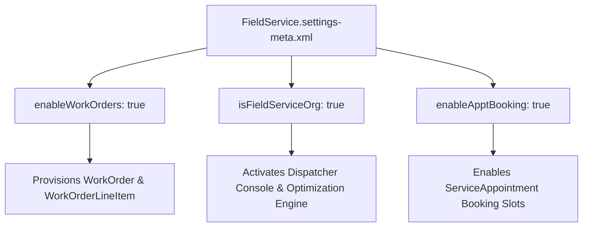

## Architectural Overview

`FieldServiceSettings` is a critical org-level settings metadata type that activates and governs the Salesforce Field Service (formerly FSL) platform engine. Field Service coordinates complex mobile workforce operations—including work order management, real-time dispatcher scheduling consoles, appointment booking algorithms, and mobile inventory tracking.

From a metadata and DevOps architecture standpoint, `FieldServiceSettings` serves as a prerequisite gateway. When `enableWorkOrders` is set to `true`, the Salesforce platform automatically provisions foundational standard schema tables: `WorkOrder`, `WorkOrderLineItem`, and `ServiceAppointment`. If an enterprise CI/CD pipeline attempts to compile custom Apex triggers, Flows, or custom fields referencing these objects before `FieldServiceSettings` is deployed, the deployment will fail immediately with compilation errors.



Enterprise architects must ensure `FieldServiceSettings` is committed to version control and integrated into base scratch org definition templates to guarantee parity between local developer environments and production.

## Directory and File Conventions

`FieldServiceSettings` follows standard Salesforce DX settings conventions in the `settings` directory:

| Property | Value |
| :--- | :--- |
| **Metadata Type Name** | `Settings` (member: `FieldService`) / `FieldServiceSettings` |
| **SFDX Folder** | `force-app/main/default/settings/` |
| **File Name** | `FieldService.settings-meta.xml` |
| **Scratch Org Setting Key** | `fieldServiceSettings` |

## Key Metadata Fields

The `FieldServiceSettings` XML schema exposes configuration toggles for work orders, appointment booking, and scheduling:

| Field Name | Field Type | Required | Architectural Description |
| :--- | :--- | :--- | :--- |
| `enableWorkOrders` | `boolean` | No | Enables the standard `WorkOrder` and `WorkOrderLineItem` database objects. |
| `isFieldServiceOrg` | `boolean` | No | Activates the core Field Service dispatch and scheduling platform engine. |
| `enableApptBooking` | `boolean` | No | Activates customer appointment booking windows and scheduling slots. |
| `enableServiceAppointments` | `boolean` | No | Activates the standard `ServiceAppointment` lifecycle records. |
| `enableWorkPlans` | `boolean` | No | Enables Work Plans and Work Steps for procedural technician guidance. |

## Declarative XML and Package Manifest Examples

Below is a declarative XML definition of `FieldService.settings-meta.xml` configured for an enterprise field operations org:

```xml title="force-app/main/default/settings/FieldService.settings-meta.xml"
<?xml version="1.0" encoding="UTF-8"?>
<FieldServiceSettings xmlns="http://soap.sforce.com/2006/04/metadata">
    <enableApptBooking>true</enableApptBooking>
    <enableServiceAppointments>true</enableServiceAppointments>
    <enableWorkOrders>true</enableWorkOrders>
    <enableWorkPlans>true</enableWorkPlans>
    <isFieldServiceOrg>true</isFieldServiceOrg>
</FieldServiceSettings>
```

### Scratch Org Configuration (`project-scratch-def.json`)

```json title="config/project-scratch-def.json"
{
  "orgName": "Field Service Dev Org",
  "edition": "Enterprise",
  "features": ["FieldService"],
  "settings": {
    "fieldServiceSettings": {
      "enableWorkOrders": true,
      "isFieldServiceOrg": true,
      "enableApptBooking": true,
      "enableServiceAppointments": true,
      "enableWorkPlans": true
    }
  }
}
```

### Package Manifest (`package.xml`)

```xml title="manifest/package.xml"
<?xml version="1.0" encoding="UTF-8"?>
<Package xmlns="http://soap.sforce.com/2006/04/metadata">
    <types>
        <members>FieldService</members>
        <name>Settings</name>
    </types>
    <version>68.0</version>
</Package>
```

## CLI Retrieval and Deployment Commands

Retrieve and deploy `FieldServiceSettings` using the Salesforce CLI:

```bash
# Retrieve Field Service settings from the org
sf project retrieve start --metadata Settings:FieldService

# Deploy Field Service settings to target environment
sf project deploy start --metadata Settings:FieldService

# Preview deployment impacts before applying
sf project deploy preview --metadata Settings:FieldService
```

## Architect Best Practices and Gotchas

- **Pipeline Phasing:** Deploy `Settings:FieldService` in Wave 0 of your CI/CD pipeline before compiling Apex classes, triggers, page layouts, or permission sets that reference `WorkOrder` or `ServiceAppointment`.
- **Scratch Org Feature Flag Pairing:** In scratch orgs, configuring `fieldServiceSettings` in `project-scratch-def.json` requires including `"FieldService"` in the `"features"` array to license the underlying platform features.
- **Irreversible Schema Activation:** Once `enableWorkOrders` is activated and `WorkOrder` records are created in production, Salesforce prevents disabling the feature if dependent custom code, validation rules, or records exist.

> [!NOTE]
> Activating `enableWorkPlans` provides guided step-by-step task execution for field technicians in the Field Service Mobile App.

> [!WARNING]
> Attempting to deploy code referencing `ServiceAppointment` to an org without `enableServiceAppointments` set to true will cause build-breaking compile failures.
