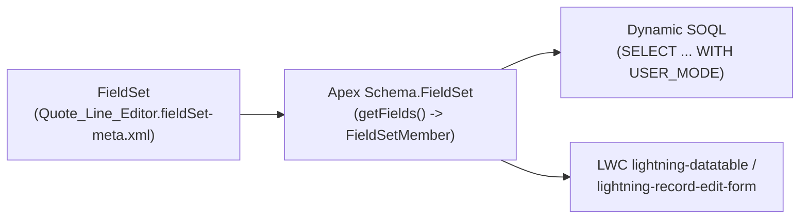

The `FieldSet` metadata type represents an administrator-configurable grouping of fields on a standard or custom object. Introduced in API version 21.0, `FieldSet` is one of the most versatile architectural patterns for building **zero-code-change UI and integration components**: developers write an [ApexClass](/docs/metadata/apex-class-metadata-type/) or [LightningComponentBundle](/docs/metadata/lightning-component-bundle-metadata-type/) once that reads a `FieldSet` by name, and administrators can add, remove, or reorder fields in Setup without modifying a single line of Apex or JavaScript.

In Salesforce DX projects, field sets live inside their parent object folder at `force-app/main/default/objects/<ObjectName>/fieldSets/<FieldSetName>.fieldSet-meta.xml`.



## Key Metadata Fields

| Field | Type | Required | Description |
|---|---|---|---|
| `fullName` | `string` | No | Developer API name of the field set |
| `label` | `string` | Yes | Display name in Object Manager -> Field Sets |
| `description` | `string` | Yes | **Required**. Explains to administrators where this field set is used (shown directly in the Setup drag-and-drop editor) |
| `displayedFields` | `FieldSetItem[]` | No | Ordered list of active fields (`field`, `isFieldManaged`, `isRequired`) |
| `availableFields` | `FieldSetItem[]` | No | Pool of optional fields exposed by managed packages for subscriber admins to drag into `displayedFields` |

## Production-Grade XML Example

Below is a `FieldSet` on `OpportunityLineItem` (`force-app/main/default/objects/OpportunityLineItem/fieldSets/Fast_Quote_Grid.fieldSet-meta.xml`) that includes both direct fields and a cross-object `Product2` relationship field:

```xml
<?xml version="1.0" encoding="UTF-8"?>
<FieldSet xmlns="http://soap.sforce.com/2006/04/metadata">
    <fullName>Fast_Quote_Grid</fullName>
    <availableFields>
        <field>Description</field>
        <isFieldManaged>false</isFieldManaged>
        <isRequired>false</isRequired>
    </availableFields>
    <description>Controls the columns displayed in the Fast Quote Grid LWC on the Opportunity record page.</description>
    <displayedFields>
        <field>Product2.Name</field>
        <isFieldManaged>true</isFieldManaged>
        <isRequired>false</isRequired>
    </displayedFields>
    <displayedFields>
        <field>Quantity</field>
        <isFieldManaged>false</isFieldManaged>
        <isRequired>true</isRequired>
    </displayedFields>
    <displayedFields>
        <field>UnitPrice</field>
        <isFieldManaged>false</isFieldManaged>
        <isRequired>true</isRequired>
    </displayedFields>
    <displayedFields>
        <field>Discount</field>
        <isFieldManaged>false</isFieldManaged>
        <isRequired>false</isRequired>
    </displayedFields>
    <label>Fast Quote Grid</label>
</FieldSet>
```

## Consuming `FieldSet` Dynamically in Apex for LWC

Here is a reusable Apex pattern that converts any `FieldSet` into `lightning-datatable` column metadata and executes a secure `WITH USER_MODE` dynamic SOQL query:

```java
public with sharing class DynamicFieldSetController {
    public class FieldMemberDTO {
        @AuraEnabled public String fieldPath;
        @AuraEnabled public String label;
        @AuraEnabled public String type;
        @AuraEnabled public Boolean required;
    }

    @AuraEnabled(cacheable=true)
    public static List<FieldMemberDTO> getFieldSetMetadata(String objectApiName, String fieldSetName) {
        Schema.SObjectType targetType = Schema.getGlobalDescribe().get(objectApiName);
        Schema.FieldSet fs = targetType.getDescribe().fieldSets.getMap().get(fieldSetName);
        List<FieldMemberDTO> result = new List<FieldMemberDTO>();

        for (Schema.FieldSetMember member : fs.getFields()) {
            FieldMemberDTO dto = new FieldMemberDTO();
            dto.fieldPath = member.getFieldPath();
            dto.label = member.getLabel();
            dto.type = String.valueOf(member.getType());
            dto.required = member.getRequired() || member.getDbRequired();
            result.add(dto);
        }
        return result;
    }
}
```

> [!TIP]
> **`isFieldManaged` in Managed Packages**: When authoring an ISV managed package, setting `<isFieldManaged>true</isFieldManaged>` on a `<displayedFields>` entry locks that field so subscriber administrators cannot remove it from the FieldSet, while still allowing them to append their own custom fields after it.

