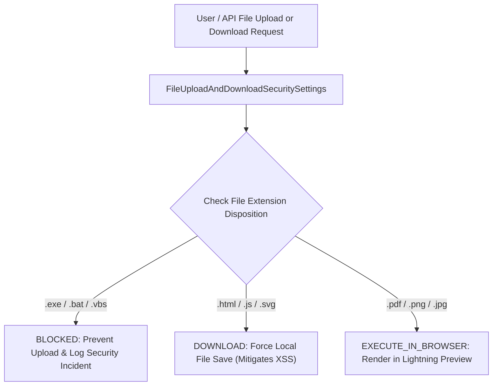

## Architectural Overview

`FileUploadAndDownloadSecuritySettings` is a critical security governance metadata type that regulates how Salesforce handles uploaded files, document attachments, and browser downloads. In enterprise Salesforce deployments, users, automated integrations, and external Experience Cloud community members upload millions of files annually. Unrestricted file handling introduces severe threat vectors—including Cross-Site Scripting (XSS), ransomware distribution, and malware execution.

This metadata type allows enterprise security architects to enforce defense-in-depth file security policies. Administrators can mandate explicit dispositions for specific file extensions: blocking high-risk executable binaries entirely (`BLOCKED`), forcing safe local downloads without in-browser rendering (`DOWNLOAD`), or permitting controlled browser execution (`EXECUTE_IN_BROWSER`) only for trusted formats.



Managing this configuration in version control guarantees that all scratch orgs, sandboxes, and production orgs strictly comply with corporate cybersecurity standards and SOC2/ISO-27001 compliance frameworks.

## Directory and File Conventions

`FileUploadAndDownloadSecuritySettings` follows standard Salesforce DX settings conventions in the `settings` directory:

| Property | Value |
| :--- | :--- |
| **Metadata Type Name** | `Settings` (member: `FileUploadAndDownloadSecurity`) / `FileUploadAndDownloadSecuritySettings` |
| **SFDX Folder** | `force-app/main/default/settings/` |
| **File Name** | `FileUploadAndDownloadSecurity.settings-meta.xml` |
| **Scratch Org Setting Key** | `fileUploadAndDownloadSecuritySettings` |

## Key Metadata Fields

The `FileUploadAndDownloadSecuritySettings` XML schema defines file disposition rules and upload safeguards:

| Field Name | Field Type | Required | Architectural Description |
| :--- | :--- | :--- | :--- |
| `dispositions` | `list` | No | File extension mapping defining security behavior: `DOWNLOAD`, `EXECUTE_IN_BROWSER`, or `HYBRID`. |
| `noHtmlUploadAsAttachment` | `boolean` | No | Prevents users from uploading potentially malicious HTML/JS files as email attachments. |

Each entry in `dispositions` contains:
- `fileExtension`: The target file extension (e.g., `html`, `pdf`, `exe`).
- `behavior`: Security disposition (`DOWNLOAD`, `EXECUTE_IN_BROWSER`, or `HYBRID`).

## Declarative XML and Package Manifest Examples

Below is a declarative XML definition of `FileUploadAndDownloadSecurity.settings-meta.xml` configured according to enterprise security best practices:

```xml title="force-app/main/default/settings/FileUploadAndDownloadSecurity.settings-meta.xml"
<?xml version="1.0" encoding="UTF-8"?>
<FileUploadAndDownloadSecuritySettings xmlns="http://soap.sforce.com/2006/04/metadata">
    <dispositions>
        <behavior>DOWNLOAD</behavior>
        <fileExtension>html</fileExtension>
    </dispositions>
    <dispositions>
        <behavior>DOWNLOAD</behavior>
        <fileExtension>htm</fileExtension>
    </dispositions>
    <dispositions>
        <behavior>DOWNLOAD</behavior>
        <fileExtension>svg</fileExtension>
    </dispositions>
    <dispositions>
        <behavior>EXECUTE_IN_BROWSER</behavior>
        <fileExtension>pdf</fileExtension>
    </dispositions>
    <noHtmlUploadAsAttachment>true</noHtmlUploadAsAttachment>
</FileUploadAndDownloadSecuritySettings>
```

### Scratch Org Configuration (`project-scratch-def.json`)

```json title="config/project-scratch-def.json"
{
  "orgName": "Security Hardened Dev Org",
  "edition": "Enterprise",
  "settings": {
    "fileUploadAndDownloadSecuritySettings": {
      "noHtmlUploadAsAttachment": true
    }
  }
}
```

### Package Manifest (`package.xml`)

```xml title="manifest/package.xml"
<?xml version="1.0" encoding="UTF-8"?>
<Package xmlns="http://soap.sforce.com/2006/04/metadata">
    <types>
        <members>FileUploadAndDownloadSecurity</members>
        <name>Settings</name>
    </types>
    <version>68.0</version>
</Package>
```

## CLI Retrieval and Deployment Commands

Manage file security settings with the Salesforce CLI:

```bash
# Retrieve file security settings from the target org
sf project retrieve start --metadata Settings:FileUploadAndDownloadSecurity

# Deploy file security settings to production
sf project deploy start --metadata Settings:FileUploadAndDownloadSecurity

# Preview file security settings deployment
sf project deploy preview --metadata Settings:FileUploadAndDownloadSecurity
```

## Architect Best Practices and Gotchas

- **Preventing Stored XSS via HTML/SVG:** Files with extensions like `.html`, `.htm`, and `.svg` can contain executable JavaScript. Always configure these extensions to `DOWNLOAD` rather than `EXECUTE_IN_BROWSER` to prevent malicious scripts from accessing session tokens or DOM objects.
- **Email Attachment Hardening:** Always set `noHtmlUploadAsAttachment` to `true`. This prevents social engineering attacks where malicious actors upload weaponized HTML attachments to outbound customer service emails.
- **Third-Party Antivirus Pairing:** While `FileUploadAndDownloadSecuritySettings` enforces browser execution boundaries, it does not scan file payloads for binary viruses. Combine this setting with a certified Salesforce AppExchange antivirus integration or AWS Lambda ICAP scanner.

> [!NOTE]
> Setting a file extension to `DOWNLOAD` forces the browser to set the `Content-Disposition: attachment` HTTP header, preventing inline browser script execution.

> [!WARNING]
> Permitting `.html` or `.svg` files to execute in the browser (`EXECUTE_IN_BROWSER`) creates critical security vulnerabilities and will trigger compliance audit failures.
