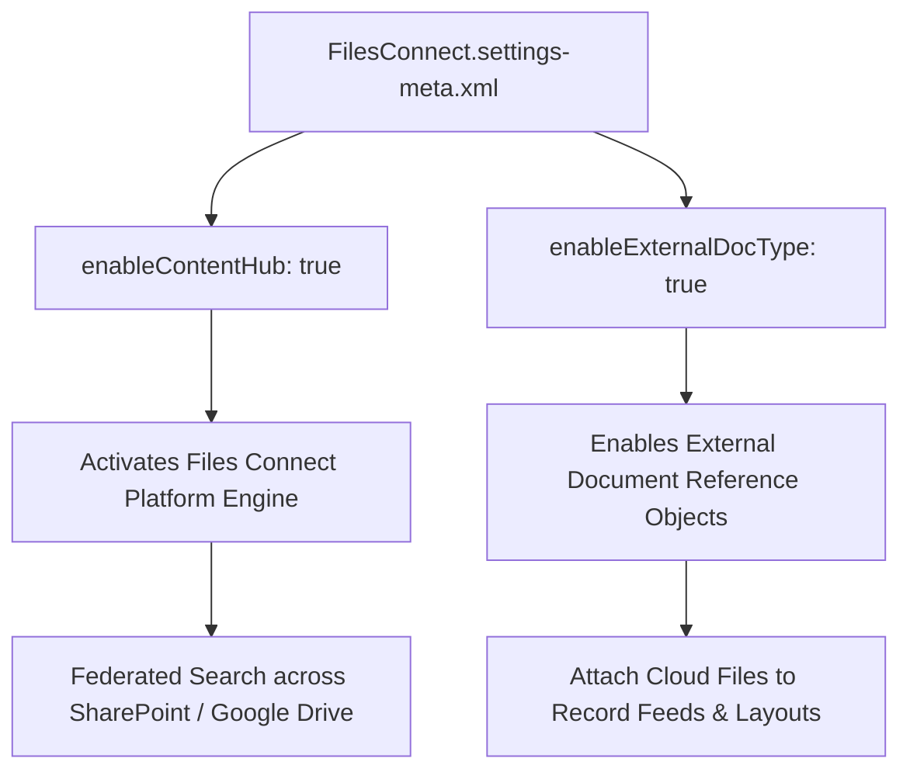

## Architectural Overview

`FilesConnectSettings` is an org-level settings metadata type that governs the Salesforce Files Connect platform engine. In enterprise IT landscapes, critical unstructured business documentation—such as CAD diagrams, executed legal contracts, and financial spreadsheets—typically resides in corporate content repositories such as Microsoft SharePoint, OneDrive, Google Drive, or Box.

Migrating terabytes of legacy documents directly into Salesforce ContentVersion storage is financially prohibitive and creates governance sprawl. Salesforce Files Connect provides a federated content integration architecture. `FilesConnectSettings` enables the org to index, search, and attach external repository documents directly to standard and custom Salesforce records via federated queries without duplicating files or consuming Salesforce file storage quotas.



Enterprise architects must include `FilesConnectSettings` in foundational org configuration deployments to ensure that scratch orgs and staging environments support external document linking components and test automation.

## Directory and File Conventions

`FilesConnectSettings` follows standard Salesforce DX settings conventions in the `settings` directory:

| Property | Value |
| :--- | :--- |
| **Metadata Type Name** | `Settings` (member: `FilesConnect`) / `FilesConnectSettings` |
| **SFDX Folder** | `force-app/main/default/settings/` |
| **File Name** | `FilesConnect.settings-meta.xml` |
| **Scratch Org Setting Key** | `filesConnectSettings` |

## Key Metadata Fields

The `FilesConnectSettings` XML schema includes the following architectural flags:

| Field Name | Field Type | Required | Architectural Description |
| :--- | :--- | :--- | :--- |
| `enableContentHub` | `boolean` | No | Master flag that activates the Salesforce Files Connect (formerly Content Hub) platform engine. |
| `enableExternalDocType` | `boolean` | No | Enables external document reference types for federated search and linking. |
| `enableFileSharing` | `boolean` | No | Authorizes users to share external cloud documents directly within Salesforce feeds and groups. |

## Declarative XML and Package Manifest Examples

Below is a declarative XML definition of `FilesConnect.settings-meta.xml` configured for an enterprise cloud content integration:

```xml title="force-app/main/default/settings/FilesConnect.settings-meta.xml"
<?xml version="1.0" encoding="UTF-8"?>
<FilesConnectSettings xmlns="http://soap.sforce.com/2006/04/metadata">
    <enableContentHub>true</enableContentHub>
    <enableExternalDocType>true</enableExternalDocType>
    <enableFileSharing>true</enableFileSharing>
</FilesConnectSettings>
```

### Scratch Org Configuration (`project-scratch-def.json`)

```json title="config/project-scratch-def.json"
{
  "orgName": "Files Connect Dev Org",
  "edition": "Enterprise",
  "features": ["FilesConnect"],
  "settings": {
    "filesConnectSettings": {
      "enableContentHub": true,
      "enableExternalDocType": true,
      "enableFileSharing": true
    }
  }
}
```

### Package Manifest (`package.xml`)

```xml title="manifest/package.xml"
<?xml version="1.0" encoding="UTF-8"?>
<Package xmlns="http://soap.sforce.com/2006/04/metadata">
    <types>
        <members>FilesConnect</members>
        <name>Settings</name>
    </types>
    <version>68.0</version>
</Package>
```

## CLI Retrieval and Deployment Commands

Manage `FilesConnectSettings` with the Salesforce CLI:

```bash
# Retrieve Files Connect settings from the org
sf project retrieve start --metadata Settings:FilesConnect

# Deploy Files Connect settings to target environment
sf project deploy start --metadata Settings:FilesConnect

# Deploy all foundational settings concurrently
sf project deploy start --source-dir force-app/main/default/settings
```

## Architect Best Practices and Gotchas

- **Prerequisite for External Data Sources:** Deploy `Settings:FilesConnect` prior to deploying `ExternalDataSource` metadata that uses the `ContentHub` or SharePoint connectors. Attempting to deploy an external data source without enabling Files Connect will throw missing capability errors.
- **Zero-Storage Impact:** When users link external files through Files Connect, Salesforce creates lightweight reference pointers rather than copying binary data. This preserves Salesforce File Storage capacity while retaining native preview and sharing capabilities.
- **Permission Set Licensing:** Activating `enableContentHub` enables the platform engine, but individual users must be assigned the "Files Connect Cloud" or "Files Connect On-Premise" Permission Set License (PSL) to search and link external files.

> [!TIP]
> Ensure user authentication to external repositories (e.g. Microsoft Entra ID) is configured via Named Credentials or OpenID Connect Auth Providers for seamless SSO.

> [!WARNING]
> Disabling `enableContentHub` in an active production org will immediately hide all external document links and disrupt user access to linked cloud files across record pages.
