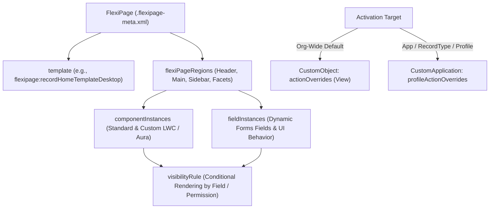

## Overview

The `FlexiPage` metadata type (`flexipages/<PageName>.flexipage-meta.xml`) represents a **Lightning Page** designed in Lightning App Builder or Experience Builder. A `FlexiPage` defines a layout template (`flexipage:recordHomeTemplateDesktop`), regions (`flexiPageRegions`), standard and custom [LightningComponentBundle](/docs/metadata/lightning-component-bundle-metadata-type/) instances (`componentInstances`), Dynamic Forms field sections (`fieldInstances`), Dynamic Highlights Panels, and conditional component visibility filters (`visibilityRule`).

In modern Lightning Experience architecture, `FlexiPage` with **Dynamic Forms** and **Dynamic Actions** supersedes traditional [Layout](/docs/metadata/layout-metadata-type/) metadata for record pages: instead of creating dozens of page layouts and record types to show or hide fields based on record status, you use a single `FlexiPage` with declarative `<visibilityRule>` criteria on individual fields and sections.



As shown in the diagram above, a `FlexiPage` organizes `componentInstances` and Dynamic Forms `fieldInstances` inside `flexiPageRegions` with granular `visibilityRule` filters, while **page activation** is stored separately in `CustomObject` or `CustomApplication` metadata.

## Prerequisites

- **Permissions:** "Customize Application" and "View Setup and Configuration" permissions.
- **Referenced Components:** Every LWC (`c:componentName`), custom field, quick action, or custom permission referenced in a `FlexiPage` must exist in the target org or be deployed in the same transaction.
- **API Version:** Introduced in API version 29.0. Verified against API version `68.0` (Winter '27).

## Key FlexiPage XML Elements

| XML Element | Required | Purpose & Architectural Notes |
| :--- | :--- | :--- |
| `masterLabel` | ✅ Yes | Display name of the Lightning Page in Setup and Lightning App Builder. |
| `type` | ✅ Yes | Page category: `RecordPage`, `AppPage`, `HomePage`, `UtilityBar`, `CommRecordPage`, `QuickAction` (Beta in v68.0). |
| `sobjectType` | Conditional | **Required** when `type` is `RecordPage` (`Account`, `Invoice__c`). Cannot be changed after creation. `null` for `AppPage` and `HomePage`. |
| `template` | ✅ Yes | Defines the region grid (`flexipage:recordHomeTemplateDesktop`, `flexipage:appHomeTemplateHeaderTwoColumns`). |
| `flexiPageRegions` | No | Named layout containers (`header`, `main`, `sidebar`, or UUID `Facet` regions for Tabs, Accordions, and Dynamic Forms Field Sections). |
| `itemInstances` | No | Contains either a `<componentInstance>` (an LWC/Aura widget) or a `<fieldInstance>` (a Dynamic Forms field). |
| `visibilityRule` | No | `UiFormulaRule` containing `<criteria>` (`leftValue`, `operator`, `rightValue`) and `<booleanFilter>` (`1 AND 2`) for conditional display. |

> [!NOTE]
> Simply deploying `Invoice_Record_Page.flexipage-meta.xml` **does not activate** the page for users. To deploy activation:
> - **Org Default:** Deploy the `<actionOverrides>` block (`<actionName>View</actionName>`, `<type>Flexipage</type>`) in [CustomObject](/docs/metadata/custom-object-metadata-type/).
> - **App Default or App + Record Type + Profile:** Deploy the `<profileActionOverrides>` block inside `CustomApplication` (`.app-meta.xml`).

## Querying FlexiPage via Tooling API

The `FlexiPage` object is queryable via the **Tooling API** (`sf data query --use-tooling-api`).

### 1. List All Record Pages and Their Target Objects (Tooling API)
```soql
SELECT Id, DeveloperName, MasterLabel, Type,
       EntityDefinition.QualifiedApiName, Description, LastModifiedDate, LastModifiedBy.Name
FROM FlexiPage
WHERE Type = 'RecordPage'
  AND ManageableState = 'unmanaged'
ORDER BY EntityDefinition.QualifiedApiName ASC, DeveloperName ASC
```

### 2. Audit Utility Bar and App Pages Across the Org (Tooling API)
```soql
SELECT Id, DeveloperName, MasterLabel, Type, LastModifiedDate
FROM FlexiPage
WHERE Type IN ('AppPage', 'HomePage', 'UtilityBar')
ORDER BY Type ASC, DeveloperName ASC
```

## Example

The following `Invoice_Record_Page.flexipage-meta.xml` configures a Lightning `RecordPage` for `Invoice__c` with a Highlights Panel in the header and our custom `c:invoiceSummary` LWC in the main region, rendered conditionally only when `Total_Amount__c >= 10000`.

```xml title="force-app/main/default/flexipages/Invoice_Record_Page.flexipage-meta.xml"
<?xml version="1.0" encoding="UTF-8"?>
<FlexiPage xmlns="http://soap.sforce.com/2006/04/metadata">
    <description>Primary Lightning Record Page for Invoice__c with conditional high-value summary card.</description>
    <flexiPageRegions>
        <itemInstances>
            <componentInstance>
                <componentInstanceProperties>
                    <name>collapsed</name>
                    <value>false</value>
                </componentInstanceProperties>
                <componentName>force:highlightsPanel</componentName>
                <identifier>force_highlightsPanel</identifier>
            </componentInstance>
        </itemInstances>
        <name>header</name>
        <type>Region</type>
    </flexiPageRegions>
    <flexiPageRegions>
        <itemInstances>
            <componentInstance>
                <componentInstanceProperties>
                    <name>maxRows</name>
                    <value>10</value>
                </componentInstanceProperties>
                <componentInstanceProperties>
                    <name>showOverdueOnly</name>
                    <value>true</value>
                </componentInstanceProperties>
                <componentName>c:invoiceSummary</componentName>
                <identifier>c_invoiceSummary_highValue</identifier>
                <visibilityRule>
                    <criteria>
                        <leftValue>{!Record.Total_Amount__c}</leftValue>
                        <operator>GE</operator>
                        <rightValue>10000</rightValue>
                    </criteria>
                </visibilityRule>
            </componentInstance>
        </itemInstances>
        <name>main</name>
        <type>Region</type>
    </flexiPageRegions>
    <masterLabel>Invoice Record Page</masterLabel>
    <sobjectType>Invoice__c</sobjectType>
    <template>
        <name>flexipage:recordHomeSingleColTemplateDesktop</name>
    </template>
    <type>RecordPage</type>
</FlexiPage>
```

Deploy the `FlexiPage` alongside the `CustomObject` view override to activate it in a single CLI command:

```bash
sf project deploy start \
  --metadata FlexiPage:Invoice_Record_Page CustomObject:Invoice__c \
  --target-org UATSandbox
```

## Limits and Gotchas

- **`identifier` Uniqueness (API v53.0+):** Every `<componentInstance>` on a `FlexiPage` requires a unique `<identifier>` (≤120 characters) within that page. Duplicate identifiers cause deployment errors when hand-copying XML blocks.
- **Maximum Components Warning:** Pages with more than 25–30 complex components degrade client-side Largest Contentful Paint (LCP). Place heavy related lists or custom LWCs inside non-default tabs (`flexipage:tabset`) so Salesforce lazy-loads them only when the user clicks the tab.
- **Namespace Prefix Retention:** Always keep managed package namespace prefixes on fields (`ns__Field__c`) inside Dynamic Forms `<fieldInstance>` and `<visibilityRule>` nodes to avoid name collisions.

## Related Official Documentation

- [FlexiPage Metadata API Reference](https://developer.salesforce.com/docs/atlas.en-us.api_meta.meta/api_meta/meta_flexipage.htm): Complete XML specification for `FlexiPage`, `ComponentInstance`, and `UiFormulaRule`.
- [FlexiPage Tooling API Object](https://developer.salesforce.com/docs/atlas.en-us.api_tooling.meta/api_tooling/tooling_api_objects_flexipage.htm): Querying Lightning pages via Tooling API.
