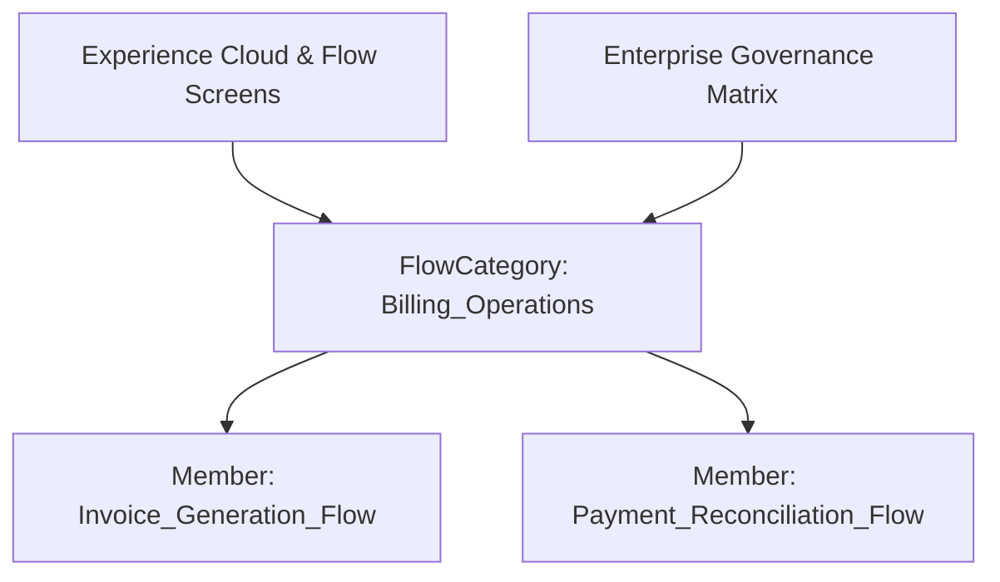

## Architectural Overview

The `FlowCategory` metadata type provides enterprise architects and administrators with a structured mechanism for categorizing and grouping business processes in Salesforce. As enterprise orgs scale to hundreds of screen flows, autolaunched flows, and subflows, organizing these automation assets into functional business domains (such as Billing, Identity Verification, and Order Processing) becomes essential for governance, delegated administration, and runtime discoverability.

In enterprise application architectures, `FlowCategory` enables clean decoupling between underlying flow definitions and the higher-level catalog presentations exposed in digital experience portals, service consoles, and Flow management dashboards. Grouping flows into distinct categories simplifies metadata auditing and helps release engineers identify which business capabilities are impacted during changes.



## Directory and File Conventions

In Salesforce DX source format (`apiVersion` 68.0), `FlowCategory` metadata files are located in the `flowCategories/` directory within your package directory.

| Property | Value |
| :--- | :--- |
| **Metadata Type Name** | `FlowCategory` |
| **SFDX Folder** | `force-app/main/default/flowCategories/` |
| **File Suffix** | `.flowCategory-meta.xml` |
| **XML Root Element** | `<FlowCategory xmlns="http://soap.sforce.com/2006/04/metadata">` |

## Key Metadata Fields

The `FlowCategory` metadata descriptor encapsulates administrative metadata and member flow references:

| Field Name | Field Type | Required | Description |
| :--- | :--- | :--- | :--- |
| `masterLabel` | `string` | Yes | Human-readable title displayed in administration views and runtime navigation panels. |
| `description` | `string` | No | Architectural summary detailing the functional purpose and scope of the flow category. |
| `flows` | `string[]` | No | Repeating array containing the developer names of all child flows assigned to this category. |

> [!NOTE]
> Flow member developer names referenced in the `flows` array must match existing [Flow](/docs/metadata/flow-metadata-type/) metadata components in the target environment or be bundled within the same deployment manifest.

## Declarative XML and Package Manifest Examples

Below is an enterprise XML definition demonstrating a categorized group of customer onboarding workflows:

```xml title="force-app/main/default/flowCategories/Customer_Onboarding.flowCategory-meta.xml"
<?xml version="1.0" encoding="UTF-8"?>
<FlowCategory xmlns="http://soap.sforce.com/2006/04/metadata">
    <masterLabel>Customer Onboarding</masterLabel>
    <description>Enterprise customer verification and initial billing account activation flows.</description>
    <flows>Customer_Identity_Verification</flows>
    <flows>Account_Provisioning_Subflow</flows>
</FlowCategory>
```

### Package Manifest (`package.xml`)

```xml title="manifest/package.xml"
<?xml version="1.0" encoding="UTF-8"?>
<Package xmlns="http://soap.sforce.com/2006/04/metadata">
    <types>
        <members>Customer_Onboarding</members>
        <name>FlowCategory</name>
    </types>
    <version>68.0</version>
</Package>
```

## CLI Retrieval and Deployment Commands

Retrieve and deploy `FlowCategory` definitions using modern Salesforce CLI commands:

```bash
# Retrieve all flow categories from the target scratch org or sandbox
sf project retrieve start --metadata FlowCategory

# Deploy a specific flow category alongside its referenced flows
sf project deploy start --metadata FlowCategory:Customer_Onboarding --metadata Flow:Customer_Identity_Verification
```

## Architect Best Practices and Gotchas

- **Strict Dependency Management:** A deployment containing a `FlowCategory` will fail if any flow name specified inside the `<flows>` tag does not already exist in the target org or is not included in the same deployment payload.
- **De-coupling from Flow Activation:** Deploying a `FlowCategory` does not activate or deactivate member flows. Activation status is governed strictly by the individual [Flow](/docs/metadata/flow-metadata-type/) metadata record.
- **Granular CI/CD Delta Packaging:** In CI/CD pipelines using git-delta diffing, ensure that modifying a flow name updates all corresponding `FlowCategory` metadata files to prevent orphan metadata references.

> [!TIP]
> Use `FlowCategory` to establish clear ownership boundaries across multi-team development pods, aligning categories to domain-driven design bounded contexts.
