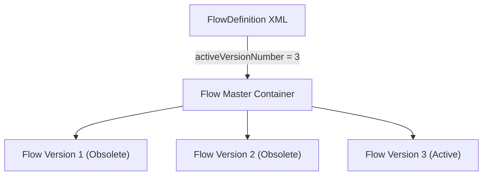

## Architectural Overview

`FlowDefinition` was historically the primary metadata mechanism used to govern the active version pointer and high-level description of a Salesforce Flow. Before Salesforce introduced versionless flow deployments in modern source format, every Flow definition generated an accompanying `FlowDefinition` metadata file to specify which numeric version (`activeVersionNumber`) was actively executing in the organization.

In modern Salesforce DX architectures running on API version 68.0, the platform natively tracks active status directly inside the [Flow](/docs/metadata/flow-metadata-type/) metadata file via the `<status>Active</status>` element. However, architects maintaining legacy managed packages, classic metadata deployments, or upgrading older codebases still encounter `FlowDefinition` files. Understanding how the Metadata API reconciles `FlowDefinition` with underlying versioned Flow records remains critical for automated CI/CD migrations.



## Directory and File Conventions

When working with legacy metadata format or specific package scenarios, `FlowDefinition` resides in the `flowDefinitions/` folder.

| Property | Value |
| :--- | :--- |
| **Metadata Type Name** | `FlowDefinition` |
| **SFDX Folder** | `force-app/main/default/flowDefinitions/` |
| **File Suffix** | `.flowDefinition-meta.xml` |
| **XML Root Element** | `<FlowDefinition xmlns="http://soap.sforce.com/2006/04/metadata">` |

## Key Metadata Fields

The XML schema for `FlowDefinition` exposes the following version pointer fields:

| Field Name | Field Type | Required | Description |
| :--- | :--- | :--- | :--- |
| `activeVersionNumber` | `integer` | No | Indicates the specific version number of the flow that is currently active and executable in the org. |
| `description` | `string` | No | Explanatory description describing the flow purpose across all versions. |
| `masterLabel` | `string` | No | Display label of the flow process container. |

> [!NOTE]
> Setting `activeVersionNumber` to `0` or omitting the tag completely deactivates the flow across the target environment.

## Declarative XML and Package Manifest Examples

Below is a declarative `FlowDefinition` file pointing to version 2 of an order processing flow:

```xml title="force-app/main/default/flowDefinitions/Order_Fulfillment_Process.flowDefinition-meta.xml"
<?xml version="1.0" encoding="UTF-8"?>
<FlowDefinition xmlns="http://soap.sforce.com/2006/04/metadata">
    <activeVersionNumber>2</activeVersionNumber>
    <description>Enterprise order validation and warehouse dispatch flow orchestration.</description>
    <masterLabel>Order Fulfillment Process</masterLabel>
</FlowDefinition>
```

### Package Manifest (`package.xml`)

```xml title="manifest/package.xml"
<?xml version="1.0" encoding="UTF-8"?>
<Package xmlns="http://soap.sforce.com/2006/04/metadata">
    <types>
        <members>Order_Fulfillment_Process</members>
        <name>FlowDefinition</name>
    </types>
    <version>68.0</version>
</Package>
```

## CLI Retrieval and Deployment Commands

You can retrieve and deploy `FlowDefinition` components using the Salesforce CLI:

```bash
# Retrieve a specific FlowDefinition from the target org
sf project retrieve start --metadata FlowDefinition:Order_Fulfillment_Process

# Deploy the FlowDefinition to toggle the active version
sf project deploy start --metadata FlowDefinition:Order_Fulfillment_Process
```

## Architect Best Practices and Gotchas

- **Modern Architecture Recommendation:** Avoid introducing new `FlowDefinition` files in modern SFDX projects. Manage activation status directly on the [Flow](/docs/metadata/flow-metadata-type/) metadata record and enable `enableFlowDeployAsActive` in `FlowSettings`.
- **Target Org Version Desynchronization:** If your `FlowDefinition` declares `<activeVersionNumber>4</activeVersionNumber>`, but the deployment target org only has versions 1 and 2 deployed, the entire deployment will fail.
- **Source Tracking Conflicts:** Having both `FlowDefinition` and `<status>Active</status>` in the `Flow` file can cause source conflict warnings during `sf project deploy start`. Remove `flowDefinitions/` when upgrading legacy projects.

> [!WARNING]
> Deploying a `FlowDefinition` that rolls back `activeVersionNumber` to an older version can cause runtime errors if intervening database schema or Apex invocable methods were deleted.
