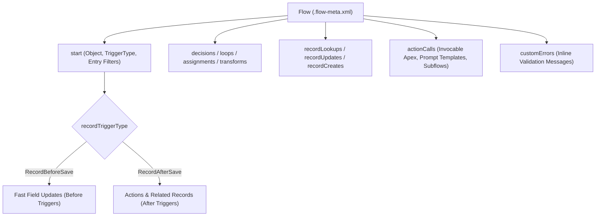

## Overview

The `Flow` metadata type represents the structure, nodes, variables, entry conditions, and runtime configuration of a Salesforce Flow (`flows/<FlowName>.flow-meta.xml`). It powers Screen Flows (`Flow`), Record-Triggered and Autolaunched Flows (`AutoLaunchedFlow`), Schedule-Triggered Flows, Platform Event–Triggered Flows, Data Cloud Segment-Triggered Flows, and Flow Orchestrations (`Orchestrator`).

When managing `Flow` metadata in Git and CI/CD pipelines, always use API version `44.0` or higher (current `68.0`) so that flow files do not include hard-coded version numbers (such as `MyFlow-3.flow-meta.xml`). Every deployment of `MyFlow.flow-meta.xml` automatically creates a new flow version in the target org and activates it if `<status>Active</status>` is set.



As shown in the diagram above, a `Flow` XML definition starts at the `<start>` node (which defines whether a record-triggered flow runs `RecordBeforeSave` or `RecordAfterSave`), routes through logic nodes (`decisions`, `loops`, `transforms`), executes database operations (`recordLookups`, `recordUpdates`), and can throw inline validation errors via `customErrors`.

## Prerequisites

- **Permissions:** "Manage Flow" and "Modify Metadata Through Metadata API Functions" permissions to deploy; "Run Flows" or explicit `flowAccesses` in a [PermissionSet](/docs/metadata/permission-set-metadata-type/) to execute restricted flows.
- **Production Active Deployment Setting:** Enable **Deploy processes and flows as active** in **Setup → Process Automation Settings** to deploy active autolaunched flows to Production.
- **API Version:** Verified against API version `68.0` (Winter '27).

## Key Flow XML Elements for Architects

| XML Element | Type | Architectural Purpose & Best Practice |
| :--- | :--- | :--- |
| `apiVersion` | `double` | Pins runtime behavior (`68.0`). Always upgrade older flows to gain bulkification improvements and reactive Screen Flow features. |
| `processType` | `FlowProcessType` | `Flow` (Screen Flow), `AutoLaunchedFlow` (Record/Schedule/Platform Event/Subflow), `Orchestrator`, or `PromptFlow`. |
| `status` | `FlowVersionStatus` | `Active`, `Draft`, `Obsolete`, or `InvalidDraft`. Set `Active` in version control so CI/CD activates the new version on deploy. |
| `runInMode` | `FlowRunInMode` | Controls sharing and CRUD/FLS context: `DefaultMode` (respects user context), `SystemModeWithSharing`, or `SystemModeWithoutSharing`. |
| `triggerOrder` | `int` | Integer (`1`–`2000`) controlling deterministic execution order for Record-Triggered Flows on the same object. |
| `start` | `FlowStart` | Defines entry conditions (`filters`), `object`, `recordTriggerType` (`Create`, `Update`, `CreateAndUpdate`, `Delete`), and `triggerType` (`RecordBeforeSave`, `RecordAfterSave`, `Scheduled`, `PlatformEvent`). |
| `customErrors` | `FlowCustomError[]` | ReplacesApex `addError()` by displaying custom field-level or page-level validation errors and rolling back the transaction. |
| `transforms` | `FlowTransform[]` | High-performance declarative data mapping and aggregation node that avoids explicit `loops` over collections. |

> [!RELEASE] Winter '27
> API version `68.0` introduces `<ends>` (`FlowEnd[]`) and `<groups>` (`FlowNodeGroup[]`) elements in Flow XML metadata, allowing canvas element grouping and explicit terminal end nodes.

## Querying Flows via SOQL and Tooling API

Salesforce provides `FlowDefinitionView` and `FlowVersionView` in **standard SOQL** for fast runtime auditing, alongside `Flow` and `FlowTestCoverage` in the **Tooling API**.

### 1. Audit All Active Record-Triggered Flows and Execution Order on an Object (Standard SOQL)
Use `FlowDefinitionView` to see every active automation running on `Account` or any object, including whether it runs Before Save or After Save:

```soql
SELECT ApiName, Label, ProcessType, TriggerType,
       TriggerObjectOrEvent.QualifiedApiName, TriggerOrder,
       ActiveVersionId, LatestVersionId, LastModifiedBy, LastModifiedDate
FROM FlowDefinitionView
WHERE IsActive = true
  AND TriggerObjectOrEvent.QualifiedApiName = 'Account'
ORDER BY TriggerType ASC, TriggerOrder ASC NULLS LAST
```

### 2. Find Flows Running in System Mode Without Sharing (Security Audit via Tooling API)
Execute with `sf data query --use-tooling-api` to identify flows that bypass record-level sharing rules and CRUD/FLS:

```soql
SELECT Id, Definition.DeveloperName, VersionNumber, Status,
       ProcessType, RunInMode, ApiVersion
FROM Flow
WHERE Status = 'Active'
  AND RunInMode = 'SystemModeWithoutSharing'
ORDER BY Definition.DeveloperName ASC
```

### 3. Check Flow Test Coverage Before Production Deployment (Tooling API)
When **Deploy processes and flows as active** is enabled in Production, Salesforce requires test coverage on active autolaunched flows. Query `FlowTestCoverage` via Tooling API to inspect element coverage:

```soql
SELECT FlowVersionId, NumElementsCovered, NumElementsNotCovered
FROM FlowTestCoverage
WHERE NumElementsNotCovered > 0
```

## Example

The following complete `Before_Save_Account_Default_Tier.flow-meta.xml` file defines an active **Fast Field Update (`RecordBeforeSave`)** Record-Triggered Flow on `Account` with `triggerOrder` set to `10`. When an Account is created or updated with `AnnualRevenue >= 1000000` and a blank `Rating`, it sets `Rating = 'Hot'` without consuming any DML statements.

```xml title="force-app/main/default/flows/Before_Save_Account_Default_Tier.flow-meta.xml"
<?xml version="1.0" encoding="UTF-8"?>
<Flow xmlns="http://soap.sforce.com/2006/04/metadata">
    <apiVersion>68.0</apiVersion>
    < assignments>
        <name>Set_Hot_Rating</name>
        <label>Set Hot Rating</label>
        <locationX>176</locationX>
        <locationY>287</locationY>
        <assignmentItems>
            <assignToReference>$Record.Rating</assignToReference>
            <operator>Assign</operator>
            <value>
                <stringValue>Hot</stringValue>
            </value>
        </assignmentItems>
    </assignments>
    <description>Elevates Account Rating to Hot before save when AnnualRevenue reaches $1M.</description>
    <environments>Default</environments>
    <interviewLabel>Before Save Account Default Tier {!$Flow.CurrentDateTime}</interviewLabel>
    <label>Before Save: Account Default Tier</label>
    <processMetadataValues>
        <name>BuilderType</name>
        <value>
            <stringValue>LightningFlowBuilder</stringValue>
        </value>
    </processMetadataValues>
    <processType>AutoLaunchedFlow</processType>
    <start>
        <locationX>50</locationX>
        <locationY>0</locationY>
        <connector>
            <targetReference>Set_Hot_Rating</targetReference>
        </connector>
        <filterLogic>and</filterLogic>
        <filters>
            <field>AnnualRevenue</field>
            <operator>GreaterThanOrEqualTo</operator>
            <value>
                <numberValue>1000000.0</numberValue>
            </value>
        </filters>
        <filters>
            <field>Rating</field>
            <operator>IsNull</operator>
            <value>
                <booleanValue>true</booleanValue>
            </value>
        </filters>
        <object>Account</object>
        <recordTriggerType>CreateAndUpdate</recordTriggerType>
        <triggerType>RecordBeforeSave</triggerType>
    </start>
    <status>Active</status>
    <triggerOrder>10</triggerOrder>
</Flow>
```

## Limits and Gotchas

- **50 Versions per Flow Limit:** A single Flow definition can have at most **50 saved versions** in an org. Once a flow hits 50 versions in a sandbox or production org, future deployments of that flow fail with `MAX_FLOW_VERSIONS_REACHED` until you delete inactive (`Obsolete` or `Draft`) versions via Tooling API.
- **2,000 Executed Elements Limit:** At runtime, a single Flow interview can execute at most **2,000 elements**. Avoid querying or updating records inside a `<loops>` element; use the `<transforms>` element or collection variables instead.
- **File Name Spaces:** Never include spaces in a Flow's `fullName` (`apiName`), as spaces cause deployment failures across Metadata API and CLI tools.
- **Never Edit Legacy Process Builder XML:** Flows whose `processType` is `Workflow` or `InvocableProcess` represent legacy Process Builder processes. Editing their XML manually corrupts them and prevents opening them in Setup.

## Related Official Documentation

- [Flow Metadata API Reference](https://developer.salesforce.com/docs/atlas.en-us.api_meta.meta/api_meta/meta_visual_workflow.htm): Complete schema for every Flow node, connector, and variable.
- [FlowDefinitionView Object Reference](https://developer.salesforce.com/docs/atlas.en-us.object_reference.meta/object_reference/sforce_api_objects_flowdefinitionview.htm): Standard SOQL reference for auditing active flows and trigger order.
- [Record-Triggered Automation Architect Guide](https://architect.salesforce.com/decision-guides/trigger-automation): Choosing between Record-Triggered Flows and Apex Triggers.
