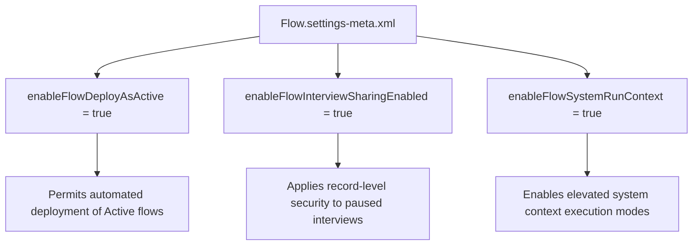

## Architectural Overview

`FlowSettings` is a vital organizational configuration file under the `Settings` metadata umbrella that governs core execution policies, security models, and deployment behaviors for Salesforce Flow. As Salesforce continues to consolidate declarative automation on Flow as the primary engine, configuring `FlowSettings` correctly in scratch org definitions and deployment pipelines is a cornerstone of enterprise CI/CD reliability.

One of the most consequential capabilities controlled by `FlowSettings` is `enableFlowDeployAsActive`. Without this setting enabled, automated deployment pipelines targeting test environments or production sandboxes deploy new flow versions in Draft status, breaking automated integration testing and requiring manual intervention.



## Directory and File Conventions

In Salesforce DX projects, `FlowSettings` is stored within the `settings/` folder as a single singleton file representing the `Flow` domain.

| Property | Value |
| :--- | :--- |
| **Metadata Type Name** | `Settings` (member: `Flow`) / `FlowSettings` |
| **SFDX Folder** | `force-app/main/default/settings/` |
| **File Name** | `Flow.settings-meta.xml` |
| **Scratch Org Setting Key** | `flowSettings` |

## Key Metadata Fields

The XML schema for `FlowSettings` provides several operational controls:

| Field Name | Field Type | Required | Description |
| :--- | :--- | :--- | :--- |
| `enableFlowDeployAsActive` | `boolean` | No | Allows flows with `<status>Active</status>` to be deployed directly into production and scratch orgs. |
| `enableFlowInterviewSharingEnabled` | `boolean` | No | Enforces sharing rules on paused flow interview records to prevent unauthorized resume operations. |
| `isFlowActiveSetting` | `boolean` | No | Specifies whether deploying flows as active is enabled organization-wide. |
| `enableFlowSystemRunContext` | `boolean` | No | Allows flows to execute in system context without sharing to bypass standard user permissions. |

> [!NOTE]
> Enabling `enableFlowDeployAsActive` requires production deployments to meet minimum Apex test execution thresholds for any Apex classes invoked by active flows.

## Declarative XML and Package Manifest Examples

Below is a production-hardened `Flow.settings-meta.xml` configuration for enterprise CI/CD pipelines:

```xml title="force-app/main/default/settings/Flow.settings-meta.xml"
<?xml version="1.0" encoding="UTF-8"?>
<FlowSettings xmlns="http://soap.sforce.com/2006/04/metadata">
    <enableFlowDeployAsActive>true</enableFlowDeployAsActive>
    <enableFlowInterviewSharingEnabled>true</enableFlowInterviewSharingEnabled>
    <isFlowActiveSetting>true</isFlowActiveSetting>
</FlowSettings>
```

### Scratch Org Configuration (`config/project-scratch-def.json`)

```json title="config/project-scratch-def.json"
{
  "orgName": "Enterprise Automation Scratch Org",
  "edition": "Enterprise",
  "settings": {
    "flowSettings": {
      "enableFlowDeployAsActive": true,
      "enableFlowInterviewSharingEnabled": true,
      "isFlowActiveSetting": true
    }
  }
}
```

### Package Manifest (`package.xml`)

```xml title="manifest/package.xml"
<?xml version="1.0" encoding="UTF-8"?>
<Package xmlns="http://soap.sforce.com/2006/04/metadata">
    <types>
        <members>Flow</members>
        <name>Settings</name>
    </types>
    <version>68.0</version>
</Package>
```

## CLI Retrieval and Deployment Commands

Manage `FlowSettings` using Salesforce CLI:

```bash
# Retrieve Flow settings from an org
sf project retrieve start --metadata Settings:Flow

# Deploy Flow settings to an automated scratch org
sf project deploy start --metadata Settings:Flow
```

## Architect Best Practices and Gotchas

- **Scratch Org Bootstrapping:** Always include `flowSettings` with `enableFlowDeployAsActive: true` in your `project-scratch-def.json` file. This prevents scratch org creation scripts from failing when deploying active record-triggered flows.
- **Apex Test Requirements:** When deploying active flows to production, Salesforce enforces that test classes achieve code coverage across any `@InvocableMethod` Apex classes called by the flows.
- **Security Implications of Interview Sharing:** Leaving `enableFlowInterviewSharingEnabled` disabled permits users to view and resume paused interviews initiated by other users if they possess the Run Flows permission.

> [!TIP]
> Deploy `Flow.settings-meta.xml` in your foundational pipeline stage before deploying individual [Flow](/docs/metadata/flow-metadata-type/) or [ApexClass](/docs/metadata/apex-class-metadata-type/) artifacts.
