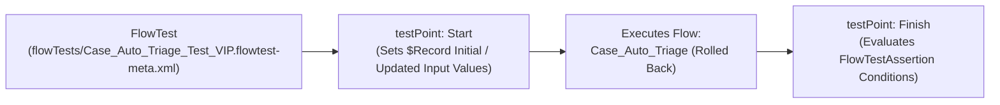

## Why the `FlowTest` Metadata Type Brings TDD to Declarative Automation

As enterprises migrate business logic from Apex Triggers into **Record-Triggered Flows** ([Flow](/docs/metadata/flow-metadata-type/)), maintaining regression test coverage without writing brittle Apex wrapper tests becomes critical.

Introduced in API v55.0 (and significantly expanded in API v66.0–v67.0), **`FlowTest`** (`flowTests/<FlowApiName>_<TestName>.flowtest-meta.xml`) lets admins and developers version-control **declarative Flow unit tests** with input mock payloads (`TriggeringRecord`) and multi-condition assertions (`assertions`).



---

## Key Metadata Fields on `FlowTest`

| Field | Type | Required | Description |
|---|---|---|---|
| `flowApiName` | `string` | Yes | Developer name of the target [Flow](/docs/metadata/flow-metadata-type/). |
| `label` | `string` | Yes | Display name of the Flow Test in Flow Builder. |
| `description` | `string` | No | Explains the business scenario and expected outcome being verified. |
| `testPoints` | `FlowTestPoint[]` | No | Contains the `Start` test point (`elementApiName: Start` with input `parameters`) and `Finish` test point (`elementApiName: Finish` with `assertions`). |
| `testPoints.assertions` | `FlowTestAssertion[]` | No | List of assertion conditions (`leftValueReference`, `operator`, `rightValue`) and custom `errorMessage` shown when an assertion fails. |
| `flowTestDataSources` | `FlowTestDataSource[]` | No | *(API v66.0+)* External/Apex test data provider (`dataSourceType: ApexClass`). |

---

## Real-World XML Example (`flowTests/Case_Priority_Triage_Verify_Enterprise_Escalation.flowtest-meta.xml`)

```xml
<?xml version="1.0" encoding="UTF-8"?>
<FlowTest xmlns="http://soap.sforce.com/2006/04/metadata">
    <description>Verifies that a Case created with Origin Phone and Severity Critical sets Priority to High.</description>
    <flowApiName>Case_Priority_Triage</flowApiName>
    <label>Verify Enterprise Escalation</label>
    <testPoints>
        <elementApiName>Start</elementApiName>
        <parameters>
            <leftValueReference>$Record</leftValueReference>
            <type>InputTriggeringRecordInitial</type>
            <value>
                <sobjectValue>{&quot;Origin&quot;:&quot;Phone&quot;,&quot;Subject&quot;:&quot;Production Outage&quot;,&quot;Status&quot;:&quot;New&quot;}</sobjectValue>
            </value>
        </parameters>
    </testPoints>
    <testPoints>
        <assertions>
            <conditions>
                <leftValueReference>$Record.Priority</leftValueReference>
                <operator>EqualTo</operator>
                <rightValue>
                    <stringValue>High</stringValue>
                </rightValue>
            </conditions>
            <errorMessage>Expected Case Priority to be automatically elevated to High for Phone outages.</errorMessage>
        </assertions>
        <elementApiName>Finish</elementApiName>
    </testPoints>
</FlowTest>
```

---

## Senior Architect Best Practices & Gotchas

> [!WARNING]
> **Avoid Hardcoded Record IDs Inside `sobjectValue` JSON:** When a `FlowTest` is created in Flow Builder using "Select a record from the org," Flow Builder serializes the sandbox record's `Id`, `OwnerId`, and lookup IDs into `<sobjectValue>`. Before committing a `.flowtest-meta.xml` file to Git, strip org-specific 18-character IDs from `<sobjectValue>` so the test passes in every Scratch Org and Sandbox!

- **Assert Both Positive Paths and Custom Error Elements:** Using the `HasError` operator (added in API v64.0), you can write a `FlowTest` that specifically verifies your Flow's **Custom Error** element blocks invalid record saves just like a Validation Rule test!

