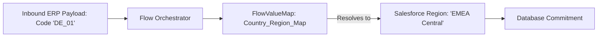

## Architectural Overview

`FlowValueMap` is an advanced metadata component designed to decouple data transformation dictionaries and mapping logic from procedural Flow execution paths. In high-volume integration architectures—such as bridging ERP product codes, country ISO codes, or external status indicators into standard Salesforce CRM picklist values—flows frequently become bloated with massive decision trees and hardcoded switch statements.

By encapsulating mapping definitions into `FlowValueMap` metadata, architects achieve clean separation of concerns. Data architects and business analysts can maintain transformation tables declaratively, while integration flows invoke value maps dynamically at runtime. This modular approach significantly lowers regression testing overhead and enhances pipeline maintainability.



## Directory and File Conventions

In Salesforce DX source format (`apiVersion` 68.0), `FlowValueMap` components are stored in the `flowValueMaps/` directory.

| Property | Value |
| :--- | :--- |
| **Metadata Type Name** | `FlowValueMap` |
| **SFDX Folder** | `force-app/main/default/flowValueMaps/` |
| **File Suffix** | `.flowValueMap-meta.xml` |
| **XML Root Element** | `<FlowValueMap xmlns="http://soap.sforce.com/2006/04/metadata">` |

## Key Metadata Fields

The `FlowValueMap` XML definition describes the dictionary schema and mapping entries:

| Field Name | Field Type | Required | Description |
| :--- | :--- | :--- | :--- |
| `masterLabel` | `string` | Yes | Human-readable name displayed in Flow Builder mapping elements. |
| `developerName` | `string` | Yes | Unique API identifier utilized in flow transformation expressions. |
| `description` | `string` | No | Architectural purpose and source-to-target mapping documentation. |
| `valueMapEntries` | `ValueMapEntry[]` | No | Structured key-value mapping elements defining input-to-output translations. |

> [!NOTE]
> Each `valueMapEntry` contains a source key and mapped target value, allowing deterministic string-to-string or enum translations.

## Declarative XML and Package Manifest Examples

Below is a declarative `FlowValueMap` translating third-party billing payment status codes into Salesforce status values:

```xml title="force-app/main/default/flowValueMaps/Payment_Status_Translation.flowValueMap-meta.xml"
<?xml version="1.0" encoding="UTF-8"?>
<FlowValueMap xmlns="http://soap.sforce.com/2006/04/metadata">
    <developerName>Payment_Status_Translation</developerName>
    <masterLabel>Payment Status Translation</masterLabel>
    <description>Translates external Stripe webhook statuses into internal Billing record statuses.</description>
    <valueMapEntries>
        <sourceValue>succeeded</sourceValue>
        <targetValue>Paid</targetValue>
    </valueMapEntries>
    <valueMapEntries>
        <sourceValue>requires_action</sourceValue>
        <targetValue>Pending Verification</targetValue>
    </valueMapEntries>
    <valueMapEntries>
        <sourceValue>failed</sourceValue>
        <targetValue>Declined</targetValue>
    </valueMapEntries>
</FlowValueMap>
```

### Package Manifest (`package.xml`)

```xml title="manifest/package.xml"
<?xml version="1.0" encoding="UTF-8"?>
<Package xmlns="http://soap.sforce.com/2006/04/metadata">
    <types>
        <members>Payment_Status_Translation</members>
        <name>FlowValueMap</name>
    </types>
    <version>68.0</version>
</Package>
```

## CLI Retrieval and Deployment Commands

Manage `FlowValueMap` assets with the Salesforce CLI:

```bash
# Retrieve all FlowValueMaps from the environment
sf project retrieve start --metadata FlowValueMap

# Deploy a specific FlowValueMap along with dependent flows
sf project deploy start --metadata FlowValueMap:Payment_Status_Translation --metadata Flow:Billing_Webhook_Processor
```

## Architect Best Practices and Gotchas

- **Deployment Sequencing:** Always deploy `FlowValueMap` definitions before or concurrently with the [Flow](/docs/metadata/flow-metadata-type/) artifacts that consume them; otherwise, flow compile validations will fail with missing symbol errors.
- **Handling Unmapped Values:** Design fallback logic within your flow to anticipate unexpected source keys that do not exist in the `FlowValueMap`, routing unmapped records to an administrative review queue.
- **Environment Parity:** Keep mapping entries identical between staging and production orgs to avoid subtle integration failures during end-to-end user acceptance testing.

> [!TIP]
> Prefer `FlowValueMap` over Custom Metadata Types when mappings are exclusively utilized within declarative Flow orchestration and do not require SOQL accessibility in Apex.
