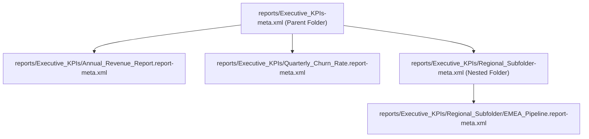

## Architectural Overview

`Folder` metadata represents the organizational containers that house reports, dashboards, documents, and classic email templates within Salesforce. In an enterprise implementation, folders do far more than arrange assets visually—they serve as the foundational security boundary for executive analytics, revenue reporting, and customer communication templates.

From an SFDX deployment and source control perspective, `Folder` components require meticulous handling. A report or dashboard cannot exist in source code without an accompanying folder definition. Furthermore, Salesforce enforces strict folder sharing rules (`FolderShare`), and subfolder hierarchies must be declared with precise naming conventions to avoid deployment failures in CI/CD pipelines.



## Directory and File Conventions

Unlike standard metadata types stored in a single flat directory, `Folder` metadata is segregated by the asset type it contains (reports, dashboards, documents, email templates) and paired with a companion descriptor XML file.

| Property | Value |
| :--- | :--- |
| **Metadata Type Name** | `Folder` (or `ReportFolder`, `DashboardFolder`, `DocumentFolder`, `EmailFolder`) |
| **SFDX Folders** | `force-app/main/default/reports/<folderName>/`, `dashboards/<folderName>/`, `email/<folderName>/` |
| **File Suffix** | `<folderName>-meta.xml` |
| **XML Root Element** | `<Folder xmlns="http://soap.sforce.com/2006/04/metadata">` |

## Key Metadata Fields

The `Folder` metadata type specifies organizational access, public availability, and sharing permissions:

| Field Name | Field Type | Required | Description |
| :--- | :--- | :--- | :--- |
| `name` | `string` | Yes | Administrative label displayed to users in reports and dashboards navigation tabs. |
| `accessType` | `FolderAccessTypes` | Yes | Defines accessibility level: `Public`, `Hidden`, or `Shared`. |
| `publicFolderAccess` | `PublicFolderAccess` | No | Specifies default access permissions for public folders: `ReadOnly` or `ReadWrite`. |
| `folderShares` | `FolderShare[]` | No | Child array defining explicit sharing rules for users, roles, and public groups. |

> [!NOTE]
> When Enhanced Folder Sharing is enabled in the organization, `accessType` should be configured as `Shared` to delegate granular permissions via `folderShares`.

## Declarative XML and Package Manifest Examples

Below is a declarative `Folder` metadata descriptor for an Executive Analytics report repository:

```xml title="force-app/main/default/reports/Executive_Analytics-meta.xml"
<?xml version="1.0" encoding="UTF-8"?>
<Folder xmlns="http://soap.sforce.com/2006/04/metadata">
    <name>Executive Analytics</name>
    <accessType>Shared</accessType>
    <publicFolderAccess>ReadOnly</publicFolderAccess>
    <folderShares>
        <accessLevel>Manage</accessLevel>
        <sharedTo>VP_Sales_Role</sharedTo>
        <sharedType>Role</sharedType>
    </folderShares>
    <folderShares>
        <accessLevel>View</accessLevel>
        <sharedTo>Sales_Strategy_Group</sharedTo>
        <sharedType>Group</sharedType>
    </folderShares>
</Folder>
```

### Package Manifest (`package.xml`)

```xml title="manifest/package.xml"
<?xml version="1.0" encoding="UTF-8"?>
<Package xmlns="http://soap.sforce.com/2006/04/metadata">
    <types>
        <members>Executive_Analytics</members>
        <members>Executive_Analytics/Annual_Revenue_Summary</members>
        <name>Report</name>
    </types>
    <version>68.0</version>
</Package>
```

## CLI Retrieval and Deployment Commands

Manage folder hierarchies and reports with Salesforce CLI:

```bash
# Retrieve a report folder and all contained report files
sf project retrieve start --metadata "Report:Executive_Analytics*"

# Deploy the folder metadata alongside report components
sf project deploy start --source-dir force-app/main/default/reports/Executive_Analytics
```

## Architect Best Practices and Gotchas

- **Parent-Child Deployment Ordering:** Always ensure folder descriptor files (`<folderName>-meta.xml`) are present when committing reports or dashboards. Deploying a report without its parent folder XML will fail with an invalid folder error.
- **Avoid User-Specific Sharing in Metadata:** Do not bind `sharedTo` inside `folderShares` to individual usernames or user IDs, which vary across scratch orgs, sandboxes, and production. Map shares exclusively to Roles, Territories, or Public Groups.
- **Nested Folder Pathing:** In enhanced folder hierarchies, subfolder names in `package.xml` must include the full directory path (e.g., `Parent_Folder/Child_Folder`).

> [!TIP]
> Use public groups to manage folder access rather than role hierarchies to keep `FolderShare` metadata lean and resilient against corporate organizational restructures.
