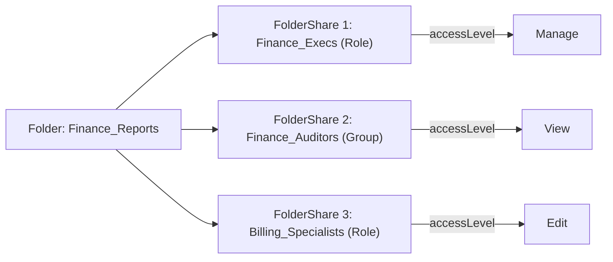

## Architectural Overview

`FolderShare` represents the explicit access control grants applied to report, dashboard, and document folders in Salesforce. Under Enhanced Folder Sharing, organizations can move beyond coarse public/private folder access to assign granular privileges—specifically `View`, `Edit`, and `Manage`—to specific user constituencies.

In enterprise security architectures, folder sharing must be managed through continuous delivery pipelines to ensure regulatory compliance and strict access tiering. By representing folder access as declarative metadata, security architects ensure that sensitive financial metrics, sales pipeline analytics, and executive dashboards are never exposed to unauthorized personnel when environments are cloned or refreshed.



## Directory and File Conventions

In Salesforce DX source format (`apiVersion` 68.0), `FolderShare` elements are embedded directly within the parent folder descriptor XML file (`<folderName>-meta.xml`).

| Property | Value |
| :--- | :--- |
| **Metadata Type Name** | `FolderShare` (child of `Folder`) |
| **SFDX Location** | Embedded inside `<folderShares>` elements within `<folderName>-meta.xml` |
| **Parent Metadata Types** | `ReportFolder`, `DashboardFolder`, `DocumentFolder`, `EmailFolder` |
| **XML Element** | `<folderShares>` |

## Key Metadata Fields

The `FolderShare` schema specifies the grantee, entity type, and granted privilege level:

| Field Name | Field Type | Required | Description |
| :--- | :--- | :--- | :--- |
| `accessLevel` | `FolderShareAccessLevel` | Yes | Access tier granted to the share target: `View`, `Edit`, or `Manage`. |
| `sharedTo` | `string` | Yes | Developer name of the Public Group, Role, Territory, or Username receiving access. |
| `sharedType` | `FolderSharedType` | Yes | Entity classification of the recipient: `Group`, `Role`, `RoleAndSubordinates`, `RoleAndSubordinatesInternal`, `Territory`, or `User`. |

> [!NOTE]
> `Manage` access allows the grantee to view, edit, delete, and grant folder permissions to other users in the org.

## Declarative XML and Package Manifest Examples

Below is a folder metadata file demonstrating multiple declarative `FolderShare` entries:

```xml title="force-app/main/default/dashboards/Executive_Dashboards-meta.xml"
<?xml version="1.0" encoding="UTF-8"?>
<Folder xmlns="http://soap.sforce.com/2006/04/metadata">
    <name>Executive Dashboards</name>
    <accessType>Shared</accessType>
    <folderShares>
        <accessLevel>Manage</accessLevel>
        <sharedTo>Global_VP_Role</sharedTo>
        <sharedType>Role</sharedType>
    </folderShares>
    <folderShares>
        <accessLevel>View</accessLevel>
        <sharedTo>Board_Auditors_Group</sharedTo>
        <sharedType>Group</sharedType>
    </folderShares>
    <folderShares>
        <accessLevel>Edit</accessLevel>
        <sharedTo>Sales_Operations_Leads</sharedTo>
        <sharedType>RoleAndSubordinatesInternal</sharedType>
    </folderShares>
</Folder>
```

### Package Manifest (`package.xml`)

Because `FolderShare` is deployed as part of the parent folder or dashboard, it is packaged under the container metadata type:

```xml title="manifest/package.xml"
<?xml version="1.0" encoding="UTF-8"?>
<Package xmlns="http://soap.sforce.com/2006/04/metadata">
    <types>
        <members>Executive_Dashboards</members>
        <name>Dashboard</name>
    </types>
    <version>68.0</version>
</Package>
```

## CLI Retrieval and Deployment Commands

Manage folder sharing definitions via the parent metadata container:

```bash
# Retrieve the folder descriptor including all folder shares
sf project retrieve start --metadata "Dashboard:Executive_Dashboards"

# Deploy the updated folder sharing configuration to a target sandbox
sf project deploy start --metadata "Dashboard:Executive_Dashboards"
```

## Architect Best Practices and Gotchas

- **Abstract Target Identifiers:** Never use `sharedType` set to `User` in repository files. Usernames differ across environments (`user@company.com.sandbox`), causing deployments to fail. Use Public Groups or Roles instead.
- **Role Hierarchy Deletions:** If a Role referenced in a `FolderShare` `<sharedTo>` tag is removed from the organizational hierarchy, subsequent deployments will fail with missing target errors.
- **Subfolder Inheritance:** In Salesforce Enhanced Folder Sharing, subfolders inherit permissions from their root parent folder unless explicit overriding permissions are established.

> [!WARNING]
> Granting `Manage` access to a Public Group gives all member users the ability to permanently delete or re-share sensitive business intelligence dashboards.
