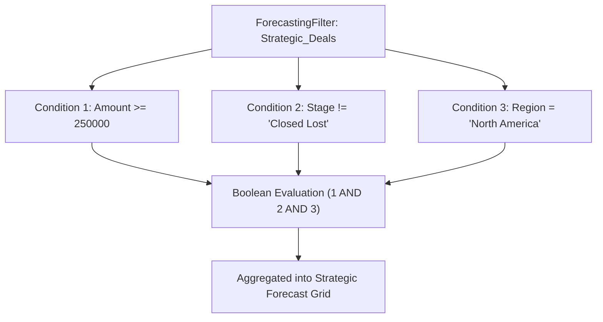

## Architectural Overview

`ForecastingFilterCondition` is the granular metadata structure that encapsulates individual logical expressions within a `ForecastingFilter`. In complex Sales Cloud architectures, filtering opportunities into specialized forecast types often requires multi-attribute criteria (for example: identifying opportunities where Deal Type is New Business, ARR exceeds \$100,000, and Billing Frequency is Annual).

Each `ForecastingFilterCondition` item represents one row in the Boolean logic matrix of the filter. Understanding its exact XML schema, supported operators, and evaluation sequence ensures seamless continuous delivery when modifying pipeline segmentation rules across developer scratch orgs and production environments.



## Directory and File Conventions

In Salesforce DX source format (`apiVersion` 68.0), `ForecastingFilterCondition` records are typically represented as child elements within the parent `forecastingFilters/` file or retrieved via child manifests.

| Property | Value |
| :--- | :--- |
| **Metadata Type Name** | `ForecastingFilterCondition` (child of `ForecastingFilter`) |
| **SFDX Storage** | Embedded inside `<filterConditions>` in `force-app/main/default/forecastingFilters/` |
| **Parent Metadata** | `ForecastingFilter` |
| **XML Element** | `<filterConditions>` |

## Key Metadata Fields

The XML schema for a filter condition declares target field identifiers, relational operators, and target comparison literals:

| Field Name | Field Type | Required | Description |
| :--- | :--- | :--- | :--- |
| `colNum` | `integer` | Yes | Numeric ordering index determining condition evaluation sequence. |
| `fieldName` | `string` | Yes | Fully qualified field API name evaluated on the source object (e.g., `Opportunity.Amount`). |
| `operation` | `string` | Yes | Comparison operator: `equals`, `notEqual`, `greaterThan`, `lessThan`, `greaterOrEqual`, `lessOrEqual`, or `contains`. |
| `value` | `string` | Yes | Literal comparison string, numeric threshold, or picklist API value evaluated against the field. |

> [!NOTE]
> Field names must include the object prefix and standard double-underscore suffix for custom fields (e.g., `Opportunity.ARR_Tier__c`).

## Declarative XML and Package Manifest Examples

Below is a parent `ForecastingFilter` containing multiple granular `ForecastingFilterCondition` elements:

```xml title="force-app/main/default/forecastingFilters/MidMarket_Expansion.forecastingFilter-meta.xml"
<?xml version="1.0" encoding="UTF-8"?>
<ForecastingFilter xmlns="http://soap.sforce.com/2006/04/metadata">
    <developerName>MidMarket_Expansion</developerName>
    <masterLabel>MidMarket Expansion</masterLabel>
    <forecastingSourceDefinition>Opportunity_Revenue_Source</forecastingSourceDefinition>
    <filterConditions>
        <colNum>1</colNum>
        <fieldName>Opportunity.Market_Segment__c</fieldName>
        <operation>equals</operation>
        <value>MidMarket</value>
    </filterConditions>
    <filterConditions>
        <colNum>2</colNum>
        <fieldName>Opportunity.Type</fieldName>
        <operation>equals</operation>
        <value>Existing Customer - Upgrade</value>
    </filterConditions>
</ForecastingFilter>
```

### Package Manifest (`package.xml`)

Condition elements are packaged and deployed through their parent `ForecastingFilter` component:

```xml title="manifest/package.xml"
<?xml version="1.0" encoding="UTF-8"?>
<Package xmlns="http://soap.sforce.com/2006/04/metadata">
    <types>
        <members>MidMarket_Expansion</members>
        <name>ForecastingFilter</name>
    </types>
    <version>68.0</version>
</Package>
```

## CLI Retrieval and Deployment Commands

Manage condition logic through standard Salesforce CLI operations:

```bash
# Retrieve the parent filter including all condition criteria
sf project retrieve start --metadata ForecastingFilter:MidMarket_Expansion

# Deploy condition updates to the target sandbox
sf project deploy start --metadata ForecastingFilter:MidMarket_Expansion
```

## Architect Best Practices and Gotchas

- **Sequential Numbering (`colNum`):** Always maintain strictly incremental integers (1, 2, 3) for `colNum`. Gaps or duplicate numbers can cause XML validation errors during Metadata API deployment.
- **Type-Safe Value Validation:** Ensure string values for picklist fields match the active API name rather than translated labels in multi-language environments.
- **Null Safety in Rollups:** If evaluating nullable fields with `greaterThan` or `lessThan`, test how null values are handled in forecasting aggregations to avoid skewed revenue numbers.

> [!TIP]
> Validate custom fields on [CustomObject](/docs/metadata/custom-object-metadata-type/) definitions in your CI pipeline before updating `ForecastingFilterCondition` lines.
