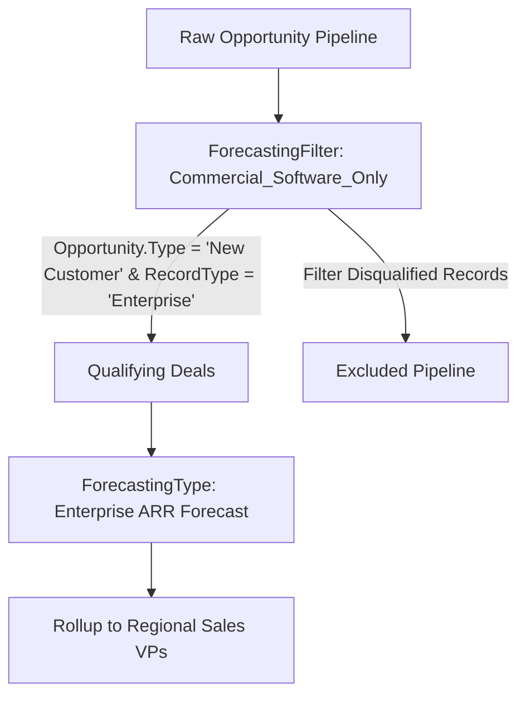

## Architectural Overview

`ForecastingFilter` is a critical Sales Cloud metadata type that allows revenue architects to construct sophisticated data filtering rules for Collaborative Forecasts. Standard forecasting rollups traditionally aggregate all opportunities matching standard close dates and forecast categories. However, modern enterprise sales organizations require segregated projections—such as distinguishing New Business revenue from Renewal ARR, or isolating Government Contracts from Commercial sales.

`ForecastingFilter` metadata provides the declarative mechanism to slice pipeline data cleanly. By applying filters at the source definition level, sales operations leaders can isolate relevant deals without requiring fragile custom rollup triggers or complex batch summary jobs.



## Directory and File Conventions

In Salesforce DX source format (`apiVersion` 68.0), `ForecastingFilter` components reside in the `forecastingFilters/` directory.

| Property | Value |
| :--- | :--- |
| **Metadata Type Name** | `ForecastingFilter` |
| **SFDX Folder** | `force-app/main/default/forecastingFilters/` |
| **File Suffix** | `.forecastingFilter-meta.xml` |
| **XML Root Element** | `<ForecastingFilter xmlns="http://soap.sforce.com/2006/04/metadata">` |

## Key Metadata Fields

The `ForecastingFilter` schema encapsulates metadata labels, source definitions, and filter logic:

| Field Name | Field Type | Required | Description |
| :--- | :--- | :--- | :--- |
| `masterLabel` | `string` | Yes | Display name of the filter shown in Collaborative Forecast setup pages. |
| `developerName` | `string` | Yes | Unique programmatic identifier utilized across forecasting configurations. |
| `description` | `string` | No | Architectural description explaining pipeline segmentation criteria. |
| `forecastingSourceDefinition` | `string` | Yes | Developer name of the underlying source object mapping driving the filter. |
| `filterConditions` | `ForecastingFilterCondition[]` | No | Collection of individual Boolean criteria evaluating record attributes. |

> [!NOTE]
> Collaborative Forecasts must be enabled organization-wide via `ForecastingSettings` before deploying `ForecastingFilter` metadata.

## Declarative XML and Package Manifest Examples

Below is a declarative `ForecastingFilter` designed to capture enterprise subscription revenue:

```xml title="force-app/main/default/forecastingFilters/Enterprise_Subscriptions.forecastingFilter-meta.xml"
<?xml version="1.0" encoding="UTF-8"?>
<ForecastingFilter xmlns="http://soap.sforce.com/2006/04/metadata">
    <developerName>Enterprise_Subscriptions</developerName>
    <masterLabel>Enterprise Subscriptions</masterLabel>
    <description>Filters pipeline for enterprise software subscriptions excluding professional services.</description>
    <forecastingSourceDefinition>Opportunity_Revenue_Source</forecastingSourceDefinition>
    <filterConditions>
        <colNum>1</colNum>
        <fieldName>Opportunity.Is_Subscription__c</fieldName>
        <operation>equals</operation>
        <value>true</value>
    </filterConditions>
</ForecastingFilter>
```

### Package Manifest (`package.xml`)

```xml title="manifest/package.xml"
<?xml version="1.0" encoding="UTF-8"?>
<Package xmlns="http://soap.sforce.com/2006/04/metadata">
    <types>
        <members>Enterprise_Subscriptions</members>
        <name>ForecastingFilter</name>
    </types>
    <version>68.0</version>
</Package>
```

## CLI Retrieval and Deployment Commands

Manage `ForecastingFilter` components using modern CLI commands:

```bash
# Retrieve all forecasting filters from your environment
sf project retrieve start --metadata ForecastingFilter

# Deploy a specific forecasting filter to your sales sandbox
sf project deploy start --metadata ForecastingFilter:Enterprise_Subscriptions
```

## Architect Best Practices and Gotchas

- **Prerequisite Dependencies:** `ForecastingFilter` references custom fields and source definitions. Ensure that all [CustomField](/docs/metadata/custom-field-metadata-type/) components on `Opportunity` are deployed prior to or alongside the filter.
- **Index Field Criteria:** Ensure fields evaluated in `filterConditions` are appropriately indexed if evaluating high-volume sales databases to prevent forecast page loading timeouts.
- **Referential Integrity:** Salesforce blocks deleting custom fields if they are actively referenced in a deployed `ForecastingFilter`.

> [!TIP]
> Group multiple related conditions logically within the filter to avoid creating excessive discrete forecast models that overwhelm sales managers.
