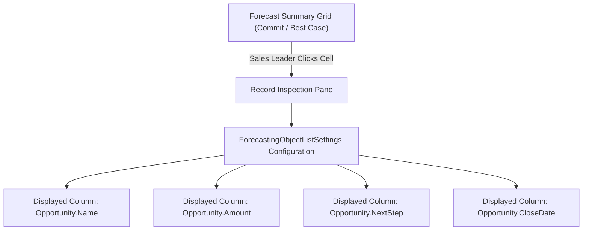

## Architectural Overview

`ForecastingObjectListSettings` is the metadata type responsible for customizing the opportunity and deal inspection table positioned at the bottom of the Collaborative Forecasts interface. When sales leaders navigate forecast rollups—expanding role hierarchies and reviewing commit totals—clicking a forecast category or rollup cell reveals the list of individual records contributing to that aggregate number.

From an administrative and architectural standpoint, `ForecastingObjectListSettings` ensures that sales managers have immediate visibility into the specific custom fields that matter during forecast inspections (such as Next Step, ARR, Competitor, or Win Probability). Automating these list settings via Salesforce DX ensures consistent inspection layouts across global enterprise teams.



## Directory and File Conventions

In Salesforce DX source format (`apiVersion` 68.0), `ForecastingObjectListSettings` metadata is managed either as independent files in `forecastingObjectListSettings/` or bundled within `ForecastingSettings`.

| Property | Value |
| :--- | :--- |
| **Metadata Type Name** | `ForecastingObjectListSettings` |
| **SFDX Folder** | `force-app/main/default/forecastingObjectListSettings/` |
| **File Suffix** | `.forecastingObjectListSettings-meta.xml` |
| **XML Root Element** | `<ForecastingObjectListSettings xmlns="http://soap.sforce.com/2006/04/metadata">` |

## Key Metadata Fields

The XML structure governs target forecasting types, sort orders, and displayed field arrays:

| Field Name | Field Type | Required | Description |
| :--- | :--- | :--- | :--- |
| `forecastingType` | `string` | Yes | Developer name of the associated `ForecastingType` whose drilldown grid is being customized. |
| `displayedFields` | `string[]` | Yes | Repeating array of field API names displayed as columns in the inspection table. |
| `sortField` | `string` | No | Default field utilized for ordering records in the list view. |
| `sortDirection` | `string` | No | Sorting sequence: `Ascending` or `Descending`. |

> [!NOTE]
> Field references in `displayedFields` must adhere to standard object dot notation (e.g., `Opportunity.Amount` or `Opportunity.CustomField__c`).

## Declarative XML and Package Manifest Examples

Below is a declarative `ForecastingObjectListSettings` definition tailored for strategic deal reviews:

```xml title="force-app/main/default/forecastingObjectListSettings/Enterprise_Revenue_List.forecastingObjectListSettings-meta.xml"
<?xml version="1.0" encoding="UTF-8"?>
<ForecastingObjectListSettings xmlns="http://soap.sforce.com/2006/04/metadata">
    <forecastingType>Enterprise_Revenue</forecastingType>
    <displayedFields>Opportunity.Name</displayedFields>
    <displayedFields>Opportunity.Account.Name</displayedFields>
    <displayedFields>Opportunity.Amount</displayedFields>
    <displayedFields>Opportunity.CloseDate</displayedFields>
    <displayedFields>Opportunity.StageName</displayedFields>
    <displayedFields>Opportunity.NextStep</displayedFields>
    <sortField>Opportunity.Amount</sortField>
    <sortDirection>Descending</sortDirection>
</ForecastingObjectListSettings>
```

### Package Manifest (`package.xml`)

```xml title="manifest/package.xml"
<?xml version="1.0" encoding="UTF-8"?>
<Package xmlns="http://soap.sforce.com/2006/04/metadata">
    <types>
        <members>Enterprise_Revenue_List</members>
        <name>ForecastingObjectListSettings</name>
    </types>
    <version>68.0</version>
</Package>
```

## CLI Retrieval and Deployment Commands

Manage object list settings via Salesforce CLI:

```bash
# Retrieve all forecasting object list settings
sf project retrieve start --metadata ForecastingObjectListSettings

# Deploy list settings to your target environment
sf project deploy start --metadata ForecastingObjectListSettings:Enterprise_Revenue_List
```

## Architect Best Practices and Gotchas

- **Field-Level Security (FLS) Adherence:** When declaring columns, ensure that the fields are readable via [PermissionSet](/docs/metadata/permission-set-metadata-type/) or Profile configurations. Restricted fields are omitted from display without error.
- **Maximum Column Thresholds:** Avoid configuring more than 15 columns in `displayedFields`. Excessive columns degrade UI responsiveness and force horizontal scrolling on mobile and laptop screens.
- **Referential Dependency Order:** The referenced `forecastingType` must exist in the target org prior to deploying this metadata asset.

> [!TIP]
> Prioritize operational velocity fields like `NextStep` and `CloseDate` near the front of `displayedFields` to facilitate efficient pipeline reviews.
