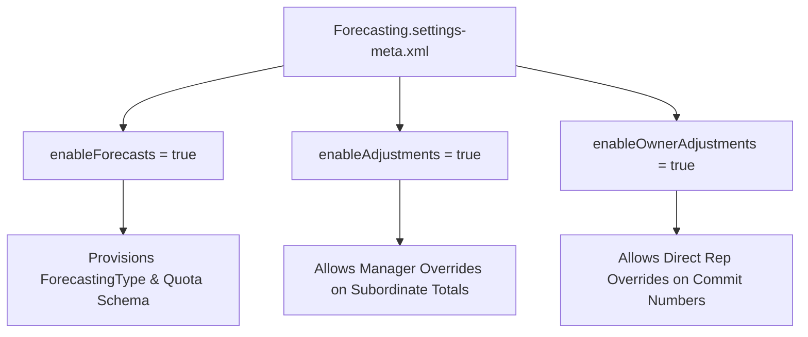

## Architectural Overview

`ForecastingSettings` is the master singleton metadata file that activates and configures Collaborative Forecasts for Salesforce organizations. Collaborative Forecasts serves as the standard predictive revenue planning tool in Sales Cloud, allowing sales leaders to track commitments, upside, pipeline, and closed revenue against monthly or quarterly sales quotas.

In automated enterprise DevOps workflows, deploying `ForecastingSettings` is a critical bootstrapping step. Scratch orgs and newly provisioned sandboxes do not enable Collaborative Forecasts by default. Failing to provision `Forecasting.settings-meta.xml` before deploying dependent forecasting types, filters, or quota integrations will cause automated build failures.



## Directory and File Conventions

In Salesforce DX source format (`apiVersion` 68.0), `ForecastingSettings` is stored within the `settings/` directory as `Forecasting.settings-meta.xml`.

| Property | Value |
| :--- | :--- |
| **Metadata Type Name** | `Settings` (member: `Forecasting`) / `ForecastingSettings` |
| **SFDX Folder** | `force-app/main/default/settings/` |
| **File Name** | `Forecasting.settings-meta.xml` |
| **Scratch Org Setting Key** | `forecastingSettings` |

## Key Metadata Fields

The `ForecastingSettings` XML schema exposes fundamental revenue operational flags:

| Field Name | Field Type | Required | Description |
| :--- | :--- | :--- | :--- |
| `enableForecasts` | `boolean` | Yes | Organization-wide master toggle activating Collaborative Forecasts. |
| `enableAdjustments` | `boolean` | No | Allows sales managers to apply adjustments to subordinate rollup forecasts. |
| `enableOwnerAdjustments` | `boolean` | No | Permits individual forecast owners to adjust their own forecast projections. |
| `defaultForecastCurrency` | `string` | No | Default corporate currency code utilized for global currency rollups. |

> [!NOTE]
> In scratch org definition files, set `"features": ["OpportunityScore", "StateAndCountryPicklist"]` and include `"forecastingSettings"` to ensure full forecasting parity.

## Declarative XML and Package Manifest Examples

Below is a production-grade `Forecasting.settings-meta.xml` configuration for an enterprise Sales Cloud deployment:

```xml title="force-app/main/default/settings/Forecasting.settings-meta.xml"
<?xml version="1.0" encoding="UTF-8"?>
<ForecastingSettings xmlns="http://soap.sforce.com/2006/04/metadata">
    <enableForecasts>true</enableForecasts>
    <enableAdjustments>true</enableAdjustments>
    <enableOwnerAdjustments>true</enableOwnerAdjustments>
</ForecastingSettings>
```

### Scratch Org Configuration (`config/project-scratch-def.json`)

```json title="config/project-scratch-def.json"
{
  "orgName": "Sales Cloud Forecasting Scratch Org",
  "edition": "Enterprise",
  "features": ["ContactsToMultipleAccounts"],
  "settings": {
    "forecastingSettings": {
      "enableForecasts": true,
      "enableAdjustments": true,
      "enableOwnerAdjustments": true
    }
  }
}
```

### Package Manifest (`package.xml`)

```xml title="manifest/package.xml"
<?xml version="1.0" encoding="UTF-8"?>
<Package xmlns="http://soap.sforce.com/2006/04/metadata">
    <types>
        <members>Forecasting</members>
        <name>Settings</name>
    </types>
    <version>68.0</version>
</Package>
```

## CLI Retrieval and Deployment Commands

Manage `ForecastingSettings` via the Salesforce CLI:

```bash
# Retrieve Forecasting settings from an org
sf project retrieve start --metadata Settings:Forecasting

# Deploy Forecasting settings to initialize a scratch org
sf project deploy start --metadata Settings:Forecasting
```

## Architect Best Practices and Gotchas

- **Deployment Ordering in CI/CD:** Always deploy `Settings:Forecasting` before attempting to deploy any `ForecastingType`, `ForecastingFilter`, or custom quota automation.
- **Audit Logging of Adjustments:** Enabling `enableAdjustments` permits managers to override system-calculated amounts. Ensure your revenue compliance framework tracks adjustment histories via standard audit fields.
- **Single-Currency vs. Multi-Currency:** In multi-currency environments, verify that corporate currency conversion tables are populated before sales users submit forecast adjustments.

> [!WARNING]
> Disabling `enableForecasts` in an active production org wipes existing manual forecast adjustments and hides forecast history.
