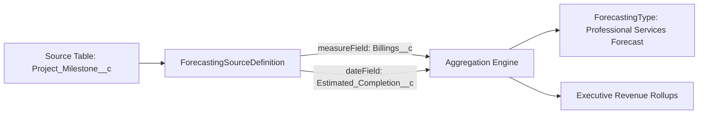

## Architectural Overview

`ForecastingSourceDefinition` is a foundational metadata type within Salesforce Collaborative Forecasts that defines the underlying database entity and numerical aggregations feeding revenue projections. Historically, Salesforce forecasting was restricted strictly to the standard `Opportunity` object. In modern Sales Cloud architectures, however, enterprises can forecast on standard opportunity splits, product line items, and custom objects (such as renewable contracts, project milestone billings, or consumption commitments).

`ForecastingSourceDefinition` decouples the mathematical aggregation mechanics from the visual forecast presentation. By declaring the source object, target quantitative measure, date dimension, and user assignment relationship, architects establish a reusable calculation contract that feeds multiple downstream forecast models.



## Directory and File Conventions

In Salesforce DX source format (`apiVersion` 68.0), `ForecastingSourceDefinition` components are located in the `forecastingSourceDefinitions/` directory.

| Property | Value |
| :--- | :--- |
| **Metadata Type Name** | `ForecastingSourceDefinition` |
| **SFDX Folder** | `force-app/main/default/forecastingSourceDefinitions/` |
| **File Suffix** | `.forecastingSourceDefinition-meta.xml` |
| **XML Root Element** | `<ForecastingSourceDefinition xmlns="http://soap.sforce.com/2006/04/metadata">` |

## Key Metadata Fields

The XML schema defines the source entity, quantitative calculation metrics, and chronological fields:

| Field Name | Field Type | Required | Description |
| :--- | :--- | :--- | :--- |
| `masterLabel` | `string` | Yes | Human-readable label displayed in Sales Cloud setup menus. |
| `developerName` | `string` | Yes | Unique programmatic identifier utilized across forecasting configurations. |
| `sourceObject` | `string` | Yes | API name of the source entity (e.g., `Opportunity`, `OpportunitySplit`, or `Custom_Invoice__c`). |
| `measureField` | `string` | Yes | Numeric or currency field aggregated across pipeline records (e.g., `Amount`, `TotalPrice`). |
| `dateField` | `string` | Yes | Date or DateTime field determining the forecast period allocation (e.g., `CloseDate`). |
| `userField` | `string` | Yes | Lookup field to `User` establishing ownership for role hierarchy rollups. |

> [!NOTE]
> When defining a source definition on a custom object, the source entity must have an indexed relationship to the `User` object to support management hierarchy rollups.

## Declarative XML and Package Manifest Examples

Below is a declarative `ForecastingSourceDefinition` mapping opportunity product schedule billings:

```xml title="force-app/main/default/forecastingSourceDefinitions/Opportunity_Product_Revenue.forecastingSourceDefinition-meta.xml"
<?xml version="1.0" encoding="UTF-8"?>
<ForecastingSourceDefinition xmlns="http://soap.sforce.com/2006/04/metadata">
    <developerName>Opportunity_Product_Revenue</developerName>
    <masterLabel>Opportunity Product Revenue</masterLabel>
    <sourceObject>OpportunityLineItem</sourceObject>
    <measureField>TotalPrice</measureField>
    <dateField>ServiceDate</dateField>
    <userField>Opportunity.OwnerId</userField>
</ForecastingSourceDefinition>
```

### Package Manifest (`package.xml`)

```xml title="manifest/package.xml"
<?xml version="1.0" encoding="UTF-8"?>
<Package xmlns="http://soap.sforce.com/2006/04/metadata">
    <types>
        <members>Opportunity_Product_Revenue</members>
        <name>ForecastingSourceDefinition</name>
    </types>
    <version>68.0</version>
</Package>
```

## CLI Retrieval and Deployment Commands

Manage `ForecastingSourceDefinition` components via the Salesforce CLI:

```bash
# Retrieve all forecasting source definitions
sf project retrieve start --metadata ForecastingSourceDefinition

# Deploy a specific source definition to the integration sandbox
sf project deploy start --metadata ForecastingSourceDefinition:Opportunity_Product_Revenue
```

## Architect Best Practices and Gotchas

- **Schema Precedence:** Ensure that the underlying `sourceObject` (such as a [CustomObject](/docs/metadata/custom-object-metadata-type/)) and target measure [CustomField](/docs/metadata/custom-field-metadata-type/) are deployed before deploying the source definition.
- **Date Dimension Consistency:** The designated `dateField` governs how pipeline items fall into monthly or quarterly forecast buckets. Never change the `dateField` on an active source definition without executing historical pipeline reconciliations.
- **Scratch Org Prerequisites:** Collaborative Forecasts must be enabled via `ForecastingSettings` in your scratch org definition prior to pushing source definition files.

> [!TIP]
> Use standard `OpportunityLineItem` or `OpportunitySplit` source definitions when sales models require split quotas across overlay specialists and territory account executives.
