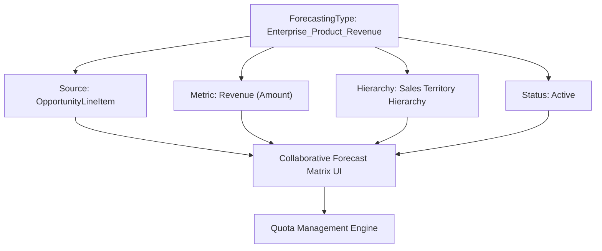

## Architectural Overview

`ForecastingType` represents a discrete, actionable forecast model within Salesforce Collaborative Forecasts. Each forecast type binds an underlying revenue or quantity metric (such as Opportunity Revenue, Product Family Volume, or Custom Object Contract Values) to an organizational hierarchy (User Role or Territory Management). In enterprise organizations, sales leadership rarely operates on a single homogeneous forecast; commercial sales leaders focus on committed ARR, product specialists forecast unit volumes, and overlay teams forecast split quotas.

In Salesforce DX architectures, configuring `ForecastingType` metadata enables programmatic governance over the organization's entire forecasting catalog. Managing these definitions in source control ensures that newly launched sales channels, territory models, and metric calculations are synchronized seamlessly across sandboxes and production environments.



## Directory and File Conventions

In Salesforce DX source format (`apiVersion` 68.0), `ForecastingType` components are stored in the `forecastingTypes/` directory.

| Property | Value |
| :--- | :--- |
| **Metadata Type Name** | `ForecastingType` |
| **SFDX Folder** | `force-app/main/default/forecastingTypes/` |
| **File Suffix** | `.forecastingType-meta.xml` |
| **XML Root Element** | `<ForecastingType xmlns="http://soap.sforce.com/2006/04/metadata">` |

## Key Metadata Fields

The `ForecastingType` schema configures status, aggregation units, and associated data sources:

| Field Name | Field Type | Required | Description |
| :--- | :--- | :--- | :--- |
| `masterLabel` | `string` | Yes | Label displayed in the Forecasts tab dropdown selector. |
| `developerName` | `string` | Yes | Unique programmatic identifier utilized across forecasting configurations. |
| `active` | `boolean` | Yes | Toggles whether this forecast model is active and accessible to end users. |
| `hasAmount` | `boolean` | No | Specifies if the forecast aggregates currency amounts. |
| `hasQuantity` | `boolean` | No | Specifies if the forecast aggregates unit quantities. |
| `roleType` | `string` | No | Organizational hierarchy driving rollups: `UserRole` or `Territory`. |

> [!NOTE]
> Organizations can have up to four active forecast types enabled concurrently in standard editions, with expanded limits available in Enterprise and Unlimited editions.

## Declarative XML and Package Manifest Examples

Below is a declarative `ForecastingType` configuring a territory-based product revenue forecast:

```xml title="force-app/main/default/forecastingTypes/Product_Territory_Revenue.forecastingType-meta.xml"
<?xml version="1.0" encoding="UTF-8"?>
<ForecastingType xmlns="http://soap.sforce.com/2006/04/metadata">
    <developerName>Product_Territory_Revenue</developerName>
    <masterLabel>Product Territory Revenue</masterLabel>
    <active>true</active>
    <hasAmount>true</hasAmount>
    <hasQuantity>false</hasQuantity>
    <roleType>Territory</roleType>
</ForecastingType>
```

### Package Manifest (`package.xml`)

```xml title="manifest/package.xml"
<?xml version="1.0" encoding="UTF-8"?>
<Package xmlns="http://soap.sforce.com/2006/04/metadata">
    <types>
        <members>Product_Territory_Revenue</members>
        <name>ForecastingType</name>
    </types>
    <version>68.0</version>
</Package>
```

## CLI Retrieval and Deployment Commands

Manage `ForecastingType` definitions via the Salesforce CLI:

```bash
# Retrieve all forecasting types from the environment
sf project retrieve start --metadata ForecastingType

# Deploy a specific forecasting type to your sales staging sandbox
sf project deploy start --metadata ForecastingType:Product_Territory_Revenue
```

## Architect Best Practices and Gotchas

- **Territory Management Prerequisites:** If `roleType` is set to `Territory`, Enterprise Territory Management (`Territory2`) must be enabled and an active territory model must exist in the target org prior to deployment.
- **Quota Data Loss on Deletion:** Deleting a `ForecastingType` or deploying with `<active>false</active>` deactivates the forecast grid and purges historical quota mappings and adjustments tied to that type.
- **Bootstrapping Sequence:** Deploy `ForecastingSettings` and `ForecastingSourceDefinition` components before deploying dependent `ForecastingType` files.

> [!WARNING]
> Renaming an existing `ForecastingType` developer name in Git acts as a drop-and-recreate operation during destructive deployments, which permanently wipes manual forecast adjustments.
