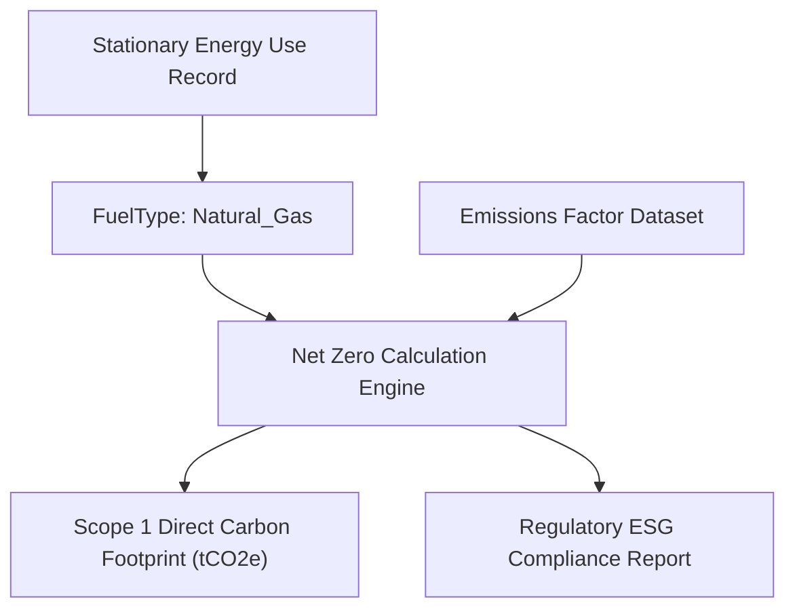

## Architectural Overview

`FuelType` is a core metadata type within Salesforce Net Zero Cloud (formerly Sustainability Cloud) that standardizes energy source classifications for enterprise environmental, social, and governance (ESG) accounting. Net Zero Cloud tracks greenhouse gas (GHG) emissions across stationary assets (office buildings, manufacturing plants, data centers) and mobile assets (vehicle fleets, executive travel).

Accurate carbon accounting mandates rigorous classification of energy inputs—such as natural gas, diesel, grid electricity, heavy fuel oil, or bio-methane. `FuelType` metadata establishes the canonical system of record for these fuel classifications. By managing fuel classifications as declarative code in Salesforce DX, sustainability architects ensure that emissions factor lookups, global carbon accounting rules, and regulatory audit reports maintain consistency across distributed multinational subsidiaries.



## Directory and File Conventions

In Salesforce DX source format (`apiVersion` 68.0), `FuelType` components reside in the `fuelTypes/` directory.

| Property | Value |
| :--- | :--- |
| **Metadata Type Name** | `FuelType` |
| **SFDX Folder** | `force-app/main/default/fuelTypes/` |
| **File Suffix** | `.fuelType-meta.xml` |
| **XML Root Element** | `<FuelType xmlns="http://soap.sforce.com/2006/04/metadata">` |

## Key Metadata Fields

The `FuelType` XML definition captures sustainability classifications, renewability markers, and fuel categories:

| Field Name | Field Type | Required | Description |
| :--- | :--- | :--- | :--- |
| `masterLabel` | `string` | Yes | Human-readable fuel name displayed on Net Zero asset records. |
| `developerName` | `string` | Yes | Unique programmatic identifier utilized in sustainability calculation formulas. |
| `description` | `string` | No | Architectural description detailing fuel source specifications. |
| `fuelCategory` | `string` | Yes | High-level GHG protocol classification: `FossilFuel`, `Biofuel`, `Electricity`, or `Renewable`. |
| `isRenewable` | `boolean` | No | Flags whether the fuel is classified as a zero-carbon or renewable energy source. |

> [!NOTE]
> Net Zero Cloud licenses and platform features must be provisioned in the target environment before deploying `FuelType` metadata.

## Declarative XML and Package Manifest Examples

Below is a declarative `FuelType` configuration for renewable bio-diesel:

```xml title="force-app/main/default/fuelTypes/Bio_Diesel_B20.fuelType-meta.xml"
<?xml version="1.0" encoding="UTF-8"?>
<FuelType xmlns="http://soap.sforce.com/2006/04/metadata">
    <developerName>Bio_Diesel_B20</developerName>
    <masterLabel>Bio Diesel B20 Blend</masterLabel>
    <description>Commercial vehicle fleet blend with 20 percent renewable biodiesel content.</description>
    <fuelCategory>Biofuel</fuelCategory>
    <isRenewable>true</isRenewable>
</FuelType>
```

### Package Manifest (`package.xml`)

```xml title="manifest/package.xml"
<?xml version="1.0" encoding="UTF-8"?>
<Package xmlns="http://soap.sforce.com/2006/04/metadata">
    <types>
        <members>Bio_Diesel_B20</members>
        <name>FuelType</name>
    </types>
    <version>68.0</version>
</Package>
```

## CLI Retrieval and Deployment Commands

Manage `FuelType` components via standard Salesforce CLI commands:

```bash
# Retrieve all fuel types from the Net Zero org
sf project retrieve start --metadata FuelType

# Deploy a specific fuel type to your sustainability sandbox
sf project deploy start --metadata FuelType:Bio_Diesel_B20
```

## Architect Best Practices and Gotchas

- **Scratch Org Definitions:** Ensure your `project-scratch-def.json` includes `"NetZeroCloud"` in the `"features"` array; otherwise, attempts to retrieve or deploy `FuelType` will fail with missing entity errors.
- **Audit Compliance:** Changes to `FuelType` metadata can impact historical carbon recalculations. Track all changes in Git version control to provide third-party carbon accounting auditors with complete lineage.
- **Emission Factor Binding:** Ensure corresponding emissions factor library records are seeded immediately following `FuelType` deployments to avoid null references in carbon calculation flows.

> [!TIP]
> Standardize `developerName` conventions around ISO fuel standards to facilitate automated integration with external utility bill scraping APIs.
