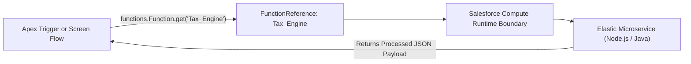

## Architectural Overview

`FunctionReference` is an advanced metadata component that binds elastic, serverless compute functions (such as Node.js or Java microservices) to the core Salesforce CRM platform. When enterprise business requirements exceed standard transaction limits—such as complex PDF generation, intensive cryptography, high-volume matrix calculations, or machine learning payload pre-processing—architects offload processing to elastic compute workloads.

`FunctionReference` provides the declarative gateway that registers the compute function inside the core Salesforce organization. Through this metadata asset, Salesforce administrators and developers can invoke external serverless microservices directly from [ApexClass](/docs/metadata/apex-class-metadata-type/) code or declarative [Flow](/docs/metadata/flow-metadata-type/) actions while inheriting platform identity, mutual TLS authentication, and unified audit logs.



## Directory and File Conventions

In Salesforce DX source format (`apiVersion` 68.0), `FunctionReference` definitions reside in the `functionReferences/` directory.

| Property | Value |
| :--- | :--- |
| **Metadata Type Name** | `FunctionReference` |
| **SFDX Folder** | `force-app/main/default/functionReferences/` |
| **File Suffix** | `.functionReference-meta.xml` |
| **XML Root Element** | `<FunctionReference xmlns="http://soap.sforce.com/2006/04/metadata">` |

## Key Metadata Fields

The XML schema for `FunctionReference` links project containers, function names, and invocation policies:

| Field Name | Field Type | Required | Description |
| :--- | :--- | :--- | :--- |
| `masterLabel` | `string` | Yes | Human-readable title displayed in Flow Builder and setup consoles. |
| `developerName` | `string` | Yes | Programmatic identifier utilized when querying the function in Apex (`functions.Function.get`). |
| `functionName` | `string` | Yes | Name of the discrete function handler defined in the serverless project repository. |
| `project` | `string` | Yes | Logical project or service namespace grouping related compute functions. |
| `description` | `string` | No | Architectural summary of the function purpose, expected inputs, and computational limits. |

> [!NOTE]
> Apex code invokes registered functions using `functions.Function.get('project.developerName')` to establish an authenticated, asynchronous execution session.

## Declarative XML and Package Manifest Examples

Below is a declarative `FunctionReference` registering a high-volume pricing calculation microservice:

```xml title="force-app/main/default/functionReferences/Complex_Pricing_Engine.functionReference-meta.xml"
<?xml version="1.0" encoding="UTF-8"?>
<FunctionReference xmlns="http://soap.sforce.com/2006/04/metadata">
    <developerName>Complex_Pricing_Engine</developerName>
    <masterLabel>Complex Pricing Engine</masterLabel>
    <description>Calculates tier-based CPQ matrix discounts exceeding standard Apex CPU limits.</description>
    <functionName>pricingcalculator</functionName>
    <project>EnterpriseBillingServices</project>
</FunctionReference>
```

### Package Manifest (`package.xml`)

```xml title="manifest/package.xml"
<?xml version="1.0" encoding="UTF-8"?>
<Package xmlns="http://soap.sforce.com/2006/04/metadata">
    <types>
        <members>Complex_Pricing_Engine</members>
        <name>FunctionReference</name>
    </types>
    <version>68.0</version>
</Package>
```

## CLI Retrieval and Deployment Commands

Manage `FunctionReference` components using the Salesforce CLI:

```bash
# Retrieve all function references from your target environment
sf project retrieve start --metadata FunctionReference

# Deploy a specific function reference to your integration sandbox
sf project deploy start --metadata FunctionReference:Complex_Pricing_Engine
```

## Architect Best Practices and Gotchas

- **Multi-Pipeline Orchestration:** In automated CI/CD environments, always deploy the serverless compute bundle (e.g. via container deployment pipelines) and register the project before deploying `FunctionReference` to core Salesforce.
- **Apex Compile Dependencies:** Any [ApexClass](/docs/metadata/apex-class-metadata-type/) or unit test referencing a function by string name should verify function availability dynamically or handle invocation exceptions gracefully.
- **Sandbox Environment Isolation:** Ensure sandbox instances reference lower-environment compute endpoints rather than production functions to prevent accidental data contamination during testing.

> [!TIP]
> Use `FunctionReference` when complex algorithms threaten to breach the 10-second synchronous Apex CPU limit, shifting heavy computation to elastic infrastructure.
