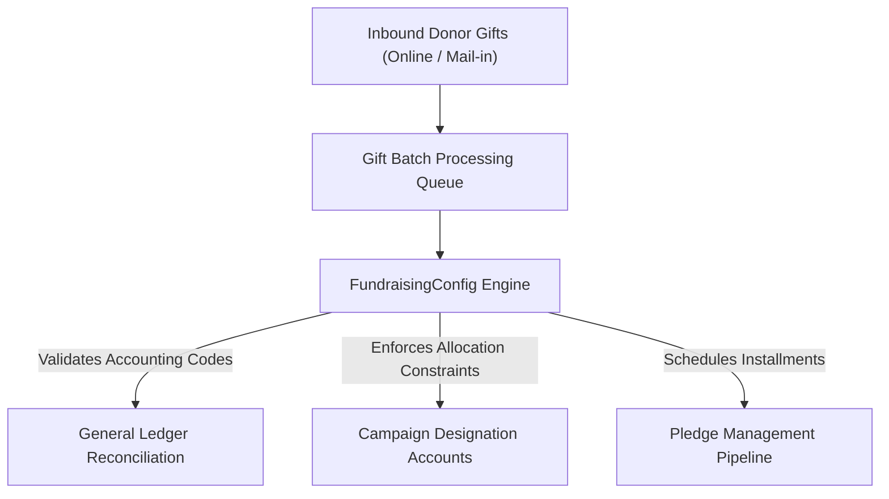

## Architectural Overview

`FundraisingConfig` is a core operational metadata type in the next-generation Salesforce Nonprofit Cloud platform (built natively on the core Salesforce data model). In nonprofit organizations, higher education institutions, and philanthropic foundations, fundraising operations require strict accounting discipline, transparent audit trails, and automated gift batch processing.

`FundraisingConfig` governs global operational policies for philanthropic campaigns, pledge fulfillment schedules, donor allocation rules, and gift entry batches. By codifying these financial and operational settings in Salesforce DX, architecture teams ensure that compliance safeguards—such as preventing gift over-allocations across capital campaigns or enforcing fiscal accounting rules—remain uniform across development, staging, and production orgs.



## Directory and File Conventions

In Salesforce DX source format (`apiVersion` 68.0), `FundraisingConfig` components are stored in the `fundraisingConfigs/` directory.

| Property | Value |
| :--- | :--- |
| **Metadata Type Name** | `FundraisingConfig` |
| **SFDX Folder** | `force-app/main/default/fundraisingConfigs/` |
| **File Suffix** | `.fundraisingConfig-meta.xml` |
| **XML Root Element** | `<FundraisingConfig xmlns="http://soap.sforce.com/2006/04/metadata">` |

## Key Metadata Fields

The `FundraisingConfig` XML schema exposes configuration flags for batch processing and allocations:

| Field Name | Field Type | Required | Description |
| :--- | :--- | :--- | :--- |
| `masterLabel` | `string` | Yes | Administrative title identifying the configuration profile. |
| `developerName` | `string` | Yes | Unique programmatic identifier utilized across Nonprofit Cloud services. |
| `enableGiftBatchProcessing` | `boolean` | No | Enables high-speed batch entry interfaces for processing large volumes of donor gifts. |
| `enablePledgeSchedules` | `boolean` | No | Activates automated multi-year installment calculations for major donor pledges. |
| `allowOverAllocation` | `boolean` | No | Governs whether gift allocations can exceed 100 percent of the parent gift amount. |

> [!NOTE]
> Scratch org definition files must include Nonprofit Cloud features (`"features": ["NonprofitCloud"]`) to deploy `FundraisingConfig` successfully.

## Declarative XML and Package Manifest Examples

Below is a declarative `FundraisingConfig` establishing financial compliance controls for an enterprise nonprofit:

```xml title="force-app/main/default/fundraisingConfigs/Default_Enterprise_Fundraising.fundraisingConfig-meta.xml"
<?xml version="1.0" encoding="UTF-8"?>
<FundraisingConfig xmlns="http://soap.sforce.com/2006/04/metadata">
    <developerName>Default_Enterprise_Fundraising</developerName>
    <masterLabel>Default Enterprise Fundraising</masterLabel>
    <enableGiftBatchProcessing>true</enableGiftBatchProcessing>
    <enablePledgeSchedules>true</enablePledgeSchedules>
    <allowOverAllocation>false</allowOverAllocation>
</FundraisingConfig>
```

### Package Manifest (`package.xml`)

```xml title="manifest/package.xml"
<?xml version="1.0" encoding="UTF-8"?>
<Package xmlns="http://soap.sforce.com/2006/04/metadata">
    <types>
        <members>Default_Enterprise_Fundraising</members>
        <name>FundraisingConfig</name>
    </types>
    <version>68.0</version>
</Package>
```

## CLI Retrieval and Deployment Commands

Manage `FundraisingConfig` definitions via the Salesforce CLI:

```bash
# Retrieve fundraising configuration settings
sf project retrieve start --metadata FundraisingConfig

# Deploy fundraising settings to your nonprofit scratch org
sf project deploy start --metadata FundraisingConfig:Default_Enterprise_Fundraising
```

## Architect Best Practices and Gotchas

- **Financial Integrity Safeguards:** Keep `allowOverAllocation` set to `false` in production environments to maintain GAAP and IFRS non-profit accounting compliance.
- **Licensing and Permission Constraints:** Users managing gift batches must be assigned the standard Fundraising User permission set license in addition to standard object permissions.
- **Data Migration Sequencing:** Ensure `FundraisingConfig` is committed and active before loading historical gift batch records or recurring donation schedules.

> [!TIP]
> Combine `FundraisingConfig` with standard Salesforce Flow automations to trigger immediate donor tax acknowledgment receipts upon batch commitment.
