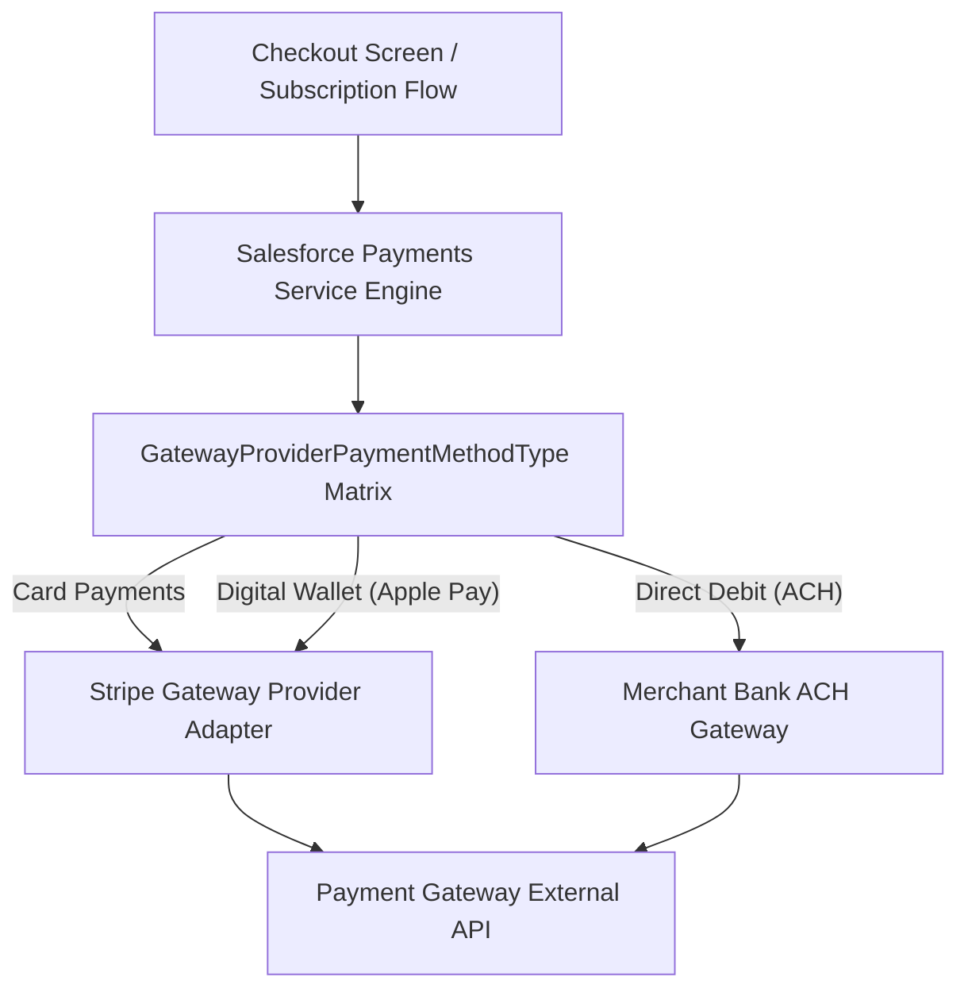

## Architectural Overview

`GatewayProviderPaymentMethodType` is an essential metadata type within the Salesforce Payments and Commerce architecture. Modern digital commerce and recurring billing implementations integrate with diverse financial payment gateways (such as Stripe, PayPal, Adyen, and Cybersource) to capture payments across global customer segments. Each payment gateway adapter offers distinct capabilities—some process standard Visa and Mastercard credit cards, others handle ACH bank transfers, while others support localized payment methods like SEPA Direct Debit, Apple Pay, or Klarna.

`GatewayProviderPaymentMethodType` acts as the declarative registry mapping a specific Payment Gateway Provider to the discrete payment method types it is authorized and certified to handle. Managing this configuration in Salesforce DX allows enterprise commerce architects to version-control their payment acceptance matrix, safely deploy new digital wallet capabilities, and prevent checkout exceptions across production storefronts.



## Directory and File Conventions

In Salesforce DX source format (`apiVersion` 68.0), `GatewayProviderPaymentMethodType` files reside in the `gatewayProviderPaymentMethodTypes/` directory.

| Property | Value |
| :--- | :--- |
| **Metadata Type Name** | `GatewayProviderPaymentMethodType` |
| **SFDX Folder** | `force-app/main/default/gatewayProviderPaymentMethodTypes/` |
| **File Suffix** | `.gatewayProviderPaymentMethodType-meta.xml` |
| **XML Root Element** | `<GatewayProviderPaymentMethodType xmlns="http://soap.sforce.com/2006/04/metadata">` |

## Key Metadata Fields

The XML schema binds payment providers to supported payment channels:

| Field Name | Field Type | Required | Description |
| :--- | :--- | :--- | :--- |
| `masterLabel` | `string` | Yes | Human-readable label displayed in payment setup consoles. |
| `developerName` | `string` | Yes | Unique programmatic identifier utilized across payment processing APIs. |
| `paymentGatewayProvider` | `string` | Yes | Developer name of the underlying `PaymentGatewayProvider` adapter. |
| `paymentMethodType` | `string` | Yes | Supported payment instrument: `CreditCard`, `DebitCard`, `ACH`, `ApplePay`, `GooglePay`, or `Sepa`. |
| `isDefault` | `boolean` | No | Specifies if this gateway mapping is the default route for the specified method type. |

> [!NOTE]
> Custom payment gateway provider implementations require an underlying Apex adapter implementing the `commercepayments.PaymentGatewayAdapter` interface.

## Declarative XML and Package Manifest Examples

Below is a declarative `GatewayProviderPaymentMethodType` enabling Apple Pay through a Stripe payment adapter:

```xml title="force-app/main/default/gatewayProviderPaymentMethodTypes/Stripe_Apple_Pay.gatewayProviderPaymentMethodType-meta.xml"
<?xml version="1.0" encoding="UTF-8"?>
<GatewayProviderPaymentMethodType xmlns="http://soap.sforce.com/2006/04/metadata">
    <developerName>Stripe_Apple_Pay</developerName>
    <masterLabel>Stripe Apple Pay Integration</masterLabel>
    <paymentGatewayProvider>Stripe_Payment_Adapter</paymentGatewayProvider>
    <paymentMethodType>ApplePay</paymentMethodType>
    <isDefault>true</isDefault>
</GatewayProviderPaymentMethodType>
```

### Package Manifest (`package.xml`)

```xml title="manifest/package.xml"
<?xml version="1.0" encoding="UTF-8"?>
<Package xmlns="http://soap.sforce.com/2006/04/metadata">
    <types>
        <members>Stripe_Apple_Pay</members>
        <name>GatewayProviderPaymentMethodType</name>
    </types>
    <version>68.0</version>
</Package>
```

## CLI Retrieval and Deployment Commands

Manage payment gateway mappings via the Salesforce CLI:

```bash
# Retrieve all gateway provider payment method types
sf project retrieve start --metadata GatewayProviderPaymentMethodType

# Deploy a specific payment method mapping to your commerce sandbox
sf project deploy start --metadata GatewayProviderPaymentMethodType:Stripe_Apple_Pay
```

## Architect Best Practices and Gotchas

- **Adapter Precedence:** The referenced `PaymentGatewayProvider` (and its supporting [ApexClass](/docs/metadata/apex-class-metadata-type/) adapter) must be successfully deployed before deploying this mapping metadata.
- **PCI Compliance Boundaries:** Configuring payment method types does not store raw credit card numbers or account secrets inside Salesforce metadata. Sensitive tokens remain isolated within encrypted gateway vaults.
- **Regional Route Testing:** In multinational deployments, ensure automated smoke tests verify that checkout experiences dynamically expose only the payment methods supported by the active regional gateway.

> [!TIP]
> Leverage `isDefault` flags carefully when orchestrating multi-gateway routing to ensure deterministic gateway selection during customer checkout.
