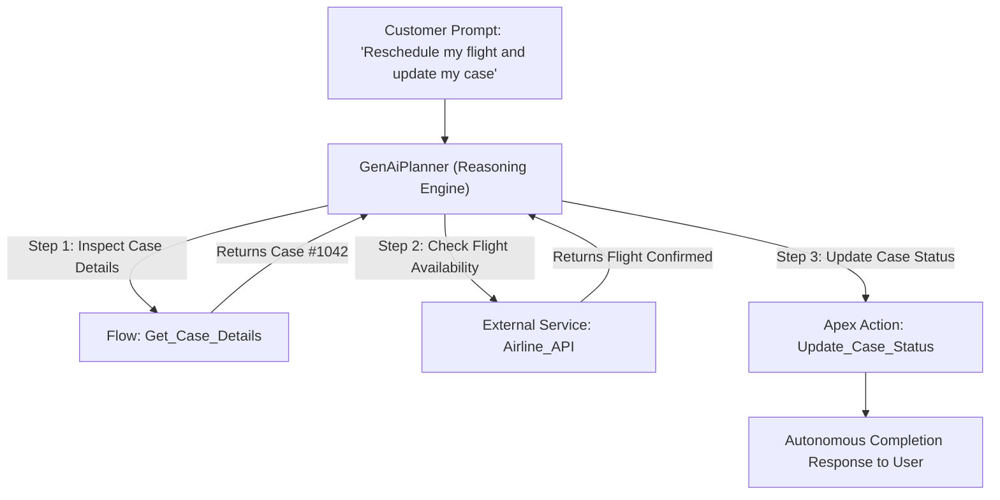

## Architectural Overview

`GenAiPlanner` is a flagship metadata component of Salesforce Agentforce (formerly Einstein Copilot and the Einstein 1 Platform). In autonomous AI agent architectures, user inquiries rarely map directly to a single static API endpoint. Instead, the autonomous agent must ingest natural language requests, assess contextual data across Salesforce CRM, decompose the user goal into discrete sub-goals, select appropriate tools (Apex actions, Flows, external APIs), and execute multi-turn reasoning loops.

`GenAiPlanner` represents the configuration of this reasoning engine. It defines the orchestration strategy—such as Reason-and-Act (ReAct) or Plan-and-Solve patterns—the underlying foundation model routing, and safety guardrails. Managing `GenAiPlanner` in Salesforce DX provides AI architects with complete version control over agent behavior, preventing regression during agent enhancement cycles.



## Directory and File Conventions

In Salesforce DX source format (`apiVersion` 68.0), `GenAiPlanner` metadata files are located in the `genAiPlanners/` directory.

| Property | Value |
| :--- | :--- |
| **Metadata Type Name** | `GenAiPlanner` |
| **SFDX Folder** | `force-app/main/default/genAiPlanners/` |
| **File Suffix** | `.genAiPlanner-meta.xml` |
| **XML Root Element** | `<GenAiPlanner xmlns="http://soap.sforce.com/2006/04/metadata">` |

## Key Metadata Fields

The `GenAiPlanner` XML schema specifies reasoning parameters, models, and execution limits:

| Field Name | Field Type | Required | Description |
| :--- | :--- | :--- | :--- |
| `masterLabel` | `string` | Yes | Human-readable title of the AI planner displayed in Agentforce Builder. |
| `developerName` | `string` | Yes | Programmatic API name utilized by Agentforce agent containers. |
| `description` | `string` | No | Architectural description of the agent's problem-solving domain and operational boundaries. |
| `plannerType` | `string` | Yes | Algorithmic reasoning strategy utilized by the agent: `ReAct` or `PlanAndSolve`. |
| `maxReasoningSteps` | `integer` | No | Maximum number of sequential tool invocation iterations permitted per user turn to prevent infinite loops. |

> [!NOTE]
> `maxReasoningSteps` acts as a crucial computational circuit breaker. Setting this value between 5 and 10 balances complex problem solving with predictable execution latency.

## Declarative XML and Package Manifest Examples

Below is a declarative `GenAiPlanner` configured for customer service autonomous resolution:

```xml title="force-app/main/default/genAiPlanners/Service_Agent_Planner.genAiPlanner-meta.xml"
<?xml version="1.0" encoding="UTF-8"?>
<GenAiPlanner xmlns="http://soap.sforce.com/2006/04/metadata">
    <developerName>Service_Agent_Planner</developerName>
    <masterLabel>Service Agent Planner</masterLabel>
    <description>Autonomous customer support reasoning engine for tier-1 service inquiries.</description>
    <plannerType>ReAct</plannerType>
    <maxReasoningSteps>8</maxReasoningSteps>
</GenAiPlanner>
```

### Package Manifest (`package.xml`)

```xml title="manifest/package.xml"
<?xml version="1.0" encoding="UTF-8"?>
<Package xmlns="http://soap.sforce.com/2006/04/metadata">
    <types>
        <members>Service_Agent_Planner</members>
        <name>GenAiPlanner</name>
    </types>
    <version>68.0</version>
</Package>
```

## CLI Retrieval and Deployment Commands

Manage `GenAiPlanner` components using modern Salesforce CLI commands:

```bash
# Retrieve all AI planners from the Agentforce environment
sf project retrieve start --metadata GenAiPlanner

# Deploy a planner definition alongside related agent instructions
sf project deploy start --metadata GenAiPlanner:Service_Agent_Planner
```

## Architect Best Practices and Gotchas

- **Agentforce Feature Licensing:** Deployments of `GenAiPlanner` will fail unless Einstein Generative AI and Agentforce are enabled in the destination org licenses and scratch org configuration.
- **Action Pre-Requisites:** All invocable [ApexClass](/docs/metadata/apex-class-metadata-type/) methods and [Flow](/docs/metadata/flow-metadata-type/) actions intended for tool invocation must be deployed before binding them to the agent.
- **Circuit Breaker Governance:** Always configure a deterministic `maxReasoningSteps` value to prevent runaway agent execution loops when resolving ambiguous customer prompts.

> [!TIP]
> Deploy `GenAiPlanner` to a dedicated Agentforce testing sandbox to run benchmark conversational regression suites before promoting to production.
