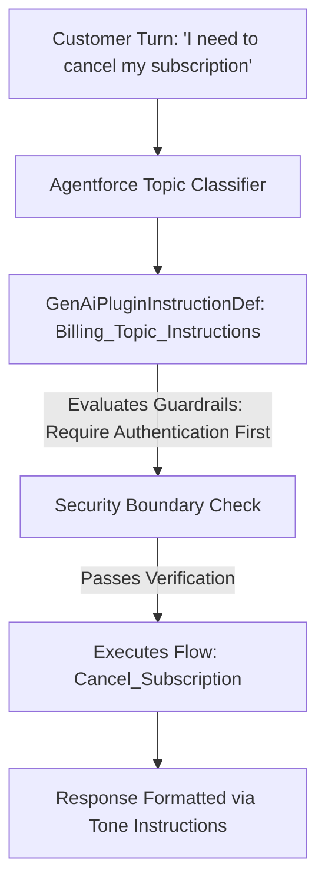

## Architectural Overview

`GenAiPluginInstructionDef` is a critical prompt engineering and orchestration metadata type within Salesforce Agentforce. In generative AI architectures, the behavior of an autonomous agent is fundamentally governed by the natural language instructions, domain boundaries, and behavioral guardrails supplied to the underlying Large Language Model (LLM).

`GenAiPluginInstructionDef` encapsulates the discrete instruction blocks associated with Agentforce Topics (plugins). These instructions guide the agent on when to classify a user conversation into a specific topic, how to extract and validate required parameters, what security boundaries to enforce, and how to format responses. Managing these system instructions as declarative metadata in Salesforce DX allows enterprise AI teams to apply software engineering discipline—such as peer code reviews, semantic versioning, and prompt regression testing—to generative agent behavior.



## Directory and File Conventions

In Salesforce DX source format (`apiVersion` 68.0), `GenAiPluginInstructionDef` components reside in the `genAiPluginInstructionDefs/` directory.

| Property | Value |
| :--- | :--- |
| **Metadata Type Name** | `GenAiPluginInstructionDef` |
| **SFDX Folder** | `force-app/main/default/genAiPluginInstructionDefs/` |
| **File Suffix** | `.genAiPluginInstructionDef-meta.xml` |
| **XML Root Element** | `<GenAiPluginInstructionDef xmlns="http://soap.sforce.com/2006/04/metadata">` |

## Key Metadata Fields

The XML schema captures instruction content, semantic categories, and parent plugin bindings:

| Field Name | Field Type | Required | Description |
| :--- | :--- | :--- | :--- |
| `masterLabel` | `string` | Yes | Human-readable title displayed in Agentforce Builder setup panels. |
| `developerName` | `string` | Yes | Unique programmatic identifier utilized across AI metadata relationships. |
| `instruction` | `string` | Yes | Natural language prompt text instructing the model on behavior, conditions, and constraints. |
| `instructionType` | `string` | Yes | Functional classification of the prompt: `TopicTrigger`, `ActionExecution`, `ResponseTone`, or `SafetyGuardrail`. |
| `language` | `string` | No | Locale code identifying the primary instruction language (e.g., `en_US`). |

> [!NOTE]
> System instructions should be written with clear conditional language (e.g., "Always verify order number before invoking the cancellation action") to ensure deterministic model reasoning.

## Declarative XML and Package Manifest Examples

Below is a declarative `GenAiPluginInstructionDef` defining operational instructions for an order returns topic:

```xml title="force-app/main/default/genAiPluginInstructionDefs/Order_Returns_Instruction.genAiPluginInstructionDef-meta.xml"
<?xml version="1.0" encoding="UTF-8"?>
<GenAiPluginInstructionDef xmlns="http://soap.sforce.com/2006/04/metadata">
    <developerName>Order_Returns_Instruction</developerName>
    <masterLabel>Order Returns Instruction</masterLabel>
    <instructionType>ActionExecution</instructionType>
    <language>en_US</language>
    <instruction>When a customer requests a product return, verify that the order was placed within the last 30 days. Ask for the return reason code. If the order value exceeds $500, require supervisor approval before issuing a return merchandise authorization (RMA).</instruction>
</GenAiPluginInstructionDef>
```

### Package Manifest (`package.xml`)

```xml title="manifest/package.xml"
<?xml version="1.0" encoding="UTF-8"?>
<Package xmlns="http://soap.sforce.com/2006/04/metadata">
    <types>
        <members>Order_Returns_Instruction</members>
        <name>GenAiPluginInstructionDef</name>
    </types>
    <version>68.0</version>
</Package>
```

## CLI Retrieval and Deployment Commands

Manage instruction definitions using the Salesforce CLI:

```bash
# Retrieve all AI plugin instruction definitions
sf project retrieve start --metadata GenAiPluginInstructionDef

# Deploy a specific instruction definition to your Agentforce sandbox
sf project deploy start --metadata GenAiPluginInstructionDef:Order_Returns_Instruction
```

## Architect Best Practices and Gotchas

- **Prompt Engineering as Code:** Treat `GenAiPluginInstructionDef` prompt text with the same rigor as Apex code. Every change to instructions should be accompanied by automated LLM evaluation runs (evals) to detect hallucinations or unintended behavior shifts.
- **Security Guardrail Redundancy:** Never rely exclusively on natural language instructions for access control. Always enforce object-level and field-level permissions, sharing rules, and validation checks in the underlying [ApexClass](/docs/metadata/apex-class-metadata-type/) or [Flow](/docs/metadata/flow-metadata-type/) actions called by the agent.
- **Context Window Hygiene:** Keep instructions concise and modular. Verbose instructions consume model context tokens and increase response latency.

> [!TIP]
> Use `GenAiPluginInstructionDef` in conjunction with Einstein Trust Layer audit logs to monitor how effectively the LLM adheres to defined behavioral boundaries in production.
