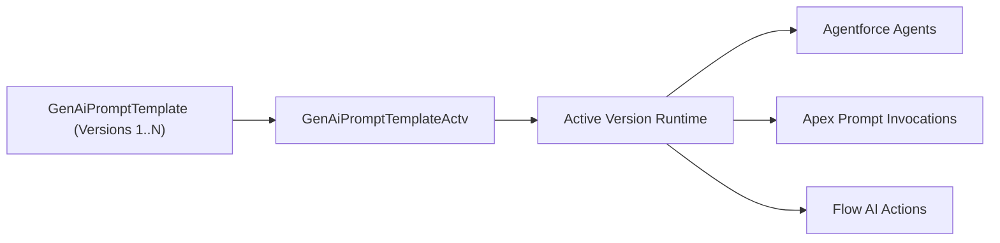

## Architectural Overview

The `GenAiPromptTemplateActv` metadata type represents the active version pointer for Generative AI prompt templates in Salesforce Prompt Builder and Einstein Studio. When prompt engineers author generative prompt templates (`GenAiPromptTemplate`), each save produces an immutable versioned iteration. Runtime invocations from Flow, Apex, or Lightning record pages do not invoke drafts; they bind exclusively to the activated version defined by `GenAiPromptTemplateActv`.

In modern Agentforce and Einstein 1 DevOps architectures, managing template activation through metadata ensures reproducible delivery across development, staging, and production orgs without manual administrative toggling.



## Directory and File Conventions

`GenAiPromptTemplateActv` components are stored in the `genAiPromptTemplateActvs` directory in SFDX source format.

| Property | Value |
| :--- | :--- |
| **Metadata Type Name** | `GenAiPromptTemplateActv` |
| **SFDX Directory** | `force-app/main/default/genAiPromptTemplateActvs/` |
| **File Suffix** | `.genAiPromptTemplateActv-meta.xml` |
| **API Version** | 68.0 |

## Key Metadata Fields

The XML schema for `GenAiPromptTemplateActv` contains the following attributes:

| Field Name | Type | Required | Description |
| :--- | :--- | :--- | :--- |
| `masterLabel` | `string` | Yes | Human-readable label for the prompt template activation. |
| `promptTemplate` | `string` | Yes | API developer name of the target `GenAiPromptTemplate`. |
| `versionNumber` | `integer` | Yes | The specific version integer of the template to mark as active. |

> [!NOTE]
> The target version specified in `versionNumber` must already exist in the org or be deployed in the same package transaction alongside the activation record.

## Declarative XML and Package Manifest Examples

Below is an example of an activation metadata file binding version 2 of an Account Summarizer prompt template:

```xml title="force-app/main/default/genAiPromptTemplateActvs/Account_Summary_Actv.genAiPromptTemplateActv-meta.xml"
<?xml version="1.0" encoding="UTF-8"?>
<GenAiPromptTemplateActv xmlns="http://soap.sforce.com/2006/04/metadata">
    <masterLabel>Account Summary Active Version</masterLabel>
    <promptTemplate>Account_Summary_Generator</promptTemplate>
    <versionNumber>2</versionNumber>
</GenAiPromptTemplateActv>
```

### Package Manifest (`package.xml`)

```xml title="manifest/package.xml"
<?xml version="1.0" encoding="UTF-8"?>
<Package xmlns="http://soap.sforce.com/2006/04/metadata">
    <types>
        <members>Account_Summary_Generator</members>
        <name>GenAiPromptTemplate</name>
    </types>
    <types>
        <members>Account_Summary_Actv</members>
        <name>GenAiPromptTemplateActv</name>
    </types>
    <version>68.0</version>
</Package>
```

## Retrieval and Deployment via SF CLI

Retrieve and deploy prompt template activations using modern Salesforce CLI commands:

```bash
# Retrieve prompt template and activation metadata
sf project retrieve start --metadata "GenAiPromptTemplate:Account_Summary_Generator" "GenAiPromptTemplateActv:Account_Summary_Actv"

# Deploy in a single transactional manifest
sf project deploy start --manifest manifest/package.xml --target-org staging-org
```

> [!TIP]
> In CI/CD pipelines, always deploy `GenAiPromptTemplate` and `GenAiPromptTemplateActv` in the same deployment payload to avoid sequencing errors.

## Senior Architect Best Practices and Gotchas

- **Atomic Deployment**: Deploying `GenAiPromptTemplateActv` without including the target `GenAiPromptTemplate` version will fail if the version has not yet landed in the destination environment.
- **Dependency Ordering**: Flows or Apex classes invoking the prompt template via ConnectApi should be deployed either alongside or after the prompt template activation.
- **Rollback Strategy**: Rolling back an active prompt template requires deploying a `GenAiPromptTemplateActv` file pointing to the previous stable `versionNumber`.
- **Scratch Org Setup**: Ensure Einstein Generative AI features are enabled in `project-scratch-def.json` before deploying GenAI metadata types.
