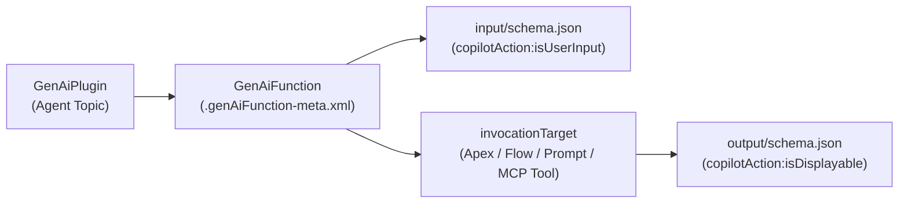

The `GenAiFunction` metadata type represents an **Agentforce Agent Action**—the bridge between the Agentforce reasoning engine and executable Salesforce platform logic. Introduced in API version 60.0, a `GenAiFunction` wraps an underlying [Flow](/docs/metadata/flow-metadata-type/), `@InvocableMethod` [ApexClass](/docs/metadata/apex-class-metadata-type/), [GenAiPromptTemplate](/docs/metadata/genai-prompt-template-metadata-type/), or Model Context Protocol (`mcpTool`) endpoint with natural-language instructions and JSON Schema definitions.

## SFDX Bundle Directory Structure

Unlike flat XML metadata types, each `GenAiFunction` is stored as a bundle directory under `force-app/main/default/genAiFunctions/<Action_Name>/`:

```text
force-app/main/default/genAiFunctions/
└── Verify_Order_Return_Eligibility/
    ├── Verify_Order_Return_Eligibility.genAiFunction-meta.xml
    ├── input/
    │   └── schema.json
    └── output/
        └── schema.json
```



## Key Metadata Fields

| Field | Type | Required | Description |
|---|---|---|---|
| `masterLabel` | `string` | Yes | Action name shown in Agentforce Builder |
| `description` | `string` | No | Natural-language instructions telling the LLM when and how to invoke this action |
| `invocationTarget` | `string` | No | API name of the target `ApexClass`, `Flow`, or `GenAiPromptTemplate` |
| `invocationTargetType` | `GenAiFunctionTargetType` | No | Target type: `apex`, `flow`, `generatePromptResponse`, `mcpTool` (v65.0+), `retriever` |
| `isConfirmationRequired` / `requiresConfirmation` | `boolean` | No | Requires explicit user confirmation in the UI before executing destructive actions |
| `isIncludeInProgressIndicator` | `boolean` | No | Shows a live status message in the chat UI while the action runs (v62.0+) |
| `progressIndicatorMessage` | `string` | No | Message shown during execution (for example, `Verifying warranty status...`) |

## Production-Grade Bundle Example

### 1. Metadata XML (`Verify_Order_Return_Eligibility.genAiFunction-meta.xml`)

```xml
<?xml version="1.0" encoding="UTF-8"?>
<GenAiFunction xmlns="http://soap.sforce.com/2006/04/metadata">
    <description>Checks whether a customer order is eligible for return based on the Order Number and purchase date. Always call this action before initiating a return.</description>
    <invocationTarget>OrderReturnEligibilityService</invocationTarget>
    <invocationTargetType>apex</invocationTargetType>
    <isConfirmationRequired>false</isConfirmationRequired>
    <isIncludeInProgressIndicator>true</isIncludeInProgressIndicator>
    <masterLabel>Verify Order Return Eligibility</masterLabel>
    <progressIndicatorMessage>Checking order return eligibility...</progressIndicatorMessage>
</GenAiFunction>
```

### 2. Input Schema (`input/schema.json`)

```json
{
  "unevaluatedProperties": false,
  "properties": {
    "orderNumber": {
      "title": "Order Number",
      "description": "The 8-digit alphanumeric Order Number provided by the customer (for example, ORD-94821).",
      "lightning:type": "lightning__textType",
      "lightning:isPII": false,
      "copilotAction:isUserInput": true
    }
  },
  "required": ["orderNumber"],
  "lightning:type": "lightning__objectType"
}
```

### 3. Output Schema (`output/schema.json`)

```json
{
  "unevaluatedProperties": false,
  "properties": {
    "isEligible": {
      "title": "Is Eligible",
      "description": "Indicates whether the order is within the 30-day return window.",
      "lightning:type": "lightning__booleanType",
      "copilotAction:isDisplayable": false,
      "copilotAction:isUsedByPlanner": true
    },
    "eligibilityReason": {
      "title": "Eligibility Reason",
      "description": "Explanation of why the order is eligible or ineligible for return.",
      "lightning:type": "lightning__textType",
      "copilotAction:isDisplayable": true,
      "copilotAction:isUsedByPlanner": true
    }
  },
  "lightning:type": "lightning__objectType"
}
```

> [!TIP]
> **`copilotAction:isUsedByPlanner` vs `copilotAction:isDisplayable`**: Set `copilotAction:isUsedByPlanner` to `true` on output fields that the reasoning engine needs to decide its next step (such as boolean flags or status codes), and set `copilotAction:isDisplayable` to `false` on internal IDs or raw JSON payloads you do not want rendered directly in the chat widget.

