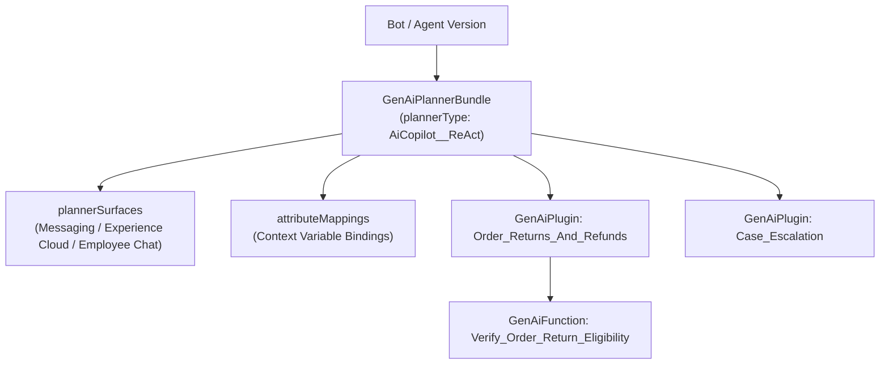

The `GenAiPlannerBundle` metadata type represents the central reasoning planner of an **Agentforce Agent**. Introduced in API version 64.0 (replacing the deprecated `GenAiPlanner` type from API versions 60.0–63.0), `GenAiPlannerBundle` binds an agent's reasoning algorithm (`plannerType`) to its [GenAiPlugin](/docs/metadata/genai-plugin-metadata-type/) topics, [GenAiFunction](/docs/metadata/genai-function-metadata-type/) actions, context variable mappings (`attributeMappings`), and channel surfaces (`plannerSurfaces`).

In Salesforce DX projects, each planner bundle resides in `force-app/main/default/genAiPlannerBundles/<PlannerName>/<PlannerName>.genAiPlannerBundle`.



## Supported Reasoning Strategies (`plannerType`)

| `plannerType` Value | Architecture | Best Used For |
|---|---|---|
| `AiCopilot__ReAct` | Reason + Act loop (Atlas Reasoning Engine) | Conversational Service Agents, SDR Agents, and Employee Copilots that dynamically select topics and actions |
| `AiCopilot__SequentialActionPlanner` | Deterministic step-by-step execution | Structured multi-step workflows where actions must execute in a fixed sequence |
| `Atlas__ConcurrentMultiAgentOrchestration` | Multi-agent supervisor orchestration | Complex enterprise tasks coordinated across multiple specialized sub-agents |

## Key Metadata Fields

| Field | Type | Required | Description |
|---|---|---|---|
| `masterLabel` | `string` | Yes | Display name of the planner in Setup |
| `description` | `string` | No | Purpose and persona overview of the planner |
| `plannerType` | `PlannerType` | Yes | Reasoning engine type (typically `AiCopilot__ReAct`) |
| `localTopics` | `GenAiLocalTopic[]` | No | Planner-scoped topic definitions (`name`, `scope`, `classificationDescription`, `localTopicLinks`) |
| `genAiPlugins` | `GenAiPlannerFunctionDef[]` | No | References to shared `GenAiPlugin` components via `<genAiPluginName>` |
| `attributeMappings` | `GenAiPlannerAttrMapping[]` | No | Binds session context variables (`attributeName`) to action inputs/outputs (`constantValue` or variable path) |
| `plannerSurfaces` | `GenAiPlannerSurface[]` | No | Configures channel-specific adaptive response cards (`surface`, `surfaceType`, `adaptiveResponseAllowed`) |

## Production-Grade XML Example

Below is a `GenAiPlannerBundle` (`Customer_Order_Support_Agent.genAiPlannerBundle`) using the `AiCopilot__ReAct` reasoning engine and referencing two `GenAiPlugin` topics:

```xml
<?xml version="1.0" encoding="UTF-8"?>
<GenAiPlannerBundle xmlns="http://soap.sforce.com/2006/04/metadata">
    <description>ReAct reasoning planner for autonomous customer order inquiries and returns processing.</description>
    <genAiPlugins>
        <genAiPluginName>Order_Returns_And_Refunds</genAiPluginName>
    </genAiPlugins>
    <genAiPlugins>
        <genAiPluginName>General_FAQ_And_Escalation</genAiPluginName>
    </genAiPlugins>
    <masterLabel>Customer Order Support Agent Planner</masterLabel>
    <plannerType>AiCopilot__ReAct</plannerType>
</GenAiPlannerBundle>
```

> [!RELEASE] Summer '25 (API 64.0)
> `GenAiPlanner` was officially deprecated in API version 64.0 in favor of `GenAiPlannerBundle`. When upgrading `sfdx-project.json` `sourceApiVersion` to `64.0` or higher, retrieve `GenAiPlannerBundle` instead of `GenAiPlanner` in your `package.xml`.

## Complete Agentforce Deployment Manifest (`package.xml`)

When migrating an Agentforce agent between sandboxes, retrieve the entire dependency chain in a single manifest:

```xml
<?xml version="1.0" encoding="UTF-8"?>
<Package xmlns="http://soap.sforce.com/2006/04/metadata">
    <types>
        <members>*</members>
        <name>GenAiPromptTemplate</name>
    </types>
    <types>
        <members>*</members>
        <name>GenAiFunction</name>
    </types>
    <types>
        <members>*</members>
        <name>GenAiPlugin</name>
    </types>
    <types>
        <members>*</members>
        <name>GenAiPlannerBundle</name>
    </types>
    <version>68.0</version>
</Package>
```

