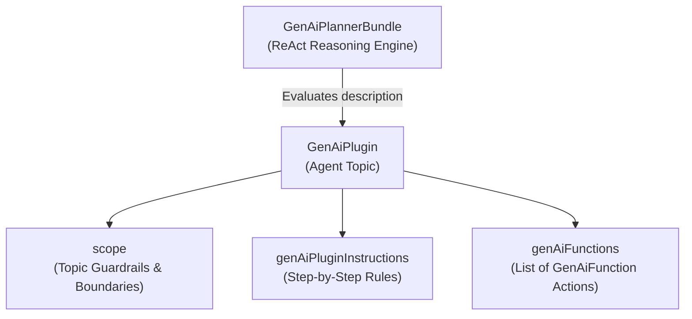

The `GenAiPlugin` metadata type represents an **Agentforce Topic**—a modular capability domain composed of natural-language classification rules, behavioral guardrails (`scope`), step-by-step instructions (`genAiPluginInstructions`), and executable actions ([GenAiFunction](/docs/metadata/genai-function-metadata-type/)). Introduced in API version 60.0, `GenAiPlugin` is the core building block referenced by an agent's [GenAiPlannerBundle](/docs/metadata/genai-planner-bundle-metadata-type/).

In Salesforce DX projects, topic definitions are stored in `force-app/main/default/genAiPlugins/` with the `.genAiPlugin-meta.xml` suffix.



## Why `GenAiPlugin` Design Determines Agent Accuracy

In Agentforce's ReAct (Reason + Act) architecture, the LLM does not evaluate every single action across your entire org on every turn. Instead:
1. **Topic Classification (`description`)**: The planner reads the `description` of all `GenAiPlugin` topics attached to the agent and selects the best-matching topic.
2. **Scoped Reasoning (`scope` + `genAiPluginInstructions`)**: Once inside the selected `GenAiPlugin`, the agent is restricted to the `genAiFunctions` listed in that plugin and follows its instructions to decide which action to call.

## Key Metadata Fields

| Field | Type | Required | Description |
|---|---|---|---|
| `masterLabel` | `string` | Yes | Topic label shown in Agentforce Builder |
| `developerName` | `string` | No | Unique API name of the topic |
| `pluginType` | `string` | Yes | Must be set to `Topic` |
| `description` | `string` | No | **Classification Description**: explains when the reasoning engine should select this topic |
| `scope` | `string` | No | **Scope**: defines the job and strict boundaries of the agent within this topic |
| `canEscalate` | `boolean` | No | Whether the topic allows escalating the session to a human agent |
| `genAiFunctions` | `GenAiPluginFunctionDef[]` | No | Array of `<functionName>` references pointing to `GenAiFunction` components |
| `genAiPluginInstructions` | `GenAiPluginInstructionDef[]` | No | Array of natural-language instructions (`description`, `developerName`, `sortOrder`) |
| `language` | `string` | No | Language code (for example, `en_US`) |

## Production-Grade XML Example

Below is a `GenAiPlugin` (`Order_Returns_And_Refunds.genAiPlugin-meta.xml`) that defines a customer-facing order return topic with clear classification rules, instructions, and two custom Agent Actions:

```xml
<?xml version="1.0" encoding="UTF-8"?>
<GenAiPlugin xmlns="http://soap.sforce.com/2006/04/metadata">
    <canEscalate>true</canEscalate>
    <description>Handles customer inquiries about returning purchased items, checking return eligibility windows, generating return shipping labels, and checking refund statuses.</description>
    <developerName>Order_Returns_And_Refunds</developerName>
    <genAiFunctions>
        <functionName>Verify_Order_Return_Eligibility</functionName>
    </genAiFunctions>
    <genAiFunctions>
        <functionName>Create_Return_Authorization</functionName>
    </genAiFunctions>
    <genAiPluginInstructions>
        <description>Always call Verify_Order_Return_Eligibility using the customer's Order Number before promising a refund or creating a return authorization.</description>
        <developerName>Instruction_Verify_Eligibility_First</developerName>
        <masterLabel>Verify Eligibility First</masterLabel>
        <sortOrder>0</sortOrder>
    </genAiPluginInstructions>
    <genAiPluginInstructions>
        <description>If the order total exceeds $1,000 or the return window expired within the last 7 days, offer to escalate the conversation to a human support specialist.</description>
        <developerName>Instruction_High_Value_Escalation</developerName>
        <masterLabel>High Value Escalation</masterLabel>
        <sortOrder>1</sortOrder>
    </genAiPluginInstructions>
    <language>en_US</language>
    <masterLabel>Order Returns and Refunds</masterLabel>
    <pluginType>Topic</pluginType>
    <scope>Your job is only to verify order return eligibility and initiate return authorizations for verified orders. Never modify shipping addresses or process credit card chargebacks directly.</scope>
</GenAiPlugin>
```

> [!TIP]
> **Preventing Topic Overlap**: If two `GenAiPlugin` files have vague or overlapping `<description>` text (for example, "Handles customer orders" and "Helps with order issues"), the planner will inconsistently switch topics mid-conversation. Write mutually exclusive classification descriptions that explicitly list the user intents covered by each topic.

> [!NOTE]
> **Deploy Order**: Always deploy referenced [GenAiFunction](/docs/metadata/genai-function-metadata-type/) components before or in the same deployment transaction as `GenAiPlugin`, and deploy `GenAiPlugin` before [GenAiPlannerBundle](/docs/metadata/genai-planner-bundle-metadata-type/).

