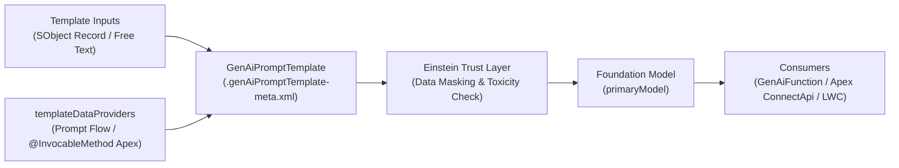

The `GenAiPromptTemplate` metadata type represents a Prompt Builder template in Salesforce Agentforce and Einstein Generative AI. Introduced in API version 60.0, it encapsulates the prompt instructions, LLM model configuration (`primaryModel`), input parameters, and CRM grounding data providers ([Flow](/docs/metadata/flow-metadata-type/), [ApexClass](/docs/metadata/apex-class-metadata-type/), and merge fields) in a single versioned XML file.

In Salesforce DX projects, prompt templates are stored in `force-app/main/default/genAiPromptTemplates/` with the file suffix `.genAiPromptTemplate-meta.xml`.



## Prompt Template Types (`type` Field)

The `type` field determines where the prompt template can be invoked and what inputs it accepts:

| Template Type (`type`) | Input Rules | Primary Use Case |
|---|---|---|
| `einstein_gpt__flex` | Up to 5 inputs (`SOBJECT` or `freeText` primitive) | Custom workflows invoked from [GenAiFunction](/docs/metadata/genai-function-metadata-type/), Flows, LWC, or Apex |
| `einstein_gpt__fieldCompletion` | 1 target `SOBJECT` input + `relatedField` (`Object.Field`) | Einstein Field Generation attached to a Dynamic Forms field on a [FlexiPage](/docs/metadata/flexipage-metadata-type/) |
| `einstein_gpt__salesEmail` | Sender `User`, Recipient `Contact`/`Lead`, plus optional related SObject | Personalized outbound sales emails in Lightning Experience Email Composer |
| `einstein_gpt__recordSummary` | 1 target `SOBJECT` input | Summarizing Cases, Opportunities, or Accounts in Agentforce conversations |

## Key Fields on `GenAiPromptTemplate` and `GenAiPromptTemplateVersion`

| Field | Location | Required | Description |
|---|---|---|---|
| `masterLabel` | Root | Yes | UI display name in Prompt Builder |
| `developerName` | Root | No | Unique API name of the prompt template |
| `type` | Root | Yes | Template category (`einstein_gpt__flex`, `einstein_gpt__fieldCompletion`, etc.) |
| `relatedEntity` | Root | Conditional | Target object API name (required for `fieldCompletion` and `recordSummary`) |
| `relatedField` | Root | Conditional | Target `Object.Field` name (required when `type` is `einstein_gpt__fieldCompletion`) |
| `activeVersionIdentifier` | Root | No | Matches the `versionIdentifier` of the published `templateVersions` entry (API v63.0+) |
| `content` | `templateVersions` | Yes | The prompt text containing merge tokens such as `{!$Input:Case.Subject}` |
| `primaryModel` | `templateVersions` | Yes | LLM identifier (for example, `sfdc_ai__DefaultOpenAIGPT4OmniMini`) |
| `status` | `templateVersions` | Yes | `Draft` or `Published` |
| `inputs` | `templateVersions` | No | Input parameters (`apiName`, `definition`, `required`, `masterLabel`) |
| `templateDataProviders` | `templateVersions` | No | Grounding Flows (`flow://...`) or Apex classes (`apex://...`) |

## Production-Grade XML Example (Flex Template Grounded with Apex)

Below is a `GenAiPromptTemplate` (`Case_Resolution_Summary.genAiPromptTemplate-meta.xml`) that takes a `Case` record input, calls an `@InvocableMethod` Apex class to fetch warranty entitlements, and generates a structured resolution summary:

```xml
<?xml version="1.0" encoding="UTF-8"?>
<GenAiPromptTemplate xmlns="http://soap.sforce.com/2006/04/metadata">
    <activeVersionIdentifier>v1_CaseResolution_2026</activeVersionIdentifier>
    <description>Generates an executive resolution summary for escalated support cases.</description>
    <developerName>Case_Resolution_Summary</developerName>
    <masterLabel>Case Resolution Summary</masterLabel>
    <templateVersions>
        <content>You are a Senior Technical Support Engineer. Summarize the following Case in 3 concise bullet points (Issue, Root Cause, Resolution).
Case Subject: {!$Input:TargetCase.Subject}
Case Description: {!$Input:TargetCase.Description}
Warranty Context: {!$Apex:CaseWarrantyDataProvider.Prompt}
Do not invent facts outside the provided Case data.</content>
        <inputs>
            <apiName>TargetCase</apiName>
            <definition>SOBJECT://Case</definition>
            <masterLabel>Target Case</masterLabel>
            <referenceName>Input:TargetCase</referenceName>
            <required>true</required>
        </inputs>
        <primaryModel>sfdc_ai__DefaultOpenAIGPT4OmniMini</primaryModel>
        <status>Published</status>
        <templateDataProviders>
            <definition>apex://CaseWarrantyDataProvider</definition>
            <parameters>
                <definition>SOBJECT://Case</definition>
                <isRequired>true</isRequired>
                <parameterName>inputCase</parameterName>
                <valueExpression>{!$Input:TargetCase}</valueExpression>
            </parameters>
            <referenceName>Apex:CaseWarrantyDataProvider</referenceName>
        </templateDataProviders>
        <versionIdentifier>v1_CaseResolution_2026</versionIdentifier>
    </templateVersions>
    <type>einstein_gpt__flex</type>
    <visibility>Global</visibility>
</GenAiPromptTemplate>
```

> [!TIP]
> **Invoking `GenAiPromptTemplate` from Apex**: You can execute any `Published` prompt template in Apex using `ConnectApi.EinsteinLLM.generateMessagesForPromptTemplate('Case_Resolution_Summary', promptGenerationsInput)`. This ensures your Apex logic automatically benefits from the Einstein Trust Layer's PII masking and zero-data-retention policies.

> [!WARNING]
> **Immutable Published Versions**: Once a `GenAiPromptTemplateVersion` has `status` set to `Published` in a target org, Salesforce prevents modifying the `content` or `inputs` of that same `versionIdentifier`. When updating a prompt template in source control, either create a new `<templateVersions>` block with a new `versionIdentifier` and update `<activeVersionIdentifier>`, or keep pre-release templates in `Draft` until UAT sign-off.

