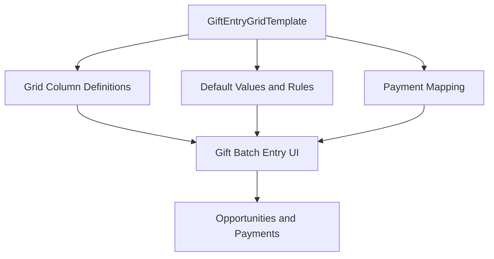

## Architectural Overview

`GiftEntryGridTemplate` is a specialized metadata type used in Salesforce for Nonprofits and Fundraising applications to configure batch gift entry layouts. High-volume fundraising operations require rapid, keyboard-friendly data entry for checks, cash, and major gifts. `GiftEntryGridTemplate` defines the grid columns, default field values, validation rules, and payment gateway linkages used by donation processors.

From an enterprise governance perspective, storing gift entry grid templates in source control ensures consistent fundraising procedures, standardized data quality rules, and automated scratch org bootstrapping for nonprofit development teams.



## Directory and File Conventions

`GiftEntryGridTemplate` components reside in the `giftEntryGridTemplates` directory:

| Property | Value |
| :--- | :--- |
| **Metadata Type Name** | `GiftEntryGridTemplate` |
| **SFDX Directory** | `force-app/main/default/giftEntryGridTemplates/` |
| **File Suffix** | `.giftEntryGridTemplate-meta.xml` |
| **API Version** | 68.0 |

## Key Metadata Fields

The XML representation of `GiftEntryGridTemplate` contains configuration nodes for column formatting and batch behavior:

| Field Name | Type | Required | Description |
| :--- | :--- | :--- | :--- |
| `masterLabel` | `string` | Yes | Display name of the gift entry template. |
| `description` | `string` | No | Description explaining the intended donation workflow. |
| `isDefault` | `boolean` | No | Indicates whether this template is the default selection for new batches. |
| `status` | `string` | Yes | Lifecycle status such as `Active` or `Draft`. |
| `templateFields` | `string` | No | Serialized configuration describing grid columns and default field mappings. |

> [!NOTE]
> `GiftEntryGridTemplate` relies on underlying objects such as `Opportunity`, `npe01__OppPayment__c`, or Nonprofit Cloud `GiftTransaction`. Ensure these objects and custom fields exist prior to deployment.

## Declarative XML and Package Manifest Examples

Below is an illustrative configuration for an Annual Gala Batch Gift Entry template:

```xml title="force-app/main/default/giftEntryGridTemplates/Annual_Gala_Template.giftEntryGridTemplate-meta.xml"
<?xml version="1.0" encoding="UTF-8"?>
<GiftEntryGridTemplate xmlns="http://soap.sforce.com/2006/04/metadata">
    <masterLabel>Annual Gala Batch Entry</masterLabel>
    <description>Standard grid layout for annual gala check and cash donations</description>
    <isDefault>false</isDefault>
    <status>Active</status>
</GiftEntryGridTemplate>
```

### Package Manifest (`package.xml`)

```xml title="manifest/package.xml"
<?xml version="1.0" encoding="UTF-8"?>
<Package xmlns="http://soap.sforce.com/2006/04/metadata">
    <types>
        <members>Annual_Gala_Template</members>
        <name>GiftEntryGridTemplate</name>
    </types>
    <version>68.0</version>
</Package>
```

## Retrieval and Deployment via SF CLI

Retrieve and deploy templates using the following commands:

```bash
# Retrieve a specific gift entry grid template
sf project retrieve start --metadata "GiftEntryGridTemplate:Annual_Gala_Template"

# Deploy all templates to a target sandbox
sf project deploy start --metadata "GiftEntryGridTemplate" --target-org uat-org
```

> [!TIP]
> Use permission sets alongside `GiftEntryGridTemplate` to ensure gift officers have read and edit permissions on all mapped donation fields.

## Senior Architect Best Practices and Gotchas

- **Schema Dependencies**: Templates referencing custom fields that are deployed in subsequent packages will cause compilation failures. Deploy schema metadata before or with grid templates.
- **Default Template Governance**: Ensure only one template is marked with `<isDefault>true</isDefault>` per donation context to avoid conflicting default states.
- **Scratch Org Definitions**: Ensure the appropriate Nonprofit Cloud or fundraising features and package dependencies are configured in your `project-scratch-def.json`.
