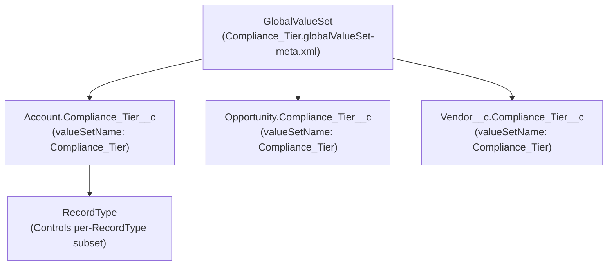

The `GlobalValueSet` metadata type represents a centralized, reusable list of picklist values shared across multiple [CustomField](/docs/metadata/custom-field-metadata-type/) definitions on different objects. Introduced in API version 38.0 (replacing `GlobalPicklist` from API version 37.0), `GlobalValueSet` guarantees domain-value consistency across your data model—such as sharing a single `ISO_Currency_Region` or `Compliance_Tier` value list across `Account`, `Opportunity`, `Contract`, and `Order`.

In Salesforce DX projects, global value sets are stored in `force-app/main/default/globalValueSets/` with the `.globalValueSet-meta.xml` suffix.



## Architectural Characteristics and Limits

- **Always Restricted**: Any custom picklist referencing a `GlobalValueSet` is strictly enforced at the database layer—Apex, Bulk API, and REST API cannot insert values that are not active in the `GlobalValueSet`.
- **Capacity Limits**: Up to **500** `GlobalValueSet` definitions per org, and up to **1,000** combined active and inactive `customValue` entries per `GlobalValueSet`.

## Key Metadata Fields

| Field | Type | Required | Description |
|---|---|---|---|
| `masterLabel` | `string` | Yes | UI display name in Setup -> Picklist Value Sets |
| `customValue` | `CustomValue[]` | No | List of picklist values (`fullName`, `label`, `default`, `isActive`, `color`) |
| `sorted` | `boolean` | No | Whether values are sorted alphabetically (`true`) or in XML declaration order (`false`) |
| `description` | `string` | No | Architectural notes explaining which objects consume this value set |

## Production-Grade XML Example

### 1. Defining the `GlobalValueSet` (`Compliance_Tier.globalValueSet-meta.xml`)

```xml
<?xml version="1.0" encoding="UTF-8"?>
<GlobalValueSet xmlns="http://soap.sforce.com/2006/04/metadata">
    <customValue>
        <fullName>Tier_1_Standard</fullName>
        <default>true</default>
        <label>Tier 1 - Standard</label>
    </customValue>
    <customValue>
        <fullName>Tier_2_Enhanced</fullName>
        <default>false</default>
        <label>Tier 2 - Enhanced Due Diligence</label>
    </customValue>
    <customValue>
        <fullName>Tier_3_Restricted</fullName>
        <default>false</default>
        <label>Tier 3 - Restricted Entity</label>
    </customValue>
    <customValue>
        <fullName>Legacy_Unverified</fullName>
        <default>false</default>
        <isActive>false</isActive>
        <label>Legacy Unverified (Retired)</label>
    </customValue>
    <description>Enterprise KYB/AML compliance tier shared across Account, Contact, and Vendor objects.</description>
    <masterLabel>Compliance Tier</masterLabel>
    <sorted>false</sorted>
</GlobalValueSet>
```

### 2. Referencing the `GlobalValueSet` in a `CustomField`

```xml
<?xml version="1.0" encoding="UTF-8"?>
<CustomField xmlns="http://soap.sforce.com/2006/04/metadata">
    <fullName>Compliance_Tier__c</fullName>
    <label>Compliance Tier</label>
    <required>false</required>
    <type>Picklist</type>
    <valueSet>
        <restricted>true</restricted>
        <valueSetName>Compliance_Tier</valueSetName>
    </valueSet>
</CustomField>
```

> [!WARNING]
> **RecordType Synchronization Gotcha**: Deploying a new `<customValue>` inside a `GlobalValueSet` does **not** automatically enable that value on objects that use [RecordType](/docs/metadata/record-type-metadata-type/) metadata. Always commit the corresponding `<picklistValues>` addition in your `.recordType-meta.xml` files in the same pull request, otherwise users will not see the new value in the UI and DML with that RecordType will fail.

## Querying `GlobalValueSet` via Tooling API

You can inspect `GlobalValueSet` definitions using the Tooling API:

```sql
-- Query GlobalValueSets via Tooling API
SELECT Id, DeveloperName, MasterLabel, Description, NamespacePrefix
FROM GlobalValueSet
ORDER BY MasterLabel ASC
```

