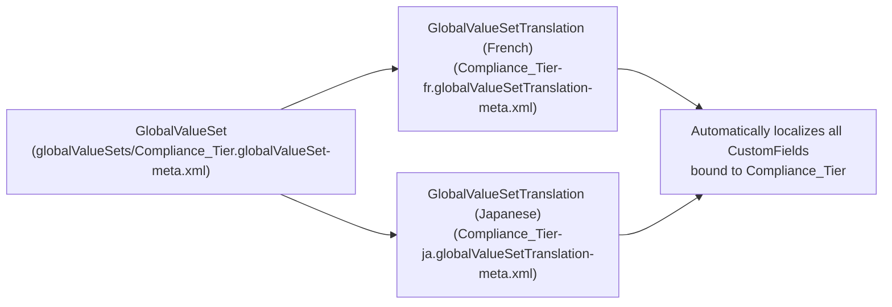

## Why the `GlobalValueSetTranslation` Metadata Type Matters

When your architecture uses a [GlobalValueSet](/docs/metadata/global-value-set-metadata-type/) to share a single canonical picklist across multiple objects (for example, `Region`, `Compliance_Tier`, or `ISO_Currency_Region`), **`GlobalValueSetTranslation`** lets you translate those picklist values **once per language** rather than repeating translations on every individual field.



---

## SFDX Source Format & Naming Convention

Files are stored in `force-app/main/default/globalValueSetTranslations/` using the naming pattern:
`<GlobalValueSetDeveloperName>-<LanguageLocaleKey>.globalValueSetTranslation-meta.xml`

Examples:
- `Compliance_Tier-es.globalValueSetTranslation-meta.xml` (Spanish)
- `Compliance_Tier-pt_BR.globalValueSetTranslation-meta.xml` (Portuguese - Brazil)
- `Compliance_Tier-de.globalValueSetTranslation-meta.xml` (German)

---

## Key Metadata Fields

| Field | Type | Required | Description |
|---|---|---|---|
| `valueTranslation` | `ValueTranslation[]` | No | List of picklist value translations for the target language. |
| `valueTranslation.masterLabel` | `string` | Yes | The exact **Master Label** (not API `fullName`) of the picklist value defined in the `GlobalValueSet`. |
| `valueTranslation.translation` | `string` | Yes | The localized display label shown to users in the target language. |

---

## Real-World XML Example (`globalValueSetTranslations/Compliance_Tier-fr.globalValueSetTranslation-meta.xml`)

```xml
<?xml version="1.0" encoding="UTF-8"?>
<GlobalValueSetTranslation xmlns="http://soap.sforce.com/2006/04/metadata">
    <valueTranslation>
        <masterLabel>Standard Verification</masterLabel>
        <translation>Vérification standard</translation>
    </valueTranslation>
    <valueTranslation>
        <masterLabel>Enhanced Due Diligence</masterLabel>
        <translation>Diligence raisonnable renforcée</translation>
    </valueTranslation>
    <valueTranslation>
        <masterLabel>Restricted Entity</masterLabel>
        <translation>Entité restreinte</translation>
    </valueTranslation>
</GlobalValueSetTranslation>
```

---

## Retrieving & Deploying via `package.xml`

```xml
<?xml version="1.0" encoding="UTF-8"?>
<Package xmlns="http://soap.sforce.com/2006/04/metadata">
    <types>
        <members>Compliance_Tier</members>
        <name>GlobalValueSet</name>
    </types>
    <types>
        <members>Compliance_Tier-fr</members>
        <members>Compliance_Tier-de</members>
        <name>GlobalValueSetTranslation</name>
    </types>
    <version>68.0</version>
</Package>
```

> [!WARNING]
> **`masterLabel` Binding Gotcha:** Notice that `<masterLabel>` in `GlobalValueSetTranslation` matches the `<label>` of the value in `GlobalValueSet`, **not** its `<fullName>` API name! If a business admin edits the English display label of a Global Value Set entry in Setup from `Standard Verification` to `Standard KYC Verification`, all `GlobalValueSetTranslation` records pointing to `Standard Verification` become orphaned until their `<masterLabel>` is updated to match.
