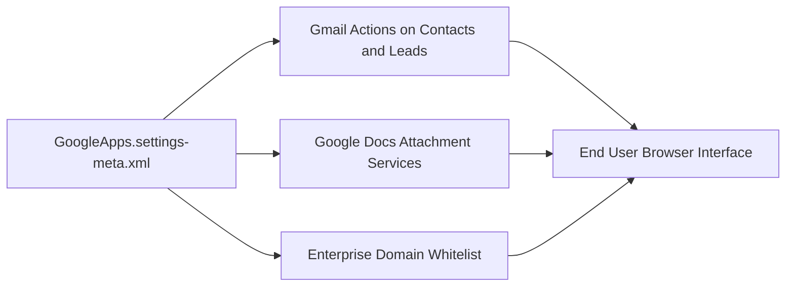

## Architectural Overview

`GoogleAppsSettings` controls the org-wide integration between Salesforce and Google Workspace (formerly Google Apps / G Suite). This metadata component enables administrative controls for activating Gmail buttons and links on standard contact and lead records, attaching Google Docs to records, and establishing domain verification for enterprise Google tenants.

In modern enterprise architectures where productivity suites integrate directly with CRM workflows, tracking `GoogleAppsSettings` in version control guarantees that sandboxes and scratch environments mirror production workspace integration settings.



## Directory and File Conventions

`GoogleAppsSettings` belongs to the Settings metadata domain and is represented as an individual XML file in source format:

| Property | Value |
| :--- | :--- |
| **Metadata Type Name** | `Settings` (member: `GoogleApps`) |
| **SFDX Directory** | `force-app/main/default/settings/` |
| **File Name** | `GoogleApps.settings-meta.xml` |
| **Scratch Org Key** | `googleAppsSettings` |

## Key Metadata Fields

The `GoogleAppsSettings` schema contains administrative flags for Google Workspace integration:

| Field Name | Type | Required | Description |
| :--- | :--- | :--- | :--- |
| `enableGmail` | `boolean` | No | Enables standard 'Send Gmail' action buttons on Contacts and Leads. |
| `enableGoogleDocs` | `boolean` | No | Allows users to link and collaborate on Google Docs within Salesforce record feeds. |
| `enableGoogleApps` | `boolean` | No | Master toggle activating Google Workspace integration across the org. |
| `googleAppsDomain` | `string` | No | The primary domain verified with Google Workspace for single-domain organizations. |

> [!NOTE]
> Modern deployments often leverage Gmail Integration through Outlook and Gmail Einstein Activity Capture alongside legacy GoogleAppsSettings.

## Declarative XML and Package Manifest Examples

Below is an enterprise configuration enabling Gmail and Docs with an authorized corporate domain:

```xml title="force-app/main/default/settings/GoogleApps.settings-meta.xml"
<?xml version="1.0" encoding="UTF-8"?>
<GoogleAppsSettings xmlns="http://soap.sforce.com/2006/04/metadata">
    <enableGmail>true</enableGmail>
    <enableGoogleApps>true</enableGoogleApps>
    <enableGoogleDocs>true</enableGoogleDocs>
    <googleAppsDomain>example.com</googleAppsDomain>
</GoogleAppsSettings>
```

### Scratch Org Configuration (`config/project-scratch-def.json`)

```json title="config/project-scratch-def.json"
{
  "orgName": "Google Workspace Integration Scratch Org",
  "edition": "Enterprise",
  "settings": {
    "googleAppsSettings": {
      "enableGoogleApps": true,
      "enableGmail": true,
      "enableGoogleDocs": true
    }
  }
}
```

### Package Manifest (`package.xml`)

```xml title="manifest/package.xml"
<?xml version="1.0" encoding="UTF-8"?>
<Package xmlns="http://soap.sforce.com/2006/04/metadata">
    <types>
        <members>GoogleApps</members>
        <name>Settings</name>
    </types>
    <version>68.0</version>
</Package>
```

## Retrieval and Deployment via SF CLI

Commands to retrieve and deploy GoogleApps settings:

```bash
# Retrieve GoogleApps settings
sf project retrieve start --metadata "Settings:GoogleApps"

# Deploy GoogleApps settings to an org
sf project deploy start --metadata "Settings:GoogleApps" --target-org production-org
```

> [!TIP]
> Always verify that corporate domain security policies permit third-party API access when linking Google Workspace domains to sandbox orgs.

## Senior Architect Best Practices and Gotchas

- **Domain Multi-Tenancy**: When deploying to sandboxes, verify whether sandbox users share the production Google Workspace domain or require dedicated testing domains.
- **Security and CSP**: Modern Lightning Experience pages embedding Google Docs or Sheets require complementary Content Security Policy (CSP) and Trusted URLs configuration.
- **Superseded Features**: Evaluate whether user requirements are better served by the modern Salesforce Inbox or Einstein Activity Capture rather than legacy Google Apps buttons.
