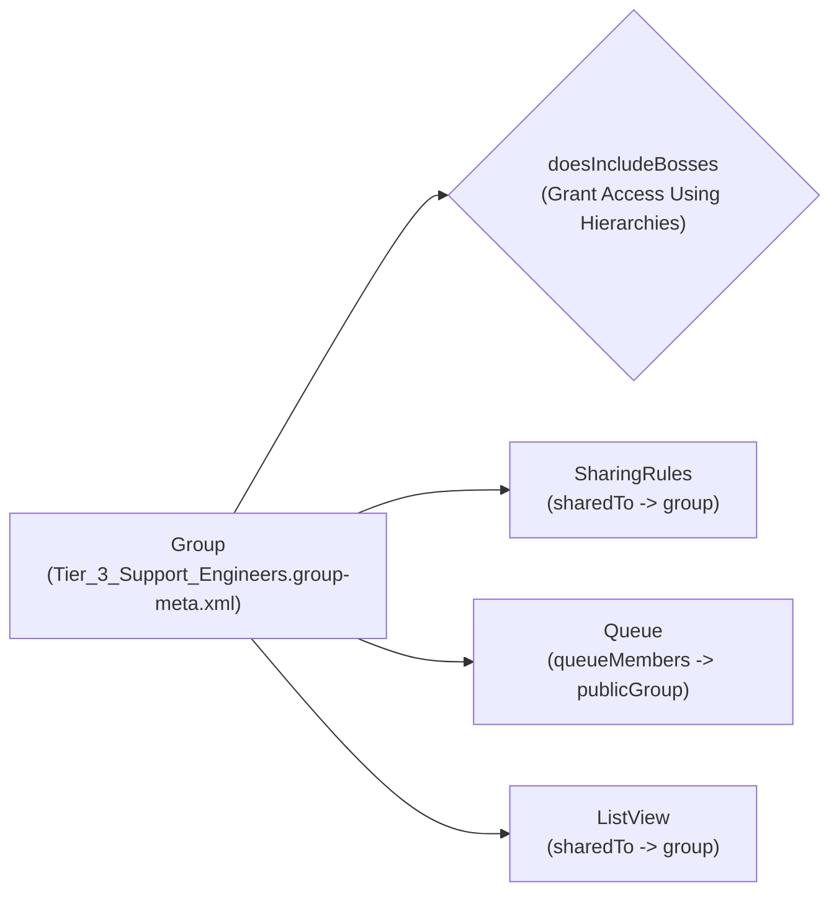

The `Group` metadata type represents a **Public Group** in Salesforce. Introduced in API version 24.0, Public Groups are foundational building blocks for [SharingRules](/docs/metadata/sharing-rules-metadata-type/), [Queue](/docs/metadata/queue-metadata-type/) memberships, [ListView](/docs/metadata/list-view-metadata-type/) visibility (`sharedTo`), and Report/Dashboard folder sharing.

In Salesforce DX projects, public groups are stored in `force-app/main/default/groups/` with the `.group-meta.xml` suffix.



## Why `doesIncludeBosses` Is Critical for Enterprise Scale

Every `Group` includes a `<doesIncludeBosses>` boolean flag corresponding to **Grant Access Using Hierarchies** in Setup:
- When `true` (default), any record shared with the Public Group is also implicitly shared with every manager above the group's members in the [Role](/docs/metadata/role-metadata-type/) hierarchy.
- When `false`, record access stops strictly at the members of the group. In large enterprises with deep role hierarchies, setting `<doesIncludeBosses>false</doesIncludeBosses>` on exception or project-based Public Groups dramatically reduces the number of implicit group maintenance rows Salesforce has to recalculate during user role moves.

## Key Metadata Fields

| Field | Type | Required | Description |
|---|---|---|---|
| `name` | `string` | Yes | UI display label of the Public Group |
| `doesIncludeBosses` | `boolean` | No | Whether users higher in the role hierarchy inherit access (`true` by default) |
| `description` | `string` | No | Governance notes explaining why the group exists (introduced in API version 62.0) |
| `fullName` | `string` | No | Developer API name (inferred from the filename in SFDX) |

## Production-Grade XML Example

Below is a `Group` definition (`Tier_3_Support_Engineers.group-meta.xml`) with hierarchy inheritance disabled to restrict sensitive incident records strictly to group members:

```xml
<?xml version="1.0" encoding="UTF-8"?>
<Group xmlns="http://soap.sforce.com/2006/04/metadata">
    <description>Restricted incident response group for Tier 3 escalation engineers. Hierarchy inheritance disabled per InfoSec policy.</description>
    <doesIncludeBosses>false</doesIncludeBosses>
    <name>Tier 3 Support Engineers</name>
</Group>
```

> [!NOTE]
> **Why Group Members Are Not in `.group-meta.xml`**: By design, Salesforce does not serialize individual User assignments inside `Group` XML metadata because `User` records are data, not metadata. Instead, assign Roles or nested Groups via post-deploy scripts or manage `GroupMember` records via data migration tools.

## Querying Public Groups and Members with SOQL

In the Salesforce database, Public Groups are stored in the `Group` object with `Type = 'Regular'`:

```sql
-- 1. List all Public Groups and whether they grant access using hierarchies
SELECT Id, Name, DeveloperName, DoesIncludeBosses, CreatedDate
FROM Group
WHERE Type = 'Regular'
ORDER BY Name ASC

-- 2. Query all members (Users, Roles, or nested Groups) inside a Public Group
SELECT Id, GroupId, Group.DeveloperName, UserOrGroupId
FROM GroupMember
WHERE Group.Type = 'Regular'
  AND Group.DeveloperName = 'Tier_3_Support_Engineers'
```

