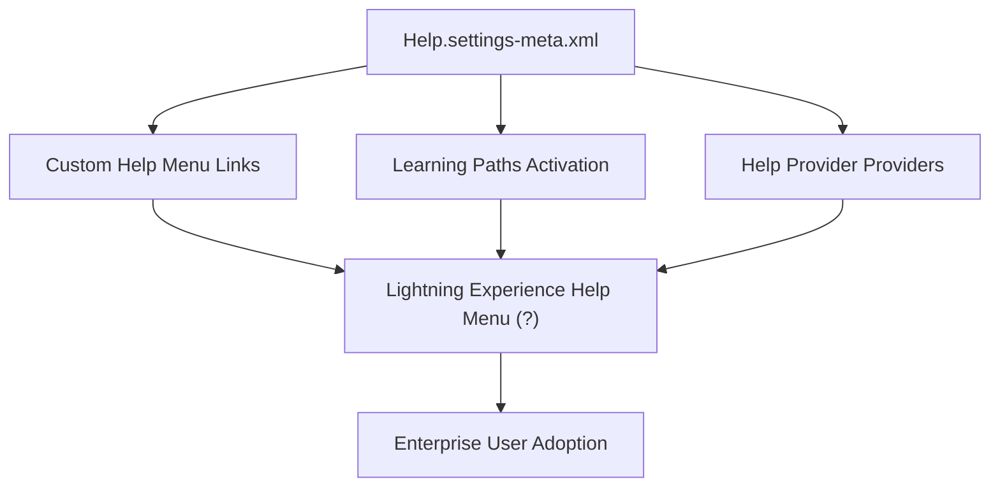

## Architectural Overview

`HelpSettings` is the metadata configuration point for in-app help, Learning Paths, and global Help Menu customization in Salesforce Lightning Experience. Large enterprise organizations customize the Help Menu to direct employees to internal wikis, standard operating procedures (SOPs), support ticketing systems, and tailored Trailhead learning modules.

Deploying `HelpSettings` through version control ensures that user enablement, onboarding pathways, and internal help desk routing remain synchronized across environments during phased CRM rollouts.



## Directory and File Conventions

`HelpSettings` is stored in the standard `settings` directory:

| Property | Value |
| :--- | :--- |
| **Metadata Type Name** | `Settings` (member: `Help`) |
| **SFDX Directory** | `force-app/main/default/settings/` |
| **File Name** | `Help.settings-meta.xml` |
| **Scratch Org Key** | `helpSettings` |

## Key Metadata Fields

The `HelpSettings` metadata type contains several XML attributes:

| Field Name | Type | Required | Description |
| :--- | :--- | :--- | :--- |
| `enableHelpMenu` | `boolean` | No | Master toggle enabling the global Lightning Experience Help Menu. |
| `enableLearningPaths` | `boolean` | No | Enables the Learning Paths panel and personalized Trailhead assignments in the app. |
| `customHelpProviders` | `string` | No | Configuration settings for external help integrations. |

> [!NOTE]
> Custom Help Menu items (individual links and labels) can be managed via the UI or declarative settings depending on API release versioning.

## Declarative XML and Package Manifest Examples

Below is a production `Help.settings-meta.xml` configuration enabling custom help and Learning Paths:

```xml title="force-app/main/default/settings/Help.settings-meta.xml"
<?xml version="1.0" encoding="UTF-8"?>
<HelpSettings xmlns="http://soap.sforce.com/2006/04/metadata">
    <enableHelpMenu>true</enableHelpMenu>
    <enableLearningPaths>true</enableLearningPaths>
</HelpSettings>
```

### Scratch Org Definition (`config/project-scratch-def.json`)

```json title="config/project-scratch-def.json"
{
  "orgName": "Enterprise User Adoption Scratch Org",
  "edition": "Enterprise",
  "settings": {
    "helpSettings": {
      "enableHelpMenu": true,
      "enableLearningPaths": true
    }
  }
}
```

### Package Manifest (`package.xml`)

```xml title="manifest/package.xml"
<?xml version="1.0" encoding="UTF-8"?>
<Package xmlns="http://soap.sforce.com/2006/04/metadata">
    <types>
        <members>Help</members>
        <name>Settings</name>
    </types>
    <version>68.0</version>
</Package>
```

## Retrieval and Deployment via SF CLI

Commands to manage `HelpSettings` across orgs:

```bash
# Retrieve HelpSettings
sf project retrieve start --metadata "Settings:Help"

# Deploy HelpSettings to sandbox
sf project deploy start --metadata "Settings:Help" --target-org staging-sandbox
```

> [!TIP]
> Combine `HelpSettings` with `Prompt` metadata (In-App Guidance walkthroughs) to create an end-to-end digital adoption platform within Salesforce.

## Senior Architect Best Practices and Gotchas

- **User Guidance Alignment**: Ensure in-app help links point to permanent redirection URLs or corporate knowledge bases that remain valid across development life cycles.
- **Sandbox Testing**: Verify that custom help links pointing to staging internal wikis are properly updated when promoting settings to production.
- **Permission Requirements**: Ensure users assigned to manage Learning Paths have the corresponding system permissions granted via permission sets.
