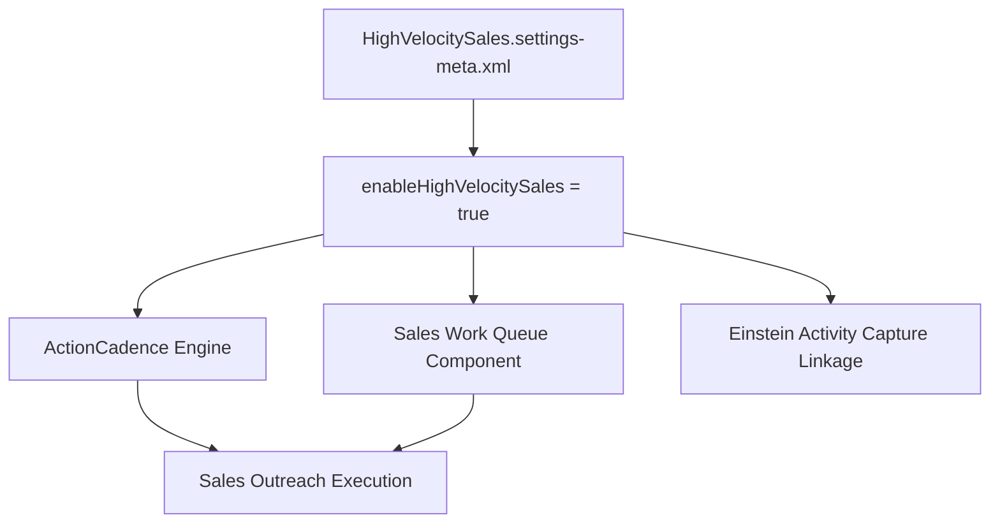

## Architectural Overview

`HighVelocitySalesSettings` manages the feature configuration for Salesforce Sales Engagement (formerly High Velocity Sales). This platform enables inside sales and business development teams to run structured outreach workflows known as Sales Cadences. Cadences guide sales representatives through phone calls, emails, LinkedIn InMail, and custom tasks.

In automated DevOps and scratch org workflows, deploying `HighVelocitySalesSettings` is a mandatory prerequisite before deploying `ActionCadence` definitions, cadence-related Flows, or custom Work Queue lightning page configurations.



## Directory and File Conventions

`HighVelocitySalesSettings` is stored under `settings/`:

| Property | Value |
| :--- | :--- |
| **Metadata Type Name** | `Settings` (member: `HighVelocitySales`) |
| **SFDX Directory** | `force-app/main/default/settings/` |
| **File Name** | `HighVelocitySales.settings-meta.xml` |
| **Scratch Org Key** | `highVelocitySalesSettings` |

## Key Metadata Fields

The XML schema exposes toggles that activate Sales Engagement features:

| Field Name | Type | Required | Description |
| :--- | :--- | :--- | :--- |
| `enableHighVelocitySales` | `boolean` | No | Master activation toggle for Sales Engagement and Action Cadence capabilities. |
| `enableSalesCadenceAutomations` | `boolean` | No | Enables automated branching and rules within sales cadences. |
| `enableWorkQueue` | `boolean` | No | Activates the Work Queue utility bar component for sales reps. |

> [!NOTE]
> Enabling Sales Engagement requires appropriate licenses (such as Sales Engagement or CRM Analytics) in production orgs. Scratch orgs require the `"SalesEngagement"` or `"HighVelocitySales"` feature flag.

## Declarative XML and Package Manifest Examples

Below is a production `HighVelocitySales.settings-meta.xml` configuration:

```xml title="force-app/main/default/settings/HighVelocitySales.settings-meta.xml"
<?xml version="1.0" encoding="UTF-8"?>
<HighVelocitySalesSettings xmlns="http://soap.sforce.com/2006/04/metadata">
    <enableHighVelocitySales>true</enableHighVelocitySales>
</HighVelocitySalesSettings>
```

### Scratch Org Definition (`config/project-scratch-def.json`)

```json title="config/project-scratch-def.json"
{
  "orgName": "Sales Engagement Testing Org",
  "edition": "Enterprise",
  "features": ["SalesEngagement"],
  "settings": {
    "highVelocitySalesSettings": {
      "enableHighVelocitySales": true
    }
  }
}
```

### Package Manifest (`package.xml`)

```xml title="manifest/package.xml"
<?xml version="1.0" encoding="UTF-8"?>
<Package xmlns="http://soap.sforce.com/2006/04/metadata">
    <types>
        <members>HighVelocitySales</members>
        <name>Settings</name>
    </types>
    <version>68.0</version>
</Package>
```

## Retrieval and Deployment via SF CLI

Retrieve and deploy the settings using SF CLI:

```bash
# Retrieve HighVelocitySales settings
sf project retrieve start --metadata "Settings:HighVelocitySales"

# Deploy settings to an integration org
sf project deploy start --metadata "Settings:HighVelocitySales" --target-org int-org
```

> [!TIP]
> Ensure user permission sets granting the `SalesEngagementUser` or `SalesEngagementCadenceCreator` permissions are deployed alongside the settings.

## Senior Architect Best Practices and Gotchas

- **Pipeline Sequencing**: Always deploy `HighVelocitySalesSettings` in an initial foundation deployment step before attempting to deploy `ActionCadence` metadata.
- **License Limitations**: Scratch orgs must explicitly define the feature in `project-scratch-def.json`; otherwise, deploying `HighVelocitySalesSettings` will throw an invalid feature error.
- **Telemetry and Activity Capture**: Sales Engagement relies heavily on Einstein Activity Capture for automatic email response tracking and cadence advancement.
