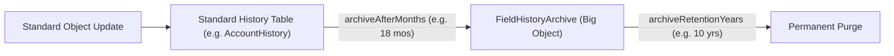

## Architectural Overview

`HistoryRetentionPolicy` is a crucial governance metadata component within Salesforce Shield Field Audit Trail (FAT). While standard Salesforce field history tracking retains up to 20 fields per object for 18 months, Field Audit Trail allows organizations to track up to 60 fields per object and retain history records for up to 10 years.

`HistoryRetentionPolicy` defines the archival lifecycle: how many months field history remains in standard relational history tables (such as `AccountHistory`), the grace period before archival, and how many years the data is retained in the `FieldHistoryArchive` Big Object before permanent deletion.



## Directory and File Conventions

`HistoryRetentionPolicy` is a child metadata component embedded inside `CustomObject` definitions (`.object-meta.xml`) or individual custom field files in decomposed source format:

| Property | Value |
| :--- | :--- |
| **Metadata Type Name** | `HistoryRetentionPolicy` |
| **Parent Metadata** | `CustomObject` or `CustomField` |
| **File Location** | Embedded inside `objects/<ObjectName>/<ObjectName>.object-meta.xml` |
| **API Version** | 68.0 |

## Key Metadata Fields

The `HistoryRetentionPolicy` XML element contains four key parameters:

| Field Name | Type | Required | Description |
| :--- | :--- | :--- | :--- |
| `archiveAfterMonths` | `integer` | Yes | Number of months history records remain in standard tables before archival (typically 18). |
| `archiveRetentionYears` | `integer` | Yes | Number of years archived data is preserved in FieldHistoryArchive (up to 10). |
| `gracePeriodDays` | `integer` | No | Additional days allowed before the archival background job executes (default is 0). |
| `description` | `string` | No | Administrative rationale or compliance reference for this retention policy. |

> [!NOTE]
> Deploying `HistoryRetentionPolicy` requires the `FieldAuditTrail` feature to be enabled on the target Salesforce organization.

## Declarative XML and Package Manifest Examples

Below is an example of an `Account.object-meta.xml` file with an embedded `historyRetentionPolicy`:

```xml title="force-app/main/default/objects/Account/Account.object-meta.xml"
<?xml version="1.0" encoding="UTF-8"?>
<CustomObject xmlns="http://soap.sforce.com/2006/04/metadata">
    <enableHistory>true</enableHistory>
    <historyRetentionPolicy>
        <archiveAfterMonths>18</archiveAfterMonths>
        <archiveRetentionYears>10</archiveRetentionYears>
        <gracePeriodDays>0</gracePeriodDays>
        <description>SOX and GDPR compliant 10-year financial audit trail policy</description>
    </historyRetentionPolicy>
</CustomObject>
```

### Package Manifest (`package.xml`)

```xml title="manifest/package.xml"
<?xml version="1.0" encoding="UTF-8"?>
<Package xmlns="http://soap.sforce.com/2006/04/metadata">
    <types>
        <members>Account</members>
        <name>CustomObject</name>
    </types>
    <version>68.0</version>
</Package>
```

## Retrieval and Deployment via SF CLI

Retrieve and deploy custom object definitions containing history retention policies:

```bash
# Retrieve Account object definition containing the policy
sf project retrieve start --metadata "CustomObject:Account"

# Deploy object definition with History Retention Policy
sf project deploy start --metadata "CustomObject:Account" --target-org prod-org
```

> [!TIP]
> Archived field history in `FieldHistoryArchive` cannot be queried with standard SOQL queries directly without specifying indexed filtering; use async SOQL or specialized Tooling API queries.

## Senior Architect Best Practices and Gotchas

- **Feature Gating**: Deploying a `historyRetentionPolicy` to an org without the Salesforce Shield Field Audit Trail license will trigger an immediate deployment failure.
- **Scratch Org Config**: Add `"FieldAuditTrail"` to the `"features"` list in `project-scratch-def.json` when provisioning development scratch orgs.
- **Immutable Archival**: Once records transition to `FieldHistoryArchive`, they become immutable Big Object records and cannot be updated, ensuring strict compliance integrity.
- **Query Strategy**: Build reporting strategies around the `FieldHistoryArchive` big object using REST API, bulk queries, or CRM Analytics rather than standard list views.
