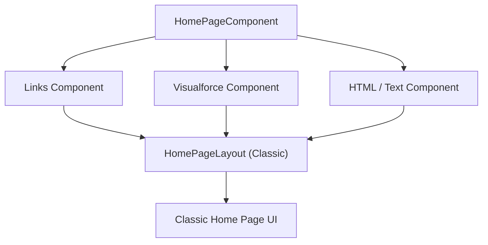

## Architectural Overview

`HomePageComponent` is a classic Salesforce metadata type that represents custom sidebar or dashboard components displayed on classic Home Page layouts (`HomePageLayout`). While modern enterprise Salesforce implementations prioritize Lightning Experience (`FlexiPage`), many legacy organizations and ISV packages maintain `HomePageComponent` definitions to support Classic console users and hybrid migration architectures.

Understanding `HomePageComponent` metadata enables architects to inventory, manage, and systematically refactor legacy UI components into modern Lightning Web Components.



## Directory and File Conventions

`HomePageComponent` files reside in the `homePageComponents` directory:

| Property | Value |
| :--- | :--- |
| **Metadata Type Name** | `HomePageComponent` |
| **SFDX Directory** | `force-app/main/default/homePageComponents/` |
| **File Suffix** | `.homePageComponent-meta.xml` |
| **API Version** | 68.0 |

## Key Metadata Fields

The XML schema for `HomePageComponent` defines component appearance and content:

| Field Name | Type | Required | Description |
| :--- | :--- | :--- | :--- |
| `pageComponentType` | `string` | Yes | Type of component (e.g. `links`, `htmlText`, `visualforcePage`). |
| `body` | `string` | No | HTML content or script body for custom text components. |
| `links` | `string[]` | No | Array of custom URL links included in link components. |
| `width` | `string` | No | Layout width: `narrow` (sidebar) or `wide` (main column). |

> [!NOTE]
> Custom HTML home page components containing unescaped JavaScript are restricted by modern Salesforce security policies and clickjack controls.

## Declarative XML and Package Manifest Examples

Below is an example of a custom sidebar links component:

```xml title="force-app/main/default/homePageComponents/Corporate_Links.homePageComponent-meta.xml"
<?xml version="1.0" encoding="UTF-8"?>
<HomePageComponent xmlns="http://soap.sforce.com/2006/04/metadata">
    <pageComponentType>links</pageComponentType>
    <width>narrow</width>
    <links>
        <link>Corporate_Intranet</link>
        <link>IT_Service_Desk</link>
    </links>
</HomePageComponent>
```

### Package Manifest (`package.xml`)

```xml title="manifest/package.xml"
<?xml version="1.0" encoding="UTF-8"?>
<Package xmlns="http://soap.sforce.com/2006/04/metadata">
    <types>
        <members>Corporate_Links</members>
        <name>HomePageComponent</name>
    </types>
    <version>68.0</version>
</Package>
```

## Retrieval and Deployment via SF CLI

Retrieve and deploy home page components:

```bash
# Retrieve a specific home page component
sf project retrieve start --metadata "HomePageComponent:Corporate_Links"

# Deploy all home page components
sf project deploy start --metadata "HomePageComponent" --target-org legacy-org
```

> [!TIP]
> When modernizing classic orgs, replace `HomePageComponent` links with Lightning App Page quick links or standard Navigation Bars.

## Senior Architect Best Practices and Gotchas

- **Lightning Modernization**: Treat `HomePageComponent` as technical debt. Migrate sidebar utilities to Global Actions, Utility Bars, or Lightning Experience Home pages.
- **Security Vulnerabilities**: Legacy HTML components with embedded script tags violate modern Locker Service and Lightning Web Security standards.
- **Layout Associations**: Deleting a `HomePageComponent` from version control will fail if it remains actively assigned inside any `HomePageLayout`.
